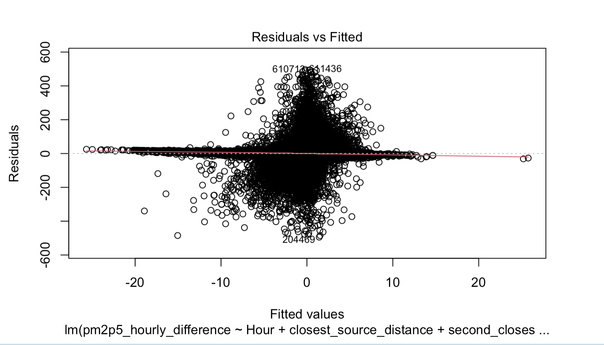
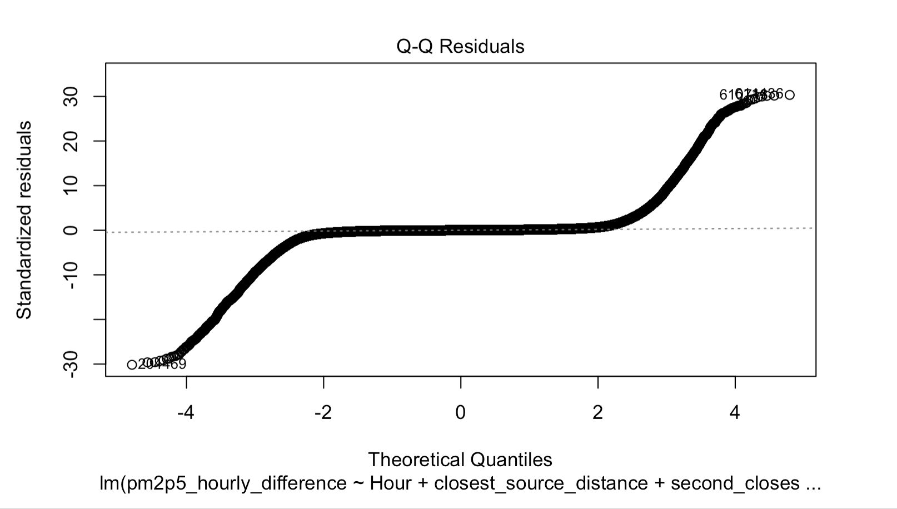
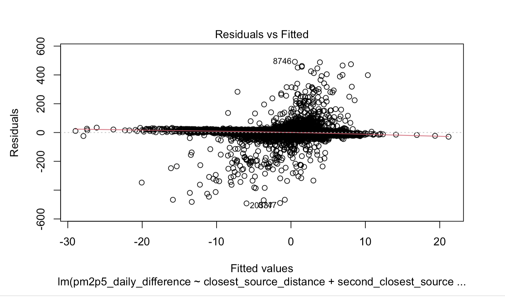
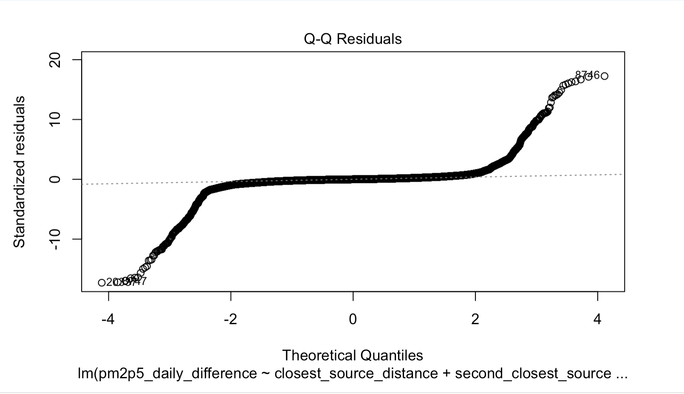
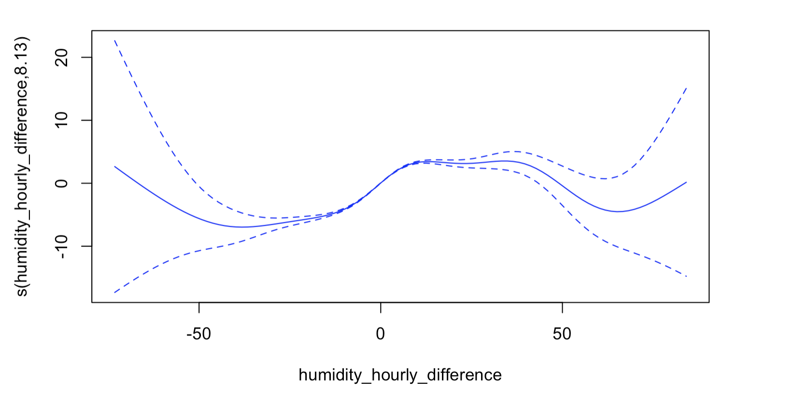
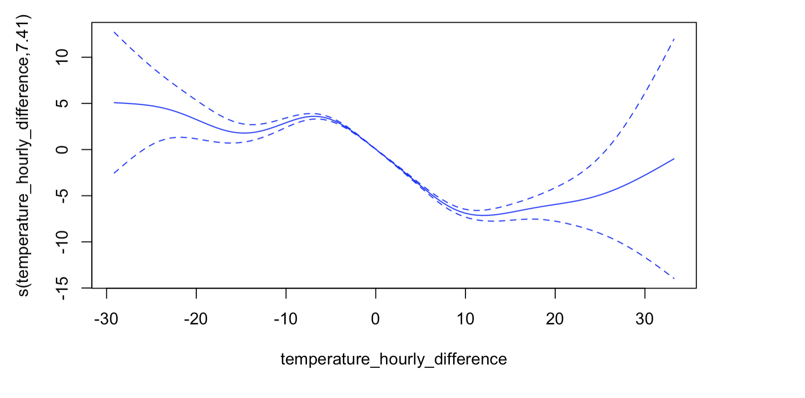
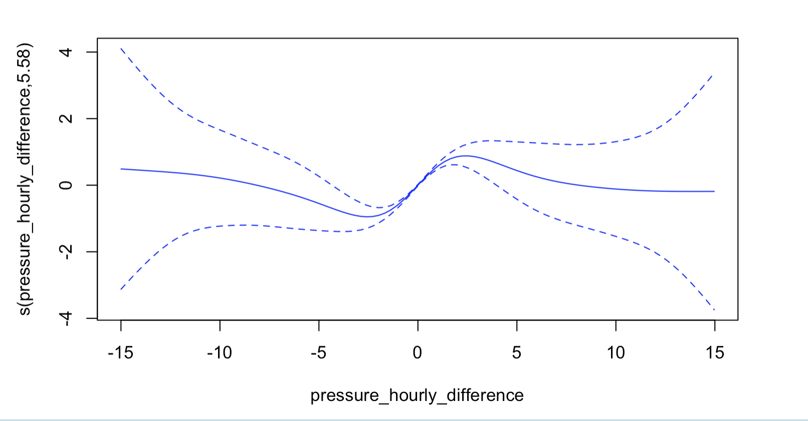

## Justin Peabody

## Project title: A Comparative Evaluation of Nonlinear Methods for Predicting Hourly and Daily Changes in Median Particulate Matter Concentrations in Chicago, using PurpleAir Sensors

### I. Background Information and Problem Statement

Air quality is a major public health concern, particularly in urban
areas, due to its many adverse health effects encompassing a wide
variety of respiratory and cardiovascular illnesses (1). Urban areas
contain some of the largest sources of anthropogenic air pollution,
including industrial facilities, power plants, traffic exhaust
emissions, and landfills and other waste management facilities. Of
especially great concern for public health is a class of air pollutant
particles known as particulate matter 2.5 (PM2.5), which include solid,
liquid, and gaseous pollutant particles less than 2.5 micrometers in
diameter. The small diameter of such particles enables easier
infiltration into the airways and bodily tissues and more acute health
effects.

As the prevalence of automobiles drastically increased throughout the
early and middle 1900s, car exhaust emissions contributed to increasing
levels of particulate matter in the form of ground level ozone, which
resulted in concerning levels of smog (2). Federal air quality
monitoring sensors, manufactured by organizations such as the
Environmental Protection Agency (EPA), began to provide highly accurate
measurements of particulate matter during the 1970s, acting as the
United States’ core tool for measuring compliance with early pieces of
air pollution reduction legislation aimed at regulating this increase in
pollution.

While federal grade air quality sensors remain an essential monitoring
equipment today, their high accuracy comes with high purchasing and
operational costs. Because of this, such sensors exist sparsely in most
urban areas, with only a few per city. The measurements from federal
sensors mask hyperlocal variations in particulate matter between urban
neighborhoods, especially those with marginalized and less affluent
populations. This is where low-cost, hyperlocal sensors, such as the
sensors sold worldwide by the PurpleAir, AirGradient, and Clarity
companies, possess a crucial advantage. Due to their lower cost, tighter
networks of several dozen sensors can be installed in a city, supporting
more detailed analysis of the spatial variability of air pollution than
is possible with federal sensors alone.

To provide air quality monitoring data to marginalized communities in
Chicago, Loyola University’s Community Local Engaged Air Research
(CLEAR) lab partners with city organizations to install low cost PM2.5
sensors. These sensors support cloud based data uploading and retrieval,
which has allowed for the creation of an air quality SQL database shared
by the CLEAR lab via downloads from the PurpleAir company API (3). After
completing an Undergraduate Summer Research Experience project orienting
me with this database, I joined the lab as a Database Manager in
September 2026. I have worked to increase the number of sensors
containing historical data in the database and have expanded the
database to include sensors from Clarity and AirGradient in addition to
PurpleAir.

Most of my work as Database Manager has focused on the development of
the database schema and producing workflows to streamline updates to the
historical data and metadata contained therein. I realized that I had
not done any heavy modeling with the data in the database, and this
project seemed an apt opportunity to apply statistical learning methods
to messy, real world environmental data. My project aims to develop a
model that best predicts changes in 2025 particulate matter
concentrations as a function of changes in humidity, temperature,
pressure, wind speed and direction, distances from nearby pollution
sources, and the amount of PM2.5 emitted by these sources in 2025. Such
changes in meteorological variables were aggregated and calculated on
both hourly and daily intervals.

### II. Data description

Purpleair Sensor Data:

As aforementioned, the CLEAR lab database contains historical data and
metadata for sensors from three companies: PurpleAir, Clarity, and
AirGradient. For this project, I focus on PurpleAir data since
observations exist from the entire year of 2025. Clarity historical
readings date back to July 2025, while Airgradient historical readings
date back to April 2025. Obtaining an entire calendar year of data
smooths out seasonal discrepancies in meteorologcial variables.

The Purpleair historical data table, called Purpleair\_air\_history,
contains the following variables (Every row in this table corresponds to
a measurement reading):

- sensor\_index: a unique ID number assigned to each sensor

- time\_stamp: the time, down to the second, when the measurement
  reading was uploaded by the sensor to the cloud. Purpleair historical
  readings are taken once every second and averaged over 2 minute
  intervals. It is the 2 minute averages that are uploaded to the cloud.

- humidity: the relative humidity (as a percentage) inside the sensor
  unit. This is NOT the same as the relative humidity of the ambient
  air. Due to the heat generated by the electronic components inside the
  sensor, relative humidity measurements tend to be underestimates of
  ambient relative humidity. For this reason, the PurpleAir company has
  developed correction formulas to make relative humidity readings a
  closer approximation of ambient relative humidity and the readings of
  federal grade sensors (see Methodology section for more details).

- temperature: the temperature (in degrees Fahrenheit) inside the sensor
  unit. The heat generated by the electronic components inside the
  sensor causes temperature readings to be overestimates of ambient
  temperature. Additional correction formulas exist to address this
  upward bias (see Methodology section).

- pressure: the atmospheric pressure (in millibars).

- pm2p5\_cf\_1\_a/pm2p5\_cf\_1\_b: the particulate matter 2.5
  concentration of Channel A and Channel B inside the sensor,
  respectively. Each Purpleair sensor has two internal channels: Channel
  A and Channel B. Within each channel, PM2.5 concentrations are
  estimated using optical sensing, in which a laser beam inside the
  channel illuminates each particle, causing it to scatter visible light
  at various frequencies. The scattered light contacts a photodiode
  within the channel, which estimates the particle size and
  concentration based on the wavelength ranges of the scattered light.

The Purpleair sensor metadata table, called
Purpleair\_sensor\_information, contains the following variables:

- sensor\_index: the same sensor\_index field in Purpleair\_air\_history

- date\_created: the date of installation of the sensor

- last\_seen: the time stamp of the latest historical measurement upload
  by the sensor

- name: A descriptive name given to each sensor, which usually includes
  the street and/or neighborhood it is located in

- location\_type: a binary variable taking on the value of 0 if the
  sensor is located outdoors and 1 if it is indoors

- latitude/longitude: the latitude/longitude coordinates of the sensor’s
  location

- additional variables pertaining to the model, hardware, and
  availability status of sensor data to the general public

As explained in the Methodology section, the sensor\_index, latitude,
and longitude variables are most relevant to my project.

The first dataset I obtained for my project was a data frame of all the
2025 historical readings for PurpleAir sensors from the CLEAR lab
database. I did so via RMySQL, a R based wrapper for SQL code that
allows users to query information, in the form of data frames, from
tables within the database. This raw dataframe contained 19,978,035
observations from 116 sensors throughout Chicago. I called this dataset
Purpleair\_2025\_historical\_data.

I then curated a dataset of documented Chicago particulate matter
sources from the Climate Trace website (4). This dataset contains the
name of each facility emitting particulate matter, the latitude and
longitude of each facility (obtained via Google Maps), and the amount of
particulate matter (in tons) emitted by the facility in 2025. 53
observations, representing 53 facilities, are in this dataset. I called
this dataset Chicago\_pollution\_sources.

The third dataset I needed was the metadata for Purpleair sensors, which
was also obtained via querying the database. This dataset contained 116
observations (1 for each sensor). I called this dataset
Purpleair\_sensor\_information.

The fourth dataset I needed was a dataset of wind speed and direction
measurements from 2025. I gathered hourly wind speed and direction
measurements from an Iowa State University webpage (5) from which I
downloaded readings from a station located at Midway, in Chicago (I made
a simplification by allowing readings from this sensor to be
representative of ambient conditions for all Chicago PurpleAir sensors).

### III. Methodology

#### III. A: Data aggregation, cleaning, and preprocessing

Before any predictive modeling could take place, substantial data
cleaning, processing, and aggregation was necessary. To create the final
dataset of hourly aggregated measurements, this consisted of the
following steps:

1.  I created a function which implemented the Haversine formula (6) to
    compute the curved Earth distance (in miles) between any two
    inputted latitude/longitude coordinates. The Haversine formula uses
    trigonometry to calculate distances under the assumption that the
    Earth is a perfect sphere (which it is not). Thus, the accuracy of
    its calculations is very high for shorter and medium distances
    (within a few hundred miles) and decreases as distances become very
    large. I used this function later for calculating the distance
    between each PurpleAir sensor and the nearest 5 pollution sources in
    my curated dataset, as explained in (c).

2.  I split Purpleair\_2025\_historical\_data into 20 chunks of 1
    million observations. Within each chunk, I aggregated the
    pm2.5\_cf\_1\_a, pm\_2.5\_cf\_1\_b, temperature, pressure, and
    humidity measurements by calculating their median within each hour
    (aggregations were performed within each chunk to prevent memory
    overload). I performed a median aggregation instead of a mean
    aggregation to minimize the effect of erroneous high sensor readings
    due to low WiFi connectivity, internal dust accumulation, and other
    random sources of error. I then stacked the chunks back together
    into a full aggregated dataset. Within each chunk, I created an
    overall pm2p5 measurement variable that was equal to pm2p5\_cf\_1\_a
    if pm2p5\_cf\_1\_b had an NA value, or the average of
    pm2p5\_cf\_1\_a and pm2p5\_cf\_1\_b if pm2p5\_cf\_1\_b did not have
    an NA value (previous inspection of the data revaled that
    pm2p5\_cf\_1\_a did not have any missing values).

3.  To account for instances in which the readings within a given hour
    for a given sensor index were split between multiple chunks, I
    needed to aggregate the five variables aggregated in b) by hour
    again on the full dataset (this was also a median aggregation). This
    final aggregated dataset was named
    Purpleair\_historical\_data\_2025\_averaged\_by\_hour\_averaged\_again.

4.  I used the dataset of Chicago pollution sources, the Purpleair
    sensor information data, and the Haversine distance function I
    previously wrote to find the distances of the closest, second
    closest, third closest, fourth closest, and fifth closest pollution
    source to each sensor index and the amount of pm2.5 (in tons)
    released by those sources in 2025, saving this information as a
    nested list. As explained in e), these calculations became 10
    additional predictors.

5.  I iteratively extracted elements from the nested list to create
    vectors representing the all\_closest\_distances,
    all\_second\_closest\_distances, all\_third\_closest\_distances,
    all\_fourth\_closest\_distances, all\_fifth\_closest\_distances,
    closest\_source\_pm2p5, second\_closest\_source\_pm2p5,
    third\_closest\_source\_pm2p5, fourth\_closest\_source\_pm2p5, and
    fifth\_closest\_source\_pm2p5 predictors. I then added these vectors
    to the Purpleair sensor information data to create a new dataset,
    Purpleair\_sensor\_information\_expanded.

6.  I joined
    Purpleair\_historical\_data\_2025\_averaged\_by\_hour\_averaged\_again
    to Purpleair\_sensor\_information\_expanded to create a new dataset,
    Purpleair\_data\_2025\_hourly\_averages.

7.  I computed hourly lags (the difference between an aggregation at one
    hour and the aggregation from the previous hour) of the hourly
    median aggregated temperature, pressure, temperature, and humidity
    sensor readings based on the Purpleair\_data\_2025\_hourly\_averages
    dataset.

Methodological note: Step g placed NA values for the lagged predictors
at row indices where the value of sensor\_index changes to a new value.
This is very important because calculating the difference between an
hourly average from one sensor and an hourly average from another sensor
would completely undermine the spatial context I have established with
the five distance predictors.

1.  I summarized the number of NA values of the lag variables per
    sensor, after concluding that NA values for all the lag variables
    consistently occurred at the same rows. Ideally, each sensor should
    only have one NA value (the first row of the dataset for which the
    value of sensor\_index is the given sensor). However, this was not
    the case, and I chose to remove sensors containing more than 168 NA
    aggregated meteorological variable values (equivalent to more than 1
    week of missing data). This decreased the number of sensor indices
    from 116 to 106.

2.  Based on meteorological temporal consistency thresholds established
    by the National Oceanic and Atmospheric Administration (NOAA)(7) as
    well as documented measurement limitations of the PurpleAir sensors
    (8), I removed rows for which the change in median pressure between
    subsequent hours exceeded 15 millibars, the change in median
    pressure between subsequent hours exceeded 35 degrees F, or the
    change in median PM2.5 concentrations between subsequent hours
    exceeded 500 micrograms per cubic meter.

3.  Following removal of the aggregations deemed to be erroneous based
    on the NOAA and PurpleAir thresholds, I assigned NA values to the
    values of the aggregations in the observations immediately following
    the removed observations to preserve the integrity of the hourly
    lagged temporal structure (the removal of an observation breaks the
    temporal structure between the observations immediately before and
    after the removed observation).

4.  Purpleair sensors do not collect data on wind speed and direction,
    two of the most important meteorological variables determining
    pollutant dispersion. So, I gathered 2025 measurements of hourly
    wind speed (in mph) and direction (in degrees from true north) from
    an Iowa State University webpage (as explained in Section II), from
    which I downloaded readings from a station located at Midway, in
    Chicago (I make a simplification by allowing readings from this
    sensor to be representative of ambient conditions for all Chicago
    PurpleAir sensors).

5.  I joined the wind dataset to the cleaned Purpleair hourly aggregated
    dataset.

To create the final dataset with daily aggregated meteorological
measurements, the aggregation and cleaning process was conceptually the
same, except for the following differences:

1.  In step b), pm2p5\_cf\_1\_a, pm2p5\_cf\_1\_b, temperature, humidity,
    and pressure measurements were aggregated by day instead of by hour
    within individual chunks.

2.  The aggregation in step c) was performed by day instead of by hour.

3.  In step h), I removed sensor indices containing more than 7 missing
    daily aggregated meteorological variable values (equivalent to more
    than 1 week of missing data).

4.  In step k), wind speed and direction measurements were median
    aggregated by day.

The final hourly aggregated dataset,
Purpleair\_final\_2025\_hourly\_modeling\_dataset, contained the
following variables:

- sensor\_index (described in the Data Description section)

- Hour: the military hour (0 representing midnight, 23 representing
  11:00 PM) of each aggregated measurement (used as a categorical
  predictor)

- Day: the calendar date of each set of aggregated measurements (this
  was not used as a predictor)

- closest/second\_closest/third\_closest/fourth\_closest/fifth\_closest\_source\_distance:
  the Haversine distance (in miles) between the
  closest/second\_closest/third\_closest/fourth\_closest/fifth\_closest
  pollution source in the curated dataset and each sensor index

- closest/second\_closest/third\_closest/fourth\_closest/fifth\_closest\_source\_2025\_pm2p5:
  the total 2025 pm2p5 emissions (in tons) of the
  closest/second\_closest/third\_closest/fourth\_closest/fifth\_closest
  pollution source in the curated dataset to each sensor index (as
  reported by ClimateTrace)

- pm2p5\_hourly\_difference: the difference between daily median
  aggregated pm2p5 measurements between subsequent days

- humidity\_hourly\_difference: the difference between daily median
  aggregated relative humidity measurements between subsequent days

- temperature\_horuly\_difference: the difference between daily median
  aggregated temperature measurements between subsequent days

- pressure\_hourly\_difference: the difference between daily median
  aggregated air pressure measurements between subsequent days

- Wind\_speed\_hourly\_difference: the difference between wind speed
  measurements (in mph) measurements between subsequent days, as
  reported by the Midway station of the Automated Surface Observing
  System network, hosted on the Iowa State University webpage.

- Wind\_direction\_hourly\_difference: the difference between wind speed
  measurements (in degrees from true north) between subsequent days, as
  reported by the Midway station of the Automated Surface Observing
  System network, maintained by the Iowa Environmental Mesonet.

The final daily aggregated dataset,
PurpleAir\_final\_2025\_daily\_modeling\_dataset, contained the same
meteorological variables aggregated by day instead of hour, as well as
the same spatial variables. As such, Hour did not exist as a variable in
this dataset. Day was not used as a predictor.

#### III. B: Modeling

For both the daily aggregated dataset and the hourly aggregated dataset,
analysis began by assessing the appropriateness of linear methods for
predictive modeling. This assessment was conducted using the residual
plots and normal QQplots of an ordinary least squares multiple linear
regression model consisting of all the predictors plus all first order
interaction terms between the temperature, pressure, and humidity lag
variables. I included these three interaction terms because of the close
physical relationships between temperature, pressure, and humidity.
Pressure and volume are inversely proportional when temperature is held
constant, pressure and temperature are directly proportional when volume
is held constant, and temperature and volume are directly proportional
when pressure is held constant.

The residual plot of the hourly aggregated OLS model (Fig 1) and the
residual plot of the daily aggregated OLS model (Fig 3) suggest severe
violations of homoscedasticity. The qqplot of the hourly aggregated OLS
model (Fig 2) and the qqplot of the daily aggregated OLS model (Fig 4)
suggest severe violations of residual normality at both tails.

Figure 1: a residual plot of the OLS model of pm2p5\_hourly\_difference
regressed on all predictors (excluding Day) in addition to
humidity\_hourly\_difference:temperature\_hourly\_difference,
temperature\_hourly\_difference:pressure\_hourly\_difference, and
pressure\_hourly\_difference:humidity\_hourly\_difference.

Figure 2: A residual plot of the OLS model of pm2p5\_hourly\_difference
regressed on all predictors (excluding Day and sensor\_index) in
addition to
humidity\_hourly\_difference:temperature\_hourly\_difference,
temperature\_hourly\_difference:pressure\_hourly\_difference, and
pressure\_hourly\_difference:humidity\_hourly\_difference.

Figure 3: A residual plot of the OLS model of pm2p5\_daily\_difference
regressed on all predictors (excluding sensor\_index) in addition to
humidity\_daily\_difference:temperature\_daily\_difference,
temperature\_daily\_difference:pressure\_daily\_difference, and
pressure\_daily\_difference:humidity\_daily\_difference.

Figure 4: A residual plot of the OLS model of pm2p5\_daily\_difference
regressed on all predictors (excluding sensor\_index) in addition to
humidity\_daily\_difference:temperature\_daily\_difference,
temperature\_daily\_difference:pressure\_daily\_difference, and
pressure\_daily\_difference:humidity\_daily\_difference.

From subsequent descriptive statistics of the meteorological lag
variables, one can infer that these two regression assumption violations
resulted from the fact that the response values and the meteorological
lag predictors were very tightly concentrated near zero, to a much
greater degree than would manifest in a standard normal distribution.
This eliminated all linear methods from consideration as final “best”
models based on predictive performance, including standard OLS
regression as well as variations of OLS, including lasso, ridge, PCR,
and all linear model variable selection methods.

Thus, only nonlinear and nonparametric models were considered for this
project. For both the hourly and daily aggregated datasets, I compare
the 10 fold cross validation error of K Nearest Neighbors regression, a
GAM with smoothing splines for each predictor, and a GAM with linear,
tricube weighted local regression fits for each predictor.

Note: A tricube weight function is a symmetric probability distribution
with a similar bell shape as the normal distribution, except that its
tails eventually touch the horizontal axis (unlike the normal
distribution, in which the tails approach the x axis asymptotically)(9),
and its peak is flatter. In the context of local regression, this allows
points outside a defined neighborhood of a training observation to
receive zero weight while using symmetric properties inside the
neighborhood.

However, due to the temporal nature of my data, standard K fold cross
validation (which assumes observations are independent) was not a
statistically sound approach. While I eliminated a significant portion
of the temporal dependency of the meteorological measurements by
aggregating them over 1 hour or 1 day intervals and then taking the
first differences of subsequent aggregations, my goal is to evaluate how
well each type of model predicts future changes in particulate matter
concentrations based on past measurements for a fixed set of monitoring
stations. Therefore, for all methods considered, I use a modified
version of K fold cross validation called grouped time series cross
validation.

Essentially, grouped time series cross validation splits the data into k
folds, grouping measurements chronologically by time interval within
each fold (every fold contains all the sensors in the dataset, but the
measurements within each fold are within the same time interval). Each
iteration of the grouped time series cross validation assigns the kth
fold to be the test data and the folds preceding the kth fold to be the
training data, which ensures the model is only tested on measurements
beyond the time interval it was trained on (9). The first fold is
skipped and is not used as a test set, since this would result in an
empty training set. Only folds 2-10 are iterated through as test sets.
On each iteration, the folds chronologically after the test set are
neither used for training or validation.

The train/test split for each iteration of 10 fold grouped time series
cross validation looks like this:

    Train Test  ---------------------------------------------
    Train Train Test ----------------------------------------
    Train Train Train Test ----------------------------------
    Train Train Train Train Test ----------------------------
    Train Train Train Train Train Test ----------------------
    Train Train Train Train Train Train Test ----------------
    Train Train Train Train Train Train Train Test ----------
    Train Train Train Train Train Train Train Train Test ----
    Train Train Train Train Train Train Train Train Train Test

For KNN regression, the entire dataset was split into a portion
containing 90% of the rows and a portion containing 10% of the rows. The
90% portion was used to perform 10 fold cross validation in order to
select the optimal value of k from a supplied list of k values (ranging
from 1 to 400 and incrementing by 25), while the 10% portion was used to
compute the MSPE of the model using the optimal value of k. Each
predictor was centered using robust normalization, by subtracting the
median of each predictor from each value of that predictor and then
dividing by the interquartile range of that predictor. For the hourly
aggregated dataset, each training fold was downsampled to only include
5,000 observations (The hourly aggregated dataset contained 611,897
observations, meaning the first training fold would contain 60,000
observations. This created memory issues on my computer and caused my R
session to crash many times).

For the GAM using tricube weighted linear local regressions on the
hourly aggregated dataset, default neighborhood fractions of 0.5 were
used initially. Neighborhood fractions of 0.1, 0.2, 0.3, 0.4, 0.6, 0.7,
0.8, and 0.9 were also evaluated from a CV error standpoint.

### IV. Results and discussion

#### IV. A. Hourly aggregated data

A GAM with local linear regression smooths with default neighborhood
fractions of 0.5, in addition to linear interaction terms between
temperature\_hourly\_difference, pressure\_hourly\_difference, and
humiidity\_hourly\_difference, yielded a 10 fold CV error of 246.0471.
Interestingly, changing the neighborhood fraction did not change the CV
error.

Fitting the local linear regression model on the entire hourly
aggregated dataset yielded the following model summary:

------------------------------------------------------------------------

    Family: gaussian 
    Link function: identity 

    Formula:
    pm2p5_hourly_difference ~ Hour + lo(humidity_hourly_difference) + 
        lo(temperature_hourly_difference) + lo(pressure_hourly_difference) + 
        lo(Wind_speed_hourly_difference) + lo(Wind_direction_hourly_difference) + 
        lo(closest_source_distance) + lo(second_closest_source_distance) + 
        lo(third_closest_source_distance) + lo(fourth_closest_source_distance) + 
        lo(fifth_closest_source_distance) + lo(closest_source_2025_pm2p5) + 
        lo(second_closest_source_2025_pm2p5) + lo(third_closest_source_2025_pm2p5) + 
        lo(fourth_closest_source_2025_pm2p5) + lo(fifth_closest_source_2025_pm2p5) + 
        temperature_hourly_difference * humidity_hourly_difference + 
        temperature_hourly_difference * pressure_hourly_difference + 
        pressure_hourly_difference * humidity_hourly_difference

    Parametric coefficients:
                                                               Estimate Std. Error t value Pr(>|t|)    
    (Intercept)                                               1.0704490  0.2383813   4.490 7.11e-06 ***
    Hour01                                                   -0.2828628  0.1443977  -1.959 0.050123 .  
    Hour02                                                   -0.3052217  0.1450283  -2.105 0.035329 *  
    Hour03                                                   -0.2519839  0.1451595  -1.736 0.082580 .  
    Hour04                                                   -0.6130670  0.1452554  -4.221 2.44e-05 ***
    Hour05                                                   -0.7925194  0.1449958  -5.466 4.61e-08 ***
    Hour06                                                   -0.5171554  0.1447999  -3.572 0.000355 ***
    Hour07                                                   -0.4911183  0.1447194  -3.394 0.000690 ***
    Hour08                                                   -0.3096803  0.1447124  -2.140 0.032357 *  
    Hour09                                                   -0.2321452  0.1446382  -1.605 0.108493    
    Hour10                                                   -0.0525219  0.1450412  -0.362 0.717265    
    Hour11                                                   -0.0959893  0.1454297  -0.660 0.509229    
    Hour12                                                    0.1517209  0.1465821   1.035 0.300642    
    Hour13                                                    0.0110580  0.1487856   0.074 0.940754    
    Hour14                                                   -0.4621722  0.1502018  -3.077 0.002091 ** 
    Hour15                                                   -0.8846820  0.1502154  -5.889 3.88e-09 ***
    Hour16                                                   -0.6708159  0.1496383  -4.483 7.36e-06 ***
    Hour17                                                   -0.6122593  0.1487966  -4.115 3.88e-05 ***
    Hour18                                                   -0.6012963  0.1473544  -4.081 4.49e-05 ***
    Hour19                                                   -0.4164182  0.1469876  -2.833 0.004611 ** 
    Hour20                                                   -0.3726748  0.1462380  -2.548 0.010822 *  
    Hour21                                                   -0.3651846  0.1453991  -2.512 0.012019 *  
    Hour22                                                   -0.1052046  0.1447974  -0.727 0.467493    
    Hour23                                                    0.1331207  0.1442846   0.923 0.356203    
    lo(humidity_hourly_difference)                            0.1215224  0.0034082  35.656  < 2e-16 ***
    lo(temperature_hourly_difference)                        -0.1224751  0.0070025 -17.490  < 2e-16 ***
    lo(pressure_hourly_difference)                            0.1398223  0.0148724   9.401  < 2e-16 ***
    lo(Wind_speed_hourly_difference)                          0.0209804  0.0073162   2.868 0.004135 ** 
    lo(Wind_direction_hourly_difference)                     -0.0011098  0.0005760  -1.927 0.054019 .  
    lo(closest_source_distance)                               0.2594457  0.0450282   5.762 8.32e-09 ***
    lo(second_closest_source_distance)                       -0.2382245  0.0406196  -5.865 4.50e-09 ***
    lo(third_closest_source_distance)                        -0.0687306  0.0396854  -1.732 0.083294 .  
    lo(fourth_closest_source_distance)                        0.2251984  0.0490919   4.587 4.49e-06 ***
    lo(fifth_closest_source_distance)                        -0.1592675  0.0433760  -3.672 0.000241 ***
    lo(closest_source_2025_pm2p5)                            -0.0073730  0.0039178  -1.882 0.059849 .  
    lo(second_closest_source_2025_pm2p5)                     -0.0144721  0.0032025  -4.519 6.21e-06 ***
    lo(third_closest_source_2025_pm2p5)                      -0.0099537  0.0032576  -3.056 0.002247 ** 
    lo(fourth_closest_source_2025_pm2p5)                     -0.0161162  0.0041243  -3.908 9.32e-05 ***
    lo(fifth_closest_source_2025_pm2p5)                      -0.0129279  0.0035071  -3.686 0.000228 ***
    temperature_hourly_difference                            -0.1224751  0.0070025 -17.490  < 2e-16 ***
    humidity_hourly_difference                                0.1215224  0.0034082  35.656  < 2e-16 ***
    pressure_hourly_difference                                0.1398223  0.0148724   9.401  < 2e-16 ***
    temperature_hourly_difference:humidity_hourly_difference  0.0089820  0.0007479  12.009  < 2e-16 ***
    temperature_hourly_difference:pressure_hourly_difference -0.0183876  0.0087813  -2.094 0.036265 *  
    humidity_hourly_difference:pressure_hourly_difference    -0.0339341  0.0057706  -5.880 4.09e-09 ***
    ---
    Signif. codes:  0 ‘***’ 0.001 ‘**’ 0.01 ‘*’ 0.05 ‘.’ 0.1 ‘ ’ 1

    Rank: 42/45
    R-sq.(adj) =  0.0098   Deviance explained = 0.987%
    GCV = 268.67  Scale est. = 268.66    n = 611897

------------------------------------------------------------------------

I cannot interpret these coefficients in the same way that I can
interpret linear regression coefficients, since each smooth has unique
parameter estimates at each value of the predictor. However, I can say
that the model has very poor fitting performance, explaining only 0.987%
of the variation from the mean of the median hourly change in pm2.5 (as
captured by the deviance metric).

A GAM with smoothing splines (natural cubic splines with a knot at every
unique value of each predictor), in addition to linear interaction terms
between temperature\_hourly\_difference, pressure\_hourly\_difference,
and humidity\_hourly\_difference, yielded a 10 fold CV error of
244.3757, slightly better predictive performance than the GAM with local
regression smooths.

Fitting this GAM on the entire hourly aggregated dataset yielded this
model summary:

------------------------------------------------------------------------

    Family: gaussian 
    Link function: identity 

    Formula:
    pm2p5_hourly_difference ~ Hour + s(humidity_hourly_difference) + 
        s(temperature_hourly_difference) + s(pressure_hourly_difference) + 
        s(Wind_speed_hourly_difference) + s(Wind_direction_hourly_difference) + 
        s(closest_source_distance) + s(second_closest_source_distance) + 
        s(third_closest_source_distance) + s(fourth_closest_source_distance) + 
        s(fifth_closest_source_distance) + s(closest_source_2025_pm2p5) + 
        s(second_closest_source_2025_pm2p5) + s(third_closest_source_2025_pm2p5) + 
        s(fourth_closest_source_2025_pm2p5) + s(fifth_closest_source_2025_pm2p5) + 
        temperature_hourly_difference:pressure_hourly_difference + 
        temperature_hourly_difference:humidity_hourly_difference + 
        pressure_hourly_difference:humidity_hourly_difference

    Parametric coefficients:
                                                              Estimate Std. Error t value Pr(>|t|)    
    (Intercept)                                               0.282812   0.105290   2.686 0.007231 ** 
    Hour01                                                   -0.273903   0.144422  -1.897 0.057888 .  
    Hour02                                                   -0.300047   0.145338  -2.064 0.038973 *  
    Hour03                                                   -0.176475   0.145486  -1.213 0.225129    
    Hour04                                                   -0.527149   0.145774  -3.616 0.000299 ***
    Hour05                                                   -0.706399   0.145723  -4.848 1.25e-06 ***
    Hour06                                                   -0.421219   0.145701  -2.891 0.003841 ** 
    Hour07                                                   -0.371743   0.145602  -2.553 0.010676 *  
    Hour08                                                   -0.200108   0.145497  -1.375 0.169026    
    Hour09                                                   -0.128050   0.145329  -0.881 0.378262    
    Hour10                                                    0.050357   0.145782   0.345 0.729775    
    Hour11                                                    0.048202   0.146443   0.329 0.742041    
    Hour12                                                    0.364179   0.147817   2.464 0.013751 *  
    Hour13                                                    0.295458   0.150106   1.968 0.049031 *  
    Hour14                                                   -0.162207   0.151754  -1.069 0.285126    
    Hour15                                                   -0.538893   0.151816  -3.550 0.000386 ***
    Hour16                                                   -0.318671   0.151507  -2.103 0.035436 *  
    Hour17                                                   -0.269494   0.150878  -1.786 0.074072 .  
    Hour18                                                   -0.290807   0.149454  -1.946 0.051680 .  
    Hour19                                                   -0.116658   0.148539  -0.785 0.432238    
    Hour20                                                   -0.136182   0.147439  -0.924 0.355670    
    Hour21                                                   -0.146652   0.146064  -1.004 0.315366    
    Hour22                                                    0.004449   0.145061   0.031 0.975531    
    Hour23                                                    0.162166   0.144337   1.124 0.261216    
    temperature_hourly_difference:pressure_hourly_difference -0.125641   0.017036  -7.375 1.65e-13 ***
    temperature_hourly_difference:humidity_hourly_difference  0.026973   0.002394  11.269  < 2e-16 ***
    pressure_hourly_difference:humidity_hourly_difference    -0.042097   0.006987  -6.025 1.69e-09 ***
    ---
    Signif. codes:  0 ‘***’ 0.001 ‘**’ 0.01 ‘*’ 0.05 ‘.’ 0.1 ‘ ’ 1

    Approximate significance of smooth terms:
                                          edf Ref.df       F  p-value    
    s(humidity_hourly_difference)       8.025  8.713 190.208  < 2e-16 ***
    s(temperature_hourly_difference)    7.966  8.636  49.132  < 2e-16 ***
    s(pressure_hourly_difference)       6.610  7.803  22.498  < 2e-16 ***
    s(Wind_speed_hourly_difference)     5.726  6.813   4.651 2.72e-05 ***
    s(Wind_direction_hourly_difference) 5.476  6.550   5.884 2.23e-06 ***
    s(closest_source_distance)          7.495  8.193   5.689  < 2e-16 ***
    s(second_closest_source_distance)   8.405  8.753  17.048  < 2e-16 ***
    s(third_closest_source_distance)    8.409  8.691  10.272  < 2e-16 ***
    s(fourth_closest_source_distance)   4.531  5.312   1.232  0.26529    
    s(fifth_closest_source_distance)    5.828  6.726   6.982  < 2e-16 ***
    s(closest_source_2025_pm2p5)        1.000  1.001   0.425  0.51482    
    s(second_closest_source_2025_pm2p5) 1.026  1.045   0.128  0.76941    
    s(third_closest_source_2025_pm2p5)  1.002  1.003   9.157  0.00247 ** 
    s(fourth_closest_source_2025_pm2p5) 7.944  8.397  12.184  < 2e-16 ***
    s(fifth_closest_source_2025_pm2p5)  8.619  8.854  18.604  < 2e-16 ***
    ---
    Signif. codes:  0 ‘***’ 0.001 ‘**’ 0.01 ‘*’ 0.05 ‘.’ 0.1 ‘ ’ 1

    R-sq.(adj) =  0.012   Deviance explained = 1.22%
    fREML = 2.5791e+06  Scale est. = 268.05    n = 611897

------------------------------------------------------------------------

This model summary is divided into two sections: a “Parametric
Coefficients” section and a “Approximate Signfiicance of Smooth Terms”
section. In the former section, the family is Gaussian and the link
function is identity, which allows me to interpret these coefficients in
the same way I would for standard linear regression. In this section,
the baseline Intercept term is 0.28, meaning we expect the median hourly
change in pm2.5 to be 0.28 micrograms per cubic meter per hour when Hour
is 0 (corresponding to the midnight hour) and all other predictors are
0. At alpha=0.01, the parametric coefficients associated with the Hour4,
Hour5, Hour6, and Hour15 levels are statistically significant. We expect
the median hourly change in pm2.5 to be 0.53 micrograms per cubic meter
per hour less than the median hourly change anticipated by the baseline
level of Hour. This means that, on average, we expect the median hourly
pm2.5 concentration to decrease by about 0.24 micrograms per cubic meter
between the hour of 3AM-4AM, 4AM-5AM, and 5AM-6AM. Using the same
reasoning, we expect the median hourly pm2.5 concentration to decrease
by about 0.24 micrograms per cubic meter between the hour of 3AM-4AM and
the hour of 4AM-5AM. Using the same reasoning, we expect the median
hourly pm2.5 concentration to decrease by about 0.42 micrograms per
cubic meter between the hour of 4AM-5AM and the hour of 5AM-6AM.
Interestingly, the coefficients associated with the values of Hour
corresponding to morning rush hours (7AM-10AM) were not significant.
Just before the early portion of the evening rush hour (2PM-3PM), the
coefficients for Hour were statistically significant; however, they
represented decreases in anticipated changes in median hourly pm2.5
concentrations between one hour and the next, and the significance drops
off into the rush hour period. This is a highly counterintuitive result
since heavier traffic usually results in increased particulate matter
emissions from car exhaust.

The smoothing spline fits of humidity\_hourly\_difference,
second\_closest\_source\_distance, third\_closest\_source\_distance, and
fifth\_closest\_source\_pm2.5\_2025 are of the greatest complexity, with
effective degrees of freedom (EDF) over 8 for each. In contrast, the
smoothing spline fits of closest\_source\_2025\_pm2.5,
second\_closest\_source\_2025\_pm2.5, and
third\_closest\_source\_2025\_pm2.5 all have EDF values close to 1,
exhibiting highly linear relationships with pm2.5\_hourly\_difference.
Only one of these three smooths, third\_closest\_source\_2025\_pm2p5,
contributes significantly to the GAM’s overall fitting performance at
alpha=0.01. All smooths for which EDF&gt;5 are highly significant.

Overall, this GAM exhibits slightly better fitting performance than the
GAM with local regression fits (although it is still very poor), with
1.22% of deviance explained.

Below are the plots of the spline smooths for
humidity\_hourly\_difference (Fig 5), temperature\_hourly\_difference
(Fig 6), and pressure\_hourly\_difference (Fig 7), with +/- 2 standard
error bands (roughly equivalent to a 95% confidence interval). All these
smooths have almost zero standard error near the mean of each respective
predictor, and the standard error greatly increases toward either tail
due to the tightly symmetric distributions. This is likely why the GAM
and local regression models have such low fitting performance on the
entire dataset.

Fig 5: a plot of the smoothing spline fit for pm2p5\_hourly\_difference
on humidity\_hourly\_difference.

Fig 6: a plot of the smoothing spline fit for pm2p5\_hourly\_difference
on temperature\_hourly\_difference.

Fig 6: a plot of the smoothing spline fit for pm2p5\_hourly\_difference
on temperature\_hourly\_difference.

KNN regression, with downsampling of each training set to 5000
observations and the set of k values being {1, 25, 50, 75, 100, 125,
150, 175, 200, 225, 250, 275, 300, 325, 350, 375, 400}, k=200 yielded
the lowest 10 fold CV error of 167.846 within the training dataset.
However, this value of k yielded a test MSE of 474.316, indicating much
worse predictive performance than the two GAM models.

In section IV.B, I investigative whether predictive performance and
fitting performance could be improved by aggregating these same
variables by day instead of by hour.

#### IV. B. Daily aggregated data

A GAM with local linear regression smooths with default neighborhood
fractions of 0.5, in addition to linear interaction terms between
temperature\_hourly\_difference, pressure\_hourly\_difference, and
humidity\_hourly\_difference, yielded a 10 fold CV error of 669.1127,
over 2.7 times higher than the CV error of 246 for the local regression
model on the hourly aggregated data. Once again, changing the
neighborhood span of the predictors did not affect the CV error.

Fitting this local regression GAM on the entire daily aggregated dataset
gave this model summary:

------------------------------------------------------------------------

    Family: gaussian 
    Link function: identity 

    Formula:
    pm2p5_daily_difference ~ lo(humidity_daily_difference) + lo(temperature_daily_difference) + 
        lo(pressure_daily_difference) + lo(Wind_speed_daily_difference) + 
        lo(Wind_direction_daily_difference) + lo(closest_source_distance) + 
        lo(second_closest_source_distance) + lo(third_closest_source_distance) + 
        lo(fourth_closest_source_distance) + lo(fifth_closest_source_distance) + 
        lo(closest_source_2025_pm2p5) + lo(second_closest_source_2025_pm2p5) + 
        lo(third_closest_source_2025_pm2p5) + lo(fourth_closest_source_2025_pm2p5) + 
        lo(fifth_closest_source_2025_pm2p5) + temperature_daily_difference:humidity_daily_difference + 
        temperature_daily_difference:pressure_daily_difference + 
        pressure_daily_difference:humidity_daily_difference

    Parametric coefficients:
                                                            Estimate Std. Error t value Pr(>|t|)    
    (Intercept)                                             0.194999   1.809037   0.108 0.914162    
    lo(humidity_daily_difference)                           0.107207   0.015790   6.790 1.15e-11 ***
    lo(temperature_daily_difference)                       -0.449874   0.037089 -12.130  < 2e-16 ***
    lo(pressure_daily_difference)                           0.094637   0.035732   2.649 0.008089 ** 
    lo(Wind_speed_daily_difference)                        -0.227655   0.045546  -4.998 5.82e-07 ***
    lo(Wind_direction_daily_difference)                    -0.004922   0.002309  -2.131 0.033077 *  
    lo(closest_source_distance)                             0.120475   0.378394   0.318 0.750196    
    lo(second_closest_source_distance)                     -0.133388   0.340821  -0.391 0.695526    
    lo(third_closest_source_distance)                       0.135876   0.339506   0.400 0.689000    
    lo(fourth_closest_source_distance)                      0.011060   0.408019   0.027 0.978375    
    lo(fifth_closest_source_distance)                      -0.094489   0.350503  -0.270 0.787484    
    lo(closest_source_2025_pm2p5)                           0.006109   0.033344   0.183 0.854631    
    lo(second_closest_source_2025_pm2p5)                    0.007213   0.027026   0.267 0.789554    
    lo(third_closest_source_2025_pm2p5)                    -0.004301   0.027417  -0.157 0.875337    
    lo(fourth_closest_source_2025_pm2p5)                    0.003815   0.034698   0.110 0.912451    
    lo(fifth_closest_source_2025_pm2p5)                    -0.007374   0.029703  -0.248 0.803935    
    temperature_daily_difference:humidity_daily_difference  0.008059   0.002209   3.647 0.000266 ***
    temperature_daily_difference:pressure_daily_difference  0.018542   0.004244   4.370 1.25e-05 ***
    humidity_daily_difference:pressure_daily_difference    -0.002956   0.002302  -1.284 0.199159    
    ---
    Signif. codes:  0 ‘***’ 0.001 ‘**’ 0.01 ‘*’ 0.05 ‘.’ 0.1 ‘ ’ 1

    R-sq.(adj) =  0.0136   Deviance explained = 1.43%
    -REML = 1.2146e+05  Scale est. = 810.53    n = 25467

------------------------------------------------------------------------

Once again, the uniqueness of the parameter estimates at every value of
the predictor prevents me from interpreting these model summary
coefficients according to OLS coefficient interpretations. However, I
can say that the model’s fitting performance, while still very low, is
slightly better than the fitting performance of the GAM with local
regression smooths fit on the hourly aggregated dataset, explaining
1.43% of the variation from the mean of the median hourly change in
pm2.5.

A GAM with smoothing splines (natural cubic splines with a knot at every
unique value of each predictor), in addition to linear interaction terms
between temperature\_hourly\_difference, pressure\_hourly\_difference,
and humidity\_hourly\_difference, yielded a 10 fold CV error of
681.7587, slightly worse predictive performance than the GAM with local
regression smooths. This stands in contrast to the hourly aggregated
dataset, for which the GAM with cubic splines exhibited sightly better
predictive performance than the GAM with local regression smooths.

Below is the model summary for the GAM with cubic splines fit on the
entire daily aggregated dataset:

------------------------------------------------------------------------

    Family: gaussian 
    Link function: identity 

    Formula:
    pm2p5_daily_difference ~ s(humidity_daily_difference) + s(temperature_daily_difference) + 
        s(pressure_daily_difference) + s(Wind_speed_daily_difference) + 
        s(Wind_direction_daily_difference) + s(closest_source_distance) + 
        s(second_closest_source_distance) + s(third_closest_source_distance) + 
        s(fourth_closest_source_distance) + s(fifth_closest_source_distance) + 
        s(closest_source_2025_pm2p5) + s(second_closest_source_2025_pm2p5) + 
        s(third_closest_source_2025_pm2p5) + s(fourth_closest_source_2025_pm2p5) + 
        s(fifth_closest_source_2025_pm2p5) + ti(temperature_daily_difference, 
        pressure_daily_difference) + ti(temperature_daily_difference, 
        humidity_daily_difference) + ti(pressure_daily_difference, 
        humidity_daily_difference)

    Parametric coefficients:
                Estimate Std. Error t value Pr(>|t|)
    (Intercept) -0.04891    0.24052  -0.203    0.839

    Approximate significance of smooth terms:
                                                                  edf Ref.df      F  p-value    
    s(humidity_daily_difference)                                8.401  8.889  6.900  < 2e-16 ***
    s(temperature_daily_difference)                             8.402  8.870 14.627  < 2e-16 ***
    s(pressure_daily_difference)                                7.461  8.412  5.788  < 2e-16 ***
    s(Wind_speed_daily_difference)                              7.531  8.447  9.746  < 2e-16 ***
    s(Wind_direction_daily_difference)                          7.812  8.613  3.391 0.000317 ***
    s(closest_source_distance)                                  1.000  1.000  0.129 0.719938    
    s(second_closest_source_distance)                           1.000  1.000  0.219 0.640040    
    s(third_closest_source_distance)                            1.000  1.000  0.087 0.768456    
    s(fourth_closest_source_distance)                           1.000  1.000  0.239 0.625027    
    s(fifth_closest_source_distance)                            1.000  1.000  0.622 0.430231    
    s(closest_source_2025_pm2p5)                                1.002  1.005  0.000 0.999491    
    s(second_closest_source_2025_pm2p5)                         1.000  1.000  0.027 0.868662    
    s(third_closest_source_2025_pm2p5)                          1.000  1.000  0.090 0.764551    
    s(fourth_closest_source_2025_pm2p5)                         1.002  1.004  0.002 0.982975    
    s(fifth_closest_source_2025_pm2p5)                          1.000  1.000  0.137 0.711786    
    ti(temperature_daily_difference,pressure_daily_difference)  6.238  7.755  7.301  < 2e-16 ***
    ti(temperature_daily_difference,humidity_daily_difference) 15.150 15.799  6.103  < 2e-16 ***
    ti(pressure_daily_difference,humidity_daily_difference)     3.408  4.710  1.264 0.315184    
    ---
    Signif. codes:  0 ‘***’ 0.001 ‘**’ 0.01 ‘*’ 0.05 ‘.’ 0.1 ‘ ’ 1

    R-sq.(adj) =  0.0274   Deviance explained = 3.02%
    GCV = 801.59  Scale est. = 799.21    n = 25467

------------------------------------------------------------------------

The deviance explained value is slightly improved over the cubic spline
GAM fit on the hourly aggregated data, indicating slightly better
overall fitting performance, but the overall fitting performance is
still very low. Both GAM models using the daily aggregated dataset have
lower predictive performance but better fitting performance than both
GAM models on the hourly aggregated dataset.

For KNN regression, k=147 yields the smallest CV error within the
training data: 644.5602. The test MSE of the knn model with k=147 is
853.9225. This value of k is smaller than the optimal value of k for KNN
regression on the the hourly aggregated dataset (which is 200). However,
the test MSE is almost twice that of the KNN model on the hourly
aggregated dataset with downsampling (474.316), indicating that, on the
daily aggregated dataset, optimizing KNN regression requires fewer
neighbors but exhibits worse predictive performance.

### V. Conclusions, Limitations, and Further Research

For the hourly aggregated data, a GAM with cubic smoothing splines
exhibits the best predictive performance as measured by 10 fold CV
error. For the daily aggregated data, a GAM with local regression
smooths exhibits the best predictive performance. For both the daily
aggregated data dn the hourly aggregated data, KNN regression yields
much higher test MSE than the CV error of both GAM models, indicating
worse predictive performance. Both the GAM models fit on the daily
aggregated dataset exhibit better overall fitting performance than the
GAM models fit on the hourly aggregated dataset. However, all the models
fit on the daily aggregated dataset exhibit much worse predictive
performance than the models fit on the hourly aggregated dataset. This
suggests that the aggregation and first-differencing of meteorological
variables by hour captures more of the variation in particulate matter
concentrations than the aggregation and first-differencing of
meteorological variables by day. This, in turn, suggests that time of
day has some relationship with the change of particulate matter
concentrations over the course of a day.

In the GAMs with cubic smoothing splines fit on the hourly aggregated
dataset, statistically significant differences in the hourly change in
average pm2.5 concentrations, relative to the baseline hour of midnight,
were observed between the hours of 3AM and 4AM, between 4AM and 5AM,
between 5AM and 6AM, and between 2PM and 3PM. However, all of these
differences were predicted, on average, to be decreases in pm2p5, and no
significant changes in hourly average pm2p5 were observed for the
morning and evening rush hour periods. The distance and source PM2.5
cubic spline smooths that were significant for the fitting performance
on the hourly aggregated dataset lose their significance for the fitting
performance on the daily aggregated dataset. Since the daily aggregated
dataset is already quite large (n=25467), the statistical significance
of the cubic smoothing spline smooths associated with
closest\_source\_distance, second\_closest\_source\_distance,
third\_closest\_source\_distance, fifth\_closest\_source\_distance,
fourth\_closest\_source\_2025\_pm2p5, and
fifth\_closest\_source\_2025\_pm2p5 may be due to the raw statistical
power gained from the immense size of the hourly aggregated dataset
(n=611897) rather than the actual effects of these predictors.

Additionally, the deviance explained for all models was very low. For
the model with the best fitting performance, the GAM with cubic
smoothing splines fit on the daily aggregated data, the deviance
explained was still only 3.02%. This, in conjunction with the
counterintuitive singificance and sign results for the levels of the
Hour categorical variable, indicate that the variables most influential
to short term changes in particulate matter concentrations are not
captured by the models. Such features could include traffic volume and
congestion, the spatial variability of building density and building
heights, and land topography (10). The CLEAR lab’s database relies
exclusively on sensor measurements and thus does not record such
variables. Future research predicting PM2.5 concentrations could
integrate measurements from hyperlocal sensor networks with traffic data
from GPS sensors (11) and could make use of models specifically suited
for regression analysis in time series settings, such as regression
models with ARIMA errors (12). As aforementioned, aggregating and first
differencing the meteorological predictors and the response produced
tightly symmetric distributions that made predictions highly certain for
predictor difference values near zero and highly uncertain for
substantially nonzero predictor difference values. The use of time
series based regression models would allow the implementation of raw
measurements for the meteorological predictors, eliminating the need for
differencing.

### VI. Works cited

1.  Epa.Gov. 2026. “Health and Environmental Effects of Particulate
    Matter (PM).” Overviews and Factsheets. May 5.
    <https://www.epa.gov/pm-pollution/health-and-environmental-effects-particulate-matter-pm>.

2.  Clarity. 2026. “The History of Air Quality Monitoring Technology.”
    May 21.
    <https://www.clarity.io/blog/the-history-of-air-quality-monitoring-technology-how-has-air-quality-measurement-evolved-over-the-years>.

3.  PurpleAir. 2026. *PurpleAir API.* Accessed October 10, 2026.
    <https://api.purpleair.com/>.

4.  Climate TRACE. n.d. “Plumes — See How Air Pollution Moves.” Accessed
    October 10, 2026. <https://climatetrace.org/air-pollution>.

5.  Herzmann, Daryl. n.d. “IEM :: Download ASOS/AWOS/METAR Data.”
    Mesonet.Agron.Iastate.Edu. Accessed November 22, 2026.
    <https://mesonet.agron.iastate.edu/request/download.phtml>.

6.  GeeksforGeeks. 2022. “Haversine Formula to Find Distance between Two
    Points on a Sphere.” September 5.
    <https://www.geeksforgeeks.org/dsa/haversine-formula-to-find-distance-between-two-points-on-a-sphere/>.

7.  Madis.Ncep.Noaa.Gov. 2017. “NCEP Meteorological Assimilation Data
    Ingest System (MADIS).” March 15.
    <https://madis.ncep.noaa.gov/madis_sfc_qc_notes.shtml>.

8.  Ardon-Dryer, Karin, Yuval Dryer, Jake N. Williams, and Nastaran
    Moghimi. 2020. “Measurements of PM2.5 with PurpleAir under
    Atmospheric Conditions.” Atmospheric Measurement Techniques 13 (10):
    5441–58. <https://doi.org/10.5194/amt-13-5441-2020>.

9.  Rspatial.Rforge.r-Project.Org. n.d. “GWR Tricube Weights Function —
    Gwr.Tricube • Spgwr.” Accessed November 20, 2026.
    <http://rspatial.r-forge.r-project.org/spgwr/reference/gwr.tricube.html>.

10. GeeksforGeeks. 2025. “Time Series Cross-Validation.” July 23.
    <https://www.geeksforgeeks.org/machine-learning/time-series-cross-validation/>.

11. Beliakov, Gleb, Marek Gagolewski, Simon James, et al. 2018.
    “Measuring Traffic Congestion: An Approach Based on Learning
    Weighted Inequality, Spread and Aggregation Indices from Comparison
    Data.” Applied Soft Computing 67 (June): 910–19.
    <https://doi.org/10.1016/j.asoc.2017.07.014>.

12. Online.Stat.Psu.Edu. 2026. “8  Regression with ARIMA Errors, Cross
    Correlation Functions, and Relationships between 2 Time Series –
    STAT 510 | Applied Time Series Analysis.”
    <https://online.stat.psu.edu/stat510/Lesson08>.

## VII. Appendix

### Data Acquisition

2025 air pollution data from the CLEAR lab SQL database:

    Purpleair_historical_data_2025<-dbGetQuery(con, "SELECT * FROM Purpleair_air_history WHERE time_stamp >= '2025-01-01 00:00:00' AND time_stamp < '2026-01-01 00:00:00'")

Air quality sensor metadata from the CLEAR lab database:

    Purpleair_sensor_information<-dbGetQuery(con, "SELECT sensor_index, latitude, longitude FROM Purpleair_sensor_information")

Dataset of air pollution sources curated from the Climate Trace site:

    Chicago_air_pollution_sources<-read_csv("~/Desktop/STAT_338/STAT_338/Final_project/STAT_338_Final_Project/Chicago_air_pollution_sources.csv")

Creating a function to compute the Haversine distance between two
(latitude, longitude) points:

    Haversine_distance<-function(lat1, lat2, long1, long2){
      latitude_difference=lat2-lat1
      longitude_difference=long2-long1
      latitude_difference_radians=(latitude_difference*pi)/180
      longitude_difference_radians=(longitude_difference*pi)/180
      term1=(sin(latitude_difference_radians/2))^2
      term2=cos(((lat1*pi)/180))
      term3=cos(((lat2*pi/180)))
      term4=(sin(longitude_difference_radians/2))^2
      a=term1+(term2*term3*term4)
      c=2*atan2(sqrt(a), sqrt(1-a))
      distance=c*3958.8
      return(distance)}

### Data processing and aggregation for hourly aggregation (code for daily aggregation and processing is omitted because it is almost the same, except for the differences explained in Section II).

(there were 20 chunks in total. I omit the code for the remainder of the
chunks because the code is the same, except for the indices used for
subsetting the original historicla dataframe):

    Chunk1<-Purpleair_historical_data_2025[1:1000000, ]
    Chunk1_aggregated_by_hour<-Chunk1%>%
      mutate(Day=format(time_stamp, format="%D"), Hour=format(time_stamp, format="%H"))%>%
      mutate(humidity_corrected=1.4498*humidity+7.022, temperature_corrected=1.0227*temperature-9.3755)%>% #Implementing peer reviewed correction formulas, which approximate ambient temperature and humidity as a function of the sensor's internal temperature and humidity 
      mutate(Single_pm2p5_measurement=ifelse(is.na(pm2p5_cf_1_b), pm2p5_cf_1_a, (pm2p5_cf_1_a+pm2p5_cf_1_b)/2))%>% #Averages the pm2p5 readings from each channel if both exist. If only the Channel A readings exist, we take that reading as the true pm2p5 measurement (it is never NA anywhere in the dataset).
      group_by(sensor_index, Day, Hour)%>%
      summarize(sensor_index=first(sensor_index), median_pm2p5=median(Single_pm2p5_measurement, na.rm=TRUE), median_humidity=median(humidity_corrected, na.rm=TRUE), median_temperature=median(temperature_corrected, na.rm=TRUE), median_pressure=median(pressure, na.rm=TRUE))

    Chunks_1_thru_5_aggregated_by_hour<-bind_rows(Chunk1_aggregated_by_hour, Chunk2_aggregated_by_hour, Chunk3_aggregated_by_hour, Chunk4_aggregated_by_hour, Chunk5_aggregated_by_hour)

    Chunks_6_thru_10_aggregated_by_hour<-bind_rows(Chunk6_aggregated_by_hour, Chunk7_aggregated_by_hour, Chunk8_aggregated_by_hour, Chunk9_aggregated_by_hour, Chunk10_aggregated_by_hour)

    Chunks_11_thru_15_aggregated_by_hour<-bind_rows(Chunk11_aggregated_by_hour, Chunk12_aggregated_by_hour, Chunk13_aggregated_by_hour, Chunk14_aggregated_by_hour, Chunk15_aggregated_by_hour)

    Chunks_16_thru_20_aggregated_by_hour<-bind_rows(Chunk16_aggregated_by_hour, Chunk17_aggregated_by_hour, Chunk18_aggregated_by_hour, Chunk19_aggregated_by_hour, Chunk20_aggregated_by_hour)

    Purpleair_historical_data_2025_aggregated_by_hour<-bind_rows(Chunks_1_thru_5_aggregated_by_hour, Chunks_6_thru_10_aggregated_by_hour, Chunks_11_thru_15_aggregated_by_hour, Chunks_16_thru_20_aggregated_by_hour) 

    Purpleair_historical_data_2025_aggregated_by_hour_aggregated_again<-Purpleair_historical_data_2025_aggregated_by_hour%>%
    ungroup()%>%
    group_by(sensor_index, Day, Hour)%>%
    summarize(median_pm2p5=median(median_pm2p5, na.rm=TRUE), median_humidity=median(median_humidity, na.rm=TRUE), median_temperature=median(median_temperature, na.rm=TRUE), median_pressure=median(median_pressure, na.rm=TRUE))

Using the dataset of Chicago pollution sources, the PurpleAir sensor
information data, and the Haversine distance function to find the
distances of the closest, second closest, third closest, fourth closest,
and fifth closest pollution source to each sensor index and the amount
of pm2.5 (in tons) released by those sources in 2025, transforming these
into 10 additional predictors (optimized by AI to prevent the
duplication of pollution sources):

    final_output_list <- list()

    for (i in seq_along(Relevant_sensor_indices)) {
      
      # Calculate the distance from this sensor to every pollution source
      distances_to_pollution_sources <- vapply(
        seq_len(nrow(Chicago_air_pollution_sources)),
        function(j) {
          Haversine_distance(
            Purpleair_sensor_information_relevant$latitude[i],
            Chicago_air_pollution_sources$Latitude[j],
            Purpleair_sensor_information_relevant$longitude[i],
            Chicago_air_pollution_sources$Longitude[j]
          )
        },
        numeric(1)
      )
      
      closest_source_indices <- order(distances_to_pollution_sources)[1:5]
      
      relevant_distances_to_pollution_sources <-
        distances_to_pollution_sources[closest_source_indices]
      
      relevant_source_pm2p5_emissions <-
        Chicago_air_pollution_sources$Tons_PM2.5_2025[closest_source_indices]
      
      final_output_list[[i]] <- list(
        Relevant_sensor_indices[i],
        relevant_distances_to_pollution_sources,
        relevant_source_pm2p5_emissions
      )
    }
    length(final_output_list)
    final_output_list[1]

    all_closest_distances<-c()
    all_second_closest_distances<-c()
    all_third_closest_distances<-c()
    all_fourth_closest_distances<-c()
    all_fifth_closest_distances<-c()
    all_closest_source_pm2p5<-c()
    all_2nd_closest_source_pm2p5<-c()
    all_3rd_closest_source_pm2p5<-c()
    all_4th_closest_source_pm2p5<-c()
    all_5th_closest_source_pm2p5<-c()

    for (i in seq(1, length(final_output_list), 1)){
      all_closest_distances<-c(all_closest_distances, final_output_list[[i]][[2]][[1]])
      all_second_closest_distances<-c(all_second_closest_distances, final_output_list[[i]][[2]][[2]])
      all_third_closest_distances<-c(all_third_closest_distances, final_output_list[[i]][[2]][[3]])
      all_fourth_closest_distances<-c(all_fourth_closest_distances, final_output_list[[i]][[2]][[4]])
      all_fifth_closest_distances<-c(all_fifth_closest_distances, final_output_list[[i]][[2]][[5]])
      all_closest_source_pm2p5<-c(all_closest_source_pm2p5, final_output_list[[i]][[3]][[1]])
      all_2nd_closest_source_pm2p5<-c(all_2nd_closest_source_pm2p5, final_output_list[[i]][[3]][[2]])
      all_3rd_closest_source_pm2p5<-c(all_3rd_closest_source_pm2p5, final_output_list[[i]][[3]][[3]])
      all_4th_closest_source_pm2p5<-c(all_4th_closest_source_pm2p5, final_output_list[[i]][[3]][[4]])
      all_5th_closest_source_pm2p5<-c(all_5th_closest_source_pm2p5, final_output_list[[i]][[3]][[5]])
    }

    Purpleair_sensor_information_relevant_expanded<-Purpleair_sensor_information_relevant%>%
    mutate(closest_source_distance=all_closest_distances, 
           second_closest_source_distance=all_second_closest_distances, 
           third_closest_source_distance=all_third_closest_distances, 
           fourth_closest_source_distance=all_fourth_closest_distances, 
           fifth_closest_source_distance=all_fifth_closest_distances, 
           closest_source_2025_pm2p5=all_closest_source_pm2p5,
           second_closest_source_2025_pm2p5=all_2nd_closest_source_pm2p5,
           third_closest_source_2025_pm2p5=all_3rd_closest_source_pm2p5,
           fourth_closest_source_2025_pm2p5=all_4th_closest_source_pm2p5,
           fifth_closest_source_2025_pm2p5=all_5th_closest_source_pm2p5)

    Purpleair_data_2025_hourly_averages<-Purpleair_historical_data_2025_aggregated_by_hour_aggregated_again%>%
    left_join(Purpleair_sensor_information_relevant_expanded, by=c("sensor_index"="sensor_index"))%>%
    select(-latitude, -longitude)

Calculating the hourly lagged predictors based on the raw hourly
aggregations of median pm2p5, humidity, temperature, and pressure, in
order to remove temporal dependency at the hourly scale:

    library(dplyr)
    library(lubridate) 

    Purpleair_data_2025_modeling_dataset <- Purpleair_data_2025_hourly_averages %>%
      arrange(sensor_index, Day, Hour) %>%
      group_by(sensor_index) %>%
      mutate(
        observation_time = mdy_h(paste(Day, Hour), tz = "UTC"),
        
        time_difference = as.numeric(
          difftime(observation_time, lag(observation_time), units = "hours")
        ),
        
        pm2p5_hourly_difference       = ifelse(time_difference == 1, median_pm2p5 - lag(median_pm2p5), NA),
        humidity_hourly_difference    = ifelse(time_difference == 1, median_humidity - lag(median_humidity), NA),
        temperature_hourly_difference = ifelse(time_difference == 1, median_temperature - lag(median_temperature), NA),
        pressure_hourly_difference    = ifelse(time_difference == 1, median_pressure - lag(median_pressure), NA)
      ) %>% 
      select(-median_pm2p5, -median_humidity, -median_temperature, -median_pressure) %>% 
      ungroup()

Removing sensor indices with more than 1 week of missing data (168
missing aggregations):

    num_NAs_per_sensor<-Purpleair_data_2025_modeling_dataset%>%
    group_by(sensor_index)%>%
    summarize(num_atmospheric_NAs=sum(is.na(pm2p5_hourly_difference) | is.na(humidity_hourly_difference) | is.na(temperature_hourly_difference) | is.na(pressure_hourly_difference)))

    sensor_indices_to_remove<-num_NAs_per_sensor%>%
    filter(num_atmospheric_NAs>168)%>%
    select(sensor_index)
    sensor_indices_to_remove$sensor_index

    Purpleair_data_2025_modeling_dataset_cleaned<-Purpleair_data_2025_modeling_dataset%>%
    filter(!(sensor_index %in% sensor_indices_to_remove$sensor_index))

Removing observations in which the hourly change in median pm2p5 is
greater than 500 micrograms per cubic meter and the hourly change in
median pressure is greater than 15 millibars and the hourly change in
median temperature is greater than 35 degrees F, while ensuring that the
valid observations immediately following each removed, invalid
observation are set to NA for all variables, since the temporal
relationship is broken at that index but not before or beyond it:

    vector_obs_to_remove<-which(abs(Purpleair_data_2025_modeling_dataset_cleaned$pm2p5_hourly_difference) > 500 | abs(Purpleair_data_2025_modeling_dataset_cleaned$pressure_hourly_difference) > 15 | abs(Purpleair_data_2025_modeling_dataset_cleaned$temperature_hourly_difference > 35))
    length(vector_obs_to_remove)

    vector_obs_to_invalidate<-vector_obs_to_remove+1

    Purpleair_data_2025_modeling_dataset_cleaned$pm2p5_hourly_difference[vector_obs_to_invalidate]=NA
    Purpleair_data_2025_modeling_dataset_cleaned$temperature_hourly_difference[vector_obs_to_invalidate]=NA
    Purpleair_data_2025_modeling_dataset_cleaned$pressure_hourly_difference[vector_obs_to_invalidate]=NA
    Purpleair_data_2025_modeling_dataset_cleaned$humidity_hourly_difference[vector_obs_to_invalidate]=NA

    Purpleair_data_2025_modeling_dataset_squeaky_clean<-Purpleair_data_2025_modeling_dataset_cleaned[-vector_obs_to_remove, ]

Obtaining wind speed and direction data from the Iowa Environmental
Mesonet, aggregating and time differencing it and then joining it to the
aggregated particulate matter and meterological variable data.

    library(tidyverse)
    library(lubridate)

    Midway_wind_data<-read_csv("~/Desktop/STAT_338/STAT_338/Final_project/STAT_338_Final_Project/Midway_station_wind_data.csv")

    sum(is.na(Midway_wind_data$Wind_direction))
    sum(is.na(Midway_wind_data$Wind_speed_mph))

    #No NA values for wind speed, 82 NA values for wind direction

    colnames(Midway_wind_data)

    Midway_wind_data_cleaned<-Midway_wind_data%>%
    select(-4, -5)%>%
    mutate(Timestamp=mdy_hm(Timestamp))%>%
    arrange(Timestamp)%>%
    mutate(Day=format(Timestamp, format="%D"))%>%
    mutate(Hour=format(Timestamp, format="%H"))%>%#Creating day and hour variables to match the Purpleair_modeling_dataset_squeaky_clean so that we can join by these variables
    group_by(Day, Hour)%>%
    group_by(Day, Hour) %>%
    summarize(
      median_wind_speed_mph = if (all(is.na(Wind_speed_mph))) {
        NA_real_
      } else {
        median(Wind_speed_mph, na.rm = TRUE)
      },
      median_wind_direction = if (all(is.na(Wind_direction))) {
        NA_real_
      } else {
        median(Wind_direction, na.rm = TRUE)
      },
      .groups = "drop"
    )%>%
    mutate(
      Hour_timestamp = as.POSIXct(
        paste(Day, Hour),
        format = "%m/%d/%y %H",
        tz = "America/Chicago"
      ),
      time_difference = as.numeric(
        difftime(Hour_timestamp, lag(Hour_timestamp), units = "hours")
      ),
      Wind_direction_hourly_difference = ifelse(
        time_difference == 1 & 
        !is.na(median_wind_direction) &
          !is.na(lag(median_wind_direction)),
        ((median_wind_direction - lag(median_wind_direction) + 180) %% 360) - 180,
        NA_real_
      ),
      Wind_speed_hourly_difference = ifelse(
        time_difference == 1 &
        !is.na(median_wind_speed_mph) &
          !is.na(lag(median_wind_speed_mph)),
        median_wind_speed_mph - lag(median_wind_speed_mph),
        NA_real_
      ))%>%
    select(Day, Hour, Wind_speed_hourly_difference, Wind_direction_hourly_difference)

    Purpleair_final_2025_modeling_dataset<-Purpleair_data_2025_modeling_dataset_squeaky_clean%>%
    left_join(Midway_wind_data_cleaned, by=c("Day", "Hour"))%>%
    select(-time_difference, -observation_time)

Testing the suitability of OLS regression by checking the
homoskedasticity and residual normality assumptions:

    Overall_OLS_model<-lm(pm2p5_hourly_difference ~ Hour+closest_source_distance+second_closest_source_distance+third_closest_source_distance+fourth_closest_source_distance+fifth_closest_source_distance+ closest_source_2025_pm2p5+second_closest_source_2025_pm2p5+third_closest_source_2025_pm2p5+fourth_closest_source_2025_pm2p5+fifth_closest_source_2025_pm2p5+humidity_hourly_difference+temperature_hourly_difference+pressure_hourly_difference+Wind_speed_hourly_difference+Wind_direction_hourly_difference+temperature_hourly_difference*humidity_hourly_difference+temperature_hourly_difference*pressure_hourly_difference+pressure_hourly_difference*humidity_hourly_difference, data=Purpleair_final_2025_modeling_dataset)

    plot(Overall_OLS_model, 1)
    plot(Overall_OLS_model, 2)

KNN regression on the hourly aggregated dataset, testing cross
validation MSE for a range of k values within a training set and then
evaluating test MSE for the optimal value of k on the validation set
(optimized by AI to improve computational efficiency on a very large
dataset):

    library(tidymodels)
    library(dplyr)

    if (!requireNamespace("FNN", quietly = TRUE)) install.packages("FNN")
    library(FNN)
    library(recipes)
    library(dplyr)

    set.seed(1)

    total_rows <- nrow(grouped_time_series_cv_ready_data)
    split_index <- floor(total_rows * 0.90) 

    cv_train_master <- grouped_time_series_cv_ready_data[1:split_index, ]
    final_test_master  <- grouped_time_series_cv_ready_data[(split_index + 1):total_rows, ]

    cv_data <- cv_train_master %>%
      group_by(sensor_index) %>%
      mutate(fold = cut(seq_len(n()), breaks = 10, labels = FALSE)) %>%
      ungroup()

    fast_recipe <- recipe(
      pm2p5_hourly_difference ~ closest_source_distance +
        second_closest_source_distance +
        third_closest_source_distance +
        fourth_closest_source_distance +
        fifth_closest_source_distance +
        closest_source_2025_pm2p5 +
        second_closest_source_2025_pm2p5 +
        third_closest_source_2025_pm2p5 +
        fourth_closest_source_2025_pm2p5 +
        fifth_closest_source_2025_pm2p5 +
        humidity_hourly_difference +
        temperature_hourly_difference +
        pressure_hourly_difference +
        Wind_speed_hourly_difference +
        Wind_direction_hourly_difference, 
      data = cv_data
    ) %>%
      step_impute_median(all_numeric_predictors()) %>% 
      step_dummy(all_factor_predictors()) %>%
      step_zv(all_predictors()) %>%
      step_interact(terms = ~ temperature_hourly_difference:humidity_hourly_difference) %>%
      step_interact(terms = ~ temperature_hourly_difference:pressure_hourly_difference) %>%
      step_interact(terms = ~ pressure_hourly_difference:humidity_hourly_difference)

    robust_normalize <- function(train_data, test_data, outcome) {
      predictors <- setdiff(names(train_data)[sapply(train_data, is.numeric)], outcome)
      
      medians <- sapply(train_data[predictors], median, na.rm = TRUE)
      iqrs <- sapply(train_data[predictors], IQR, na.rm = TRUE)
      iqrs[iqrs == 0] <- 1
      
      train_data[predictors] <- sweep(sweep(as.matrix(train_data[predictors]), 2, medians, "-"), 2, iqrs, "/")
      test_data[predictors]  <- sweep(sweep(as.matrix(test_data[predictors]), 2, medians, "-"), 2, iqrs, "/")
      
      list(train = train_data, test = test_data)
    }

    k_values <- c(1, 25, 50, 75, 100, 125, 150, 175, 200, 225, 250, 275, 300, 325, 350, 375, 400)

    results_matrix <- matrix(NA_real_, nrow = 9, ncol = length(k_values))
    colnames(results_matrix) <- k_values

    for (i in 2:10) {
      cat("\nProcessing Fold:", i, "\n")
      
      window_start <- max(1, i - 3) 
      
      training_data <- cv_data %>% 
        filter(fold >= window_start & fold < i) %>% 
        select(-fold)
        
      testing_data  <- cv_data %>% 
        filter(fold == i) %>% 
        select(-fold)
      
      if (nrow(training_data) > 5000) {
        training_data <- training_data %>% sample_n(5000)
      }
      
      prepared_recipe <- prep(fast_recipe, training = training_data)
      
      processed_train <- bake(prepared_recipe, new_data = training_data)
      processed_test  <- bake(prepared_recipe, new_data = testing_data)
      
      normalized_data <- robust_normalize(
        train_data = processed_train, 
        test_data = processed_test, 
        outcome = "pm2p5_daily_difference"
      )
      
      X_train <- normalized_data$train %>% select(-pm2p5_hourly_difference) %>% as.matrix()
      Y_train <- normalized_data$train$pm2p5_hourly_difference
      X_test  <- normalized_data$test %>% select(-pm2p5_hourly_difference) %>% as.matrix()
      Y_test  <- normalized_data$test$pm2p5_hourly_difference
      
      X_train[!is.finite(X_train)] <- 0
      X_test[!is.finite(X_test)]   <- 0
      
      for (j in seq_along(k_values)) {
        value <- k_values[j]
        
        tryCatch({
          knn_fit <- FNN::knn.reg(train = X_train, test = X_test, y = Y_train, k = value)
          results_matrix[i - 1, j] <- mean((Y_test - knn_fit$pred)^2)
        }, error = function(e) {
          cat("Fold", i, "failed for K =", value, ":", e$message, "\n")
        })
      }
    }

    final_cv_results <- tibble(
      neighbors = k_values,
      CV_MSE = colMeans(results_matrix, na.rm = TRUE)
    )

    print("--- Cross-Validation Tuning Results ---")
    print(final_cv_results)

    best_k <- final_cv_results$neighbors[which.min(final_cv_results$CV_MSE)]
    cat("\nOptimal K Selected:", best_k, "\n")

    final_train_pool <- cv_train_master
    if (nrow(final_train_pool) > 100000) {
      final_train_pool <- final_train_pool %>% sample_n(100000)
    }

    final_recipe_prep <- prep(fast_recipe, training = final_train_pool)
    baked_final_train <- bake(final_recipe_prep, new_data = final_train_pool)
    baked_final_test  <- bake(final_recipe_prep, new_data = final_test_master)

    final_normalized <- robust_normalize(
      train_data = baked_final_train,
      test_data = baked_final_test,
      outcome = "pm2p5_hourly_difference"
    )

    X_final_train <- final_normalized$train %>% select(-pm2p5_hourly_difference) %>% as.matrix()
    Y_final_train <- final_normalized$train$pm2p5_hourly_difference
    X_final_test  <- final_normalized$test %>% select(-pm2p5_hourly_difference) %>% as.matrix()
    Y_final_test  <- final_normalized$test$pm2p5_hourly_difference

    X_final_train[!is.finite(X_final_train)] <- 0
    X_final_test[!is.finite(X_final_test)]   <- 0

    final_knn <- FNN::knn.reg(train = X_final_train, test = X_final_test, y = Y_final_train, k = best_k)
    final_test_mse <- mean((Y_final_test - final_knn$pred)^2)

    cat("\n=========================================\n")
    cat("FINAL UNBIASED TEST MSE:", final_test_mse, "\n")
    cat("=========================================\n")

Evaluating the predictive performance of a GAM with cubic smoothing
splines:

    library(gam)

    set.seed(1)
    fold_assignments<-numeric(nrow(grouped_time_series_cv_ready_data)) 
    unique_sensors<-unique(grouped_time_series_cv_ready_data$sensor_index) 

    for(sensor in unique_sensors){
      indices<-which(grouped_time_series_cv_ready_data$sensor_index == sensor)
      num_sensor_rows<-length(indices)
      sensor_folds<-cut(seq_len(num_sensor_rows), breaks=10, labels=FALSE)
      fold_assignments[indices] <- sensor_folds} 

    test_MSE_values<-c()
    for(i in 2:10){
      training_indices<-which(fold_assignments < i)
      test_indices<-which(fold_assignments == i)
      training_data<-grouped_time_series_cv_ready_data[training_indices, ]
      test_data<-grouped_time_series_cv_ready_data[test_indices, ] 
      
      #Stratifies the time interval into the 10 folds and stratifies the sensor indices within each fold, in accordance with the grouped time series cross validation approach
      
       cat("Currently fitting fold:", i, "\n")
      cat("Training observations:", nrow(training_data), "\n")

      model_fit_gam<-bam(pm2p5_hourly_difference ~ Hour + s(humidity_hourly_difference)+ s(temperature_hourly_difference)+s(pressure_hourly_difference)+s(Wind_speed_hourly_difference)+s(Wind_direction_hourly_difference)+s(closest_source_distance)+s(second_closest_source_distance)+s(third_closest_source_distance)+s(fourth_closest_source_distance)+s(fifth_closest_source_distance)+s(closest_source_2025_pm2p5)+s(second_closest_source_2025_pm2p5)+s(third_closest_source_2025_pm2p5)+s(fourth_closest_source_2025_pm2p5)+s(fifth_closest_source_2025_pm2p5) + ti(temperature_hourly_difference, pressure_hourly_difference) +ti(temperature_hourly_difference, humidity_hourly_difference)+ ti(pressure_hourly_difference, humidity_hourly_difference), data=training_data, method="fREML", discrete=FALSE) #bam is a similar alternative to bam that is more efficient for very large datasets while maintaining the penalized roughness function structure of the gam fitted using the mgcv package
      

      test_MSE<-mean((test_data$pm2p5_hourly_difference-predict(model_fit_gam, test_data))^2)
      
      test_MSE_values<-c(test_MSE_values, test_MSE)}

    GAM_CV_error<-mean(test_MSE_values)
    GAM_CV_error

Generating the final GAM model fit on the entire dataset:

    final_GAM<-bam(pm2p5_hourly_difference ~ Hour + s(humidity_hourly_difference)+ s(temperature_hourly_difference)+s(pressure_hourly_difference)+s(Wind_speed_hourly_difference)+s(Wind_direction_hourly_difference)+s(closest_source_distance)+s(second_closest_source_distance)+s(third_closest_source_distance)+s(fourth_closest_source_distance)+s(fifth_closest_source_distance)+s(closest_source_2025_pm2p5)+s(second_closest_source_2025_pm2p5)+s(third_closest_source_2025_pm2p5)+s(fourth_closest_source_2025_pm2p5)+s(fifth_closest_source_2025_pm2p5)+ ti(temperature_hourly_difference, pressure_hourly_difference) +ti(temperature_hourly_difference, humidity_hourly_difference)+ ti(pressure_hourly_difference, humidity_hourly_difference), data=grouped_time_series_cv_ready_data, method="fREML", discrete=FALSE)

    summary(final_GAM)

Generating plots of GAM smooths for the hourly aggregated and
first-differenced humidity, temperature, and pressure variables:

    Humidity_smooth<-gam(pm2p5_hourly_difference~s(humidity_hourly_difference), data=grouped_time_series_cv_ready_data)
    plot(Humidity_smooth, se=TRUE, col="blue")

    Temperature_smooth<-gam(pm2p5_hourly_difference~s(temperature_hourly_difference), data=grouped_time_series_cv_ready_data)
    plot(Temperature_smooth, se=TRUE, col="blue")

    Pressure_smooth<-gam(pm2p5_hourly_difference~s(pressure_hourly_difference), data=grouped_time_series_cv_ready_data)
    plot(Pressure_smooth, se=TRUE, col="blue")

Investigating the predictive performance of a GAM using local regression
smooths:

    library(gam)
    set.seed(1)
    fold_assignments<-numeric(nrow(grouped_time_series_cv_ready_data)) 
    unique_sensors<-unique(grouped_time_series_cv_ready_data$sensor_index)

    for(sensor in unique_sensors){
      indices<-which(grouped_time_series_cv_ready_data$sensor_index == sensor)
      num_sensor_rows<-length(indices)
      sensor_folds<-cut(seq_len(num_sensor_rows), breaks=10, labels=FALSE)
      fold_assignments[indices] <- sensor_folds}

    test_MSE_values<-c()
    for(i in 2:10){
      training_indices<-which(fold_assignments < i)
      test_indices<-which(fold_assignments == i)
      training_data<-grouped_time_series_cv_ready_data[training_indices, ]
      test_data<-grouped_time_series_cv_ready_data[test_indices, ]
      
      # 1. Identify the row indices of the absolute extremes for weather metrics
      extreme_indices <- c(
        which.min(training_data$humidity_hourly_difference),
        which.max(training_data$humidity_hourly_difference),
        which.min(training_data$pressure_hourly_difference),
        which.max(training_data$pressure_hourly_difference),
        which.min(training_data$temperature_hourly_difference),
        which.max(training_data$temperature_hourly_difference),
        which.min(training_data$Wind_direction_hourly_difference),
        which.max(training_data$Wind_direction_hourly_difference),
        which.min(training_data$Wind_speed_hourly_difference),
        which.max(training_data$Wind_speed_hourly_difference)
      )
      extreme_indices <- unique(extreme_indices)
      
      # 2. Sample the remaining rows randomly up to your 10,000 cap
      remaining_slots <- 8000 - length(extreme_indices)
      all_other_indices <- setdiff(seq_len(nrow(training_data)), extreme_indices)
      random_indices <- sample(all_other_indices, size = remaining_slots)
      
      # 3. Combine them into your subset
      training_data_subset <- training_data[c(extreme_indices, random_indices), ]
      
       cat("Currently fitting fold:", i, "\n")
      cat("Training observations:", nrow(training_data), "\n")

      GAM_local_regression_model<-gam(pm2p5_hourly_difference ~ Hour + lo(humidity_hourly_difference, span=0.5) + lo(temperature_hourly_difference, span=0.5) + lo(pressure_hourly_difference, span=0.5) + lo(Wind_speed_hourly_difference, span=0.5) +lo(Wind_direction_hourly_difference, span=0.5) + lo(closest_source_distance, span=0.5) + lo(second_closest_source_distance, span=0.5) + lo(third_closest_source_distance, span=0.5) + lo(fourth_closest_source_distance, span=0.5) + lo(fifth_closest_source_distance, span=0.5) +lo( closest_source_2025_pm2p5, span=0.5) + lo(second_closest_source_2025_pm2p5, span=0.5) + lo(third_closest_source_2025_pm2p5, span=0.5) +lo(fourth_closest_source_2025_pm2p5, span=0.5) + lo(fifth_closest_source_2025_pm2p5, span=0.5) + temperature_hourly_difference*humidity_hourly_difference + temperature_hourly_difference*pressure_hourly_difference + pressure_hourly_difference*humidity_hourly_difference, data=training_data_subset)
      
      valid_test_data <- test_data[
        test_data$humidity_hourly_difference >= min(training_data_subset$humidity_hourly_difference) &
        test_data$humidity_hourly_difference <= max(training_data_subset$humidity_hourly_difference) &
        test_data$pressure_hourly_difference >= min(training_data_subset$pressure_hourly_difference) &
        test_data$pressure_hourly_difference <= max(training_data_subset$pressure_hourly_difference) &
        test_data$temperature_hourly_difference >= min(training_data_subset$temperature_hourly_difference) &
        test_data$temperature_hourly_difference <= max(training_data_subset$temperature_hourly_difference) &
        test_data$Wind_direction_hourly_difference >= min(training_data_subset$Wind_direction_hourly_difference) &
        test_data$Wind_direction_hourly_difference <= max(training_data_subset$Wind_direction_hourly_difference) &
        test_data$Wind_speed_hourly_difference >= min(training_data_subset$Wind_speed_hourly_difference) &
        test_data$Wind_speed_hourly_difference <= max(training_data_subset$Wind_speed_hourly_difference),
      ] #One downside of using GAM with local regression is that it does not allow us to predict test data values whose predictors are outside the observed ranges in the training data (throwing error messages).
      
      test_MSE<-mean((valid_test_data$pm2p5_hourly_difference-predict(GAM_local_regression_model, valid_test_data))^2)
      
      test_MSE_values<-c(test_MSE_values, test_MSE)}

    GAM_local_regression_CV_error<-mean(test_MSE_values)
    GAM_local_regression_CV_error
