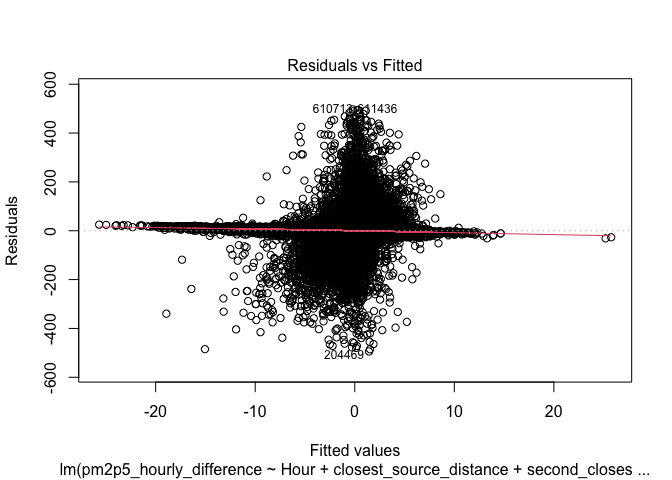

# Part 1: Data Acquisition, Cleaning, and Aggregation

## 10/8/26:

I downloaded necessary data (2025 Purpleair historical data, Purpleair
sensor metadata, and my curated dataset of Chicago pollution sources)
and wrote a function to compute the Haversine distance between any two
latitude/longitude coordinates.

My first step was to connect to the CLEAR lab’s database, from which I
downloaded historical sensor data.

    library(tidyverse)

    ## Warning: package 'ggplot2' was built under R version 4.4.3

    ## Warning: package 'tibble' was built under R version 4.4.3

    ## Warning: package 'tidyr' was built under R version 4.4.3

    ## Warning: package 'readr' was built under R version 4.4.3

    ## Warning: package 'purrr' was built under R version 4.4.3

    ## Warning: package 'dplyr' was built under R version 4.4.3

    ## ── Attaching core tidyverse packages ──────────────────────── tidyverse 2.0.0 ──
    ## ✔ dplyr     1.2.0     ✔ readr     2.1.6
    ## ✔ forcats   1.0.1     ✔ stringr   1.6.0
    ## ✔ ggplot2   4.0.2     ✔ tibble    3.3.1
    ## ✔ lubridate 1.9.4     ✔ tidyr     1.3.2
    ## ✔ purrr     1.2.1     
    ## ── Conflicts ────────────────────────────────────────── tidyverse_conflicts() ──
    ## ✖ dplyr::filter() masks stats::filter()
    ## ✖ dplyr::lag()    masks stats::lag()
    ## ℹ Use the conflicted package (<http://conflicted.r-lib.org/>) to force all conflicts to become errors

    library(readxl)
    library(httr)
    library(jsonlite)

    ## 
    ## Attaching package: 'jsonlite'
    ## 
    ## The following object is masked from 'package:purrr':
    ## 
    ##     flatten

    library(lubridate)
    library(PurpleAirAPI)
    library(DBI)

    ## Warning: package 'DBI' was built under R version 4.4.3

    library(odbc)

    ## Warning: package 'odbc' was built under R version 4.4.3

    library(PurpleAir)

    con = dbConnect(
      odbc(),
      Driver = "/opt/homebrew/lib/libmsodbcsql.18.dylib",
      Server = "resdbsprdhs02.adms.luc.edu",
      Database = "clearlab_purpleair",
      UID = Sys.getenv("DB_USERNAME"),
      PWD = Sys.getenv("DB_PASSWORD"),
      Encrypt = "yes",
      TrustServerCertificate = "yes"
    )

Once connected to the database, I obtained historical sensor data and
sensor metadata via an RMySQL query (an R based wrapper for SQL code),
the same method I used to query the database during my Summer 2026 USRE
research, and then acquired my curated dataset of Chicago pollution
sources retrieved from Climate Trace’s interactive map.

    Purpleair_historical_data_2025<-dbGetQuery(con, "SELECT * FROM Purpleair_air_history WHERE time_stamp >= '2025-01-01 00:00:00' AND time_stamp < '2026-01-01 00:00:00'")

    ###Make sure that, in your project paper, you provide a solid few paragraphs of contextual explanation about the air quality database you are accessing, how you gained access to it, and an overview of its schema

    #Reading in the air pollution sources data 
    ###Make sure your paper provides a link to the ClimateTrace site where you obtained these sources)

    Chicago_air_pollution_sources<-read_csv("~/Desktop/STAT_338/STAT_338/Final_project/STAT_338_Final_Project/Chicago_air_pollution_sources.csv")

    #Reading in the Purpleair_sensor_information table (sensor metadata) --> we need this table for the latitude and longitude of each sensor index in the historical data

    Purpleair_sensor_information<-dbGetQuery(con, "SELECT sensor_index, latitude, longitude FROM Purpleair_sensor_information")

Once I had acquired all the necessary data, I wrote a function to
compute the Haversine distance (in miles) between two inputted pairs of
latitude and longitude values. The Haversine formula uses trigonometry
to calculate distances under the assumption that the Earth is a perfect
sphere (which it is not). Thus, the accuracy of its calculations is
higher for shorter distances and decreases as distances become very
large.

<https://www.youtube.com/watch?v=lSIVK82o2sI&t=25s>

    #Make sure that, in your paper, you explain the spatial variables you are using in addition to the non spatial ones, and in conjunction with this, explain why you are using the Haversine formula to calculate distances from the perspective of map projections.

    #Include a hyperlink to the web source where you learned about the Haversine formula: 

    Haversine_distance<-function(lat1, lat2, long1, long2){
      latitude_difference=lat2-lat1
      longitude_difference=long2-long1
      latitude_difference_radians=(latitude_difference*pi)/180
      longitude_difference_radians=(longitude_difference*pi)/180
      term1=(sin(latitude_difference_radians/2))^2
      term2=cos(((lat1*pi)/180))
      term3=cos(((lat2*pi/180)))
      term4=(sin(longitude_difference_radians/2))^2
      a=term1+(term2*term3*term4)
      c=2*atan2(sqrt(a), sqrt(1-a))
      distance=c*3958.8
      return(distance)}

Testing out the function: the actual distance between Loyola University
Chicago’s Damen Center (41.9993, -87.6605) and my house (42.075814,
-87.979072) is 17.21 miles, as measured on Google Maps. Let’s see how
closely the function approximates this distance.

    test_distance<-Haversine_distance(42.000968, 42.075814, -87.659353, -87.979072)
    percent_error=abs(((test_distance-17.21)/17.21)*100)
    test_distance

    ## [1] 17.20239

    percent_error

    ## [1] 0.04422724

The Haversine function yielded 17.20239 miles (a 0.044% error). This is
excellent and indicates that the spherical Earth approximation made by
the formula is highly accurate for the purposes of the small to medium
distance calculations I need for this project.

# 10/10/26: data preprocessing and aggregation (preparation for modeling)

## My research question will require the aggregation of all the atmospheric variables within the PurpleAir historical data by hour. This dataset contains nearly 20 million observations, so I performed aggregations individually on smaller chunks of data to prevent R from crashing due to memory overload. I aggregated the atmospheric variables by taking their median within each hour. I did a median aggregation instead of a mean aggregation to minimize the effect of anomalously high sensor readings due to low WiFi connectivity, high humidity, internal dust accumulation, etc.

Sources of error in low cost pollution sensors:
<https://www.researchgate.net/publication/387292652_Low-Cost_Air_Quality_Sensors_Biases_Corrections_and_Challenges_in_Their_Comparability>

Discovery of PurpleAir sensor internal heating bias:
<https://pubmed.ncbi.nlm.nih.gov/35808235/>

Lance Wallace’s final correction formulas used by PurpleAir based on the
aforementioned bias:

<https://map.purpleair.com/environment-estimated-relative-humidity?opt=%2F1%2Flp%2Fa10%2Fp604800%2FcC0&select=182245#9.4/41.8253/-87.7556>

<https://map.purpleair.com/environment-estimated-relative-humidity?opt=%2F1%2Flp%2Fa10%2Fp604800%2FcC0#9.4/41.8253/-87.7556>

Lance Wallace’s evidence of internal heating bias:

<https://www.mdpi.com/1424-8220/22/13/4741>

    Chunk1<-Purpleair_historical_data_2025[1:1000000, ]
    Chunk1_aggregated_by_hour<-Chunk1%>%
      mutate(Day=format(time_stamp, format="%D"), Hour=format(time_stamp, format="%H"))%>%
      mutate(humidity_corrected=1.4498*humidity+7.022, temperature_corrected=1.0227*temperature-9.3755)%>% #Implementing peer reviewed correction formulas, which approximate ambient temperature and humidity as a function of the sensor's internal temperature and humidity (explain these in detail in the paper, and cite the paper where they originate from)
      mutate(Single_pm2p5_measurement=ifelse(is.na(pm2p5_cf_1_b), pm2p5_cf_1_a, (pm2p5_cf_1_a+pm2p5_cf_1_b)/2))%>% #Averages the pm2p5 readings from each channel if both exist. If only the Channel A readings exist, we take that reaidng as the true pm2p5 measurement (it is never NA anywhere in the dataset).
      group_by(sensor_index, Day, Hour)%>%
      summarize(sensor_index=first(sensor_index), median_pm2p5=median(Single_pm2p5_measurement, na.rm=TRUE), median_humidity=median(humidity_corrected, na.rm=TRUE), median_temperature=median(temperature_corrected, na.rm=TRUE), median_pressure=median(pressure, na.rm=TRUE))  #Takes median values of atmospheric variables for each day/hour combination for each sensor index

I repeated this exact pipeline for each subsequent chunk of 1 million
observations in Purpleair\_historical\_data\_2025, yielding a total of
20 chunks of data. The only difference in the code between chunks was
the row indices used in the first line of code.

    Chunk2<-Purpleair_historical_data_2025[1000001:2000000, ]
    Chunk2_aggregated_by_hour<-Chunk2%>%
      mutate(Day=format(time_stamp, format="%D"), Hour=format(time_stamp, format="%H"))%>%
      mutate(humidity_corrected=1.4498*humidity+7.022, temperature_corrected=1.0227*temperature-9.3755)%>%
      mutate(Single_pm2p5_measurement=ifelse(is.na(pm2p5_cf_1_b), pm2p5_cf_1_a, (pm2p5_cf_1_a+pm2p5_cf_1_b)/2))%>% #Averages the pm2p5 readings from each channel if both exist. If only the Channel A readings exist, we take that reaidng as the true pm2p5 measurement (it is never NA anywhere in the dataset).
      group_by(sensor_index, Day, Hour)%>%
      summarize(sensor_index=first(sensor_index), median_pm2p5=median(Single_pm2p5_measurement, na.rm=TRUE), median_humidity=median(humidity_corrected, na.rm=TRUE), median_temperature=median(temperature_corrected, na.rm=TRUE), median_pressure=median(pressure, na.rm=TRUE)) #Averages atmospheric variables for each day/hour combination for each sensor index

    Chunk3<-Purpleair_historical_data_2025[2000001:3000000, ]
    Chunk3_aggregated_by_hour<-Chunk3%>%
      mutate(Day=format(time_stamp, format="%D"), Hour=format(time_stamp, format="%H"))%>%
      mutate(humidity_corrected=1.4498*humidity+7.022, temperature_corrected=1.0227*temperature-9.3755)%>%
      mutate(Single_pm2p5_measurement=ifelse(is.na(pm2p5_cf_1_b), pm2p5_cf_1_a, (pm2p5_cf_1_a+pm2p5_cf_1_b)/2))%>% #Averages the pm2p5 readings from each channel if both exist. If only the Channel A readings exist, we take that reaidng as the true pm2p5 measurement (it is never NA anywhere in the dataset).
      group_by(sensor_index, Day, Hour)%>%
      summarize(sensor_index=first(sensor_index), median_pm2p5=median(Single_pm2p5_measurement, na.rm=TRUE), median_humidity=median(humidity_corrected, na.rm=TRUE), median_temperature=median(temperature_corrected, na.rm=TRUE), median_pressure=median(pressure, na.rm=TRUE)) #Averages atmospheric variables for each day/hour combination for each sensor index

    Chunk4<-Purpleair_historical_data_2025[3000001:4000000, ]
    Chunk4_aggregated_by_hour<-Chunk4%>%
      mutate(Day=format(time_stamp, format="%D"), Hour=format(time_stamp, format="%H"))%>%
      mutate(humidity_corrected=1.4498*humidity+7.022, temperature_corrected=1.0227*temperature-9.3755)%>%
      mutate(Single_pm2p5_measurement=ifelse(is.na(pm2p5_cf_1_b), pm2p5_cf_1_a, (pm2p5_cf_1_a+pm2p5_cf_1_b)/2))%>% #Averages the pm2p5 readings from each channel if both exist. If only the Channel A readings exist, we take that reaidng as the true pm2p5 measurement (it is never NA anywhere in the dataset).
      group_by(sensor_index, Day, Hour)%>%
      summarize(sensor_index=first(sensor_index), median_pm2p5=median(Single_pm2p5_measurement, na.rm=TRUE), median_humidity=median(humidity_corrected, na.rm=TRUE), median_temperature=median(temperature_corrected, na.rm=TRUE), median_pressure=median(pressure, na.rm=TRUE)) #Averages atmospheric variables for each day/hour combination for each sensor index

    Chunk5<-Purpleair_historical_data_2025[4000001:5000000, ]
    Chunk5_aggregated_by_hour<-Chunk5%>%
      mutate(Day=format(time_stamp, format="%D"), Hour=format(time_stamp, format="%H"))%>%
      mutate(humidity_corrected=1.4498*humidity+7.022, temperature_corrected=1.0227*temperature-9.3755)%>%
      mutate(Single_pm2p5_measurement=ifelse(is.na(pm2p5_cf_1_b), pm2p5_cf_1_a, (pm2p5_cf_1_a+pm2p5_cf_1_b)/2))%>% #Averages the pm2p5 readings from each channel if both exist. If only the Channel A readings exist, we take that reaidng as the true pm2p5 measurement (it is never NA anywhere in the dataset).
      group_by(sensor_index, Day, Hour)%>%
      summarize(sensor_index=first(sensor_index), median_pm2p5=median(Single_pm2p5_measurement, na.rm=TRUE), median_humidity=median(humidity_corrected, na.rm=TRUE), median_temperature=median(temperature_corrected, na.rm=TRUE), median_pressure=median(pressure, na.rm=TRUE)) #Averages atmospheric variables for each day/hour combination for each sensor index

    Chunk6<-Purpleair_historical_data_2025[5000001:6000000, ]
    Chunk6_aggregated_by_hour<-Chunk6%>%
      mutate(Day=format(time_stamp, format="%D"), Hour=format(time_stamp, format="%H"))%>%
      mutate(humidity_corrected=1.4498*humidity+7.022, temperature_corrected=1.0227*temperature-9.3755)%>%
      mutate(Single_pm2p5_measurement=ifelse(is.na(pm2p5_cf_1_b), pm2p5_cf_1_a, (pm2p5_cf_1_a+pm2p5_cf_1_b)/2))%>% #Averages the pm2p5 readings from each channel if both exist. If only the Channel A readings exist, we take that reaidng as the true pm2p5 measurement (it is never NA anywhere in the dataset).
      group_by(sensor_index, Day, Hour)%>%
      summarize(sensor_index=first(sensor_index), median_pm2p5=median(Single_pm2p5_measurement, na.rm=TRUE), median_humidity=median(humidity_corrected, na.rm=TRUE), median_temperature=median(temperature_corrected, na.rm=TRUE), median_pressure=median(pressure, na.rm=TRUE)) #Averages atmospheric variables for each day/hour combination for each sensor index

    Chunk7<-Purpleair_historical_data_2025[6000001:7000000, ]
    Chunk7_aggregated_by_hour<-Chunk7%>%
      mutate(Day=format(time_stamp, format="%D"), Hour=format(time_stamp, format="%H"))%>%
      mutate(humidity_corrected=1.4498*humidity+7.022, temperature_corrected=1.0227*temperature-9.3755)%>%
      mutate(Single_pm2p5_measurement=ifelse(is.na(pm2p5_cf_1_b), pm2p5_cf_1_a, (pm2p5_cf_1_a+pm2p5_cf_1_b)/2))%>% #Averages the pm2p5 readings from each channel if both exist. If only the Channel A readings exist, we take that reaidng as the true pm2p5 measurement (it is never NA anywhere in the dataset).
      group_by(sensor_index, Day, Hour)%>%
      summarize(sensor_index=first(sensor_index), median_pm2p5=median(Single_pm2p5_measurement, na.rm=TRUE), median_humidity=median(humidity_corrected, na.rm=TRUE), median_temperature=median(temperature_corrected, na.rm=TRUE), median_pressure=median(pressure, na.rm=TRUE)) #Averages atmospheric variables for each day/hour combination for each sensor index

    Chunk8<-Purpleair_historical_data_2025[7000001:8000000, ]
    Chunk8_aggregated_by_hour<-Chunk8%>%
      mutate(Day=format(time_stamp, format="%D"), Hour=format(time_stamp, format="%H"))%>%
      mutate(humidity_corrected=1.4498*humidity+7.022, temperature_corrected=1.0227*temperature-9.3755)%>%
      mutate(Single_pm2p5_measurement=ifelse(is.na(pm2p5_cf_1_b), pm2p5_cf_1_a, (pm2p5_cf_1_a+pm2p5_cf_1_b)/2))%>% #Averages the pm2p5 readings from each channel if both exist. If only the Channel A readings exist, we take that reaidng as the true pm2p5 measurement (it is never NA anywhere in the dataset).
      group_by(sensor_index, Day, Hour)%>%
      summarize(sensor_index=first(sensor_index), median_pm2p5=median(Single_pm2p5_measurement, na.rm=TRUE), median_humidity=median(humidity_corrected, na.rm=TRUE), median_temperature=median(temperature_corrected, na.rm=TRUE), median_pressure=median(pressure, na.rm=TRUE)) #Averages atmospheric variables for each day/hour combination for each sensor index

    Chunk9<-Purpleair_historical_data_2025[8000001:9000000, ]
    Chunk9_aggregated_by_hour<-Chunk9%>%
      mutate(Day=format(time_stamp, format="%D"), Hour=format(time_stamp, format="%H"))%>%
      mutate(humidity_corrected=1.4498*humidity+7.022, temperature_corrected=1.0227*temperature-9.3755)%>%
      mutate(Single_pm2p5_measurement=ifelse(is.na(pm2p5_cf_1_b), pm2p5_cf_1_a, (pm2p5_cf_1_a+pm2p5_cf_1_b)/2))%>% #Averages the pm2p5 readings from each channel if both exist. If only the Channel A readings exist, we take that reaidng as the true pm2p5 measurement (it is never NA anywhere in the dataset).
      group_by(sensor_index, Day, Hour)%>%
      summarize(sensor_index=first(sensor_index), median_pm2p5=median(Single_pm2p5_measurement, na.rm=TRUE), median_humidity=median(humidity_corrected, na.rm=TRUE), median_temperature=median(temperature_corrected, na.rm=TRUE), median_pressure=median(pressure, na.rm=TRUE)) #Averages atmospheric variables for each day/hour combination for each sensor index

    Chunk10<-Purpleair_historical_data_2025[9000001:10000000, ]
    Chunk10_aggregated_by_hour<-Chunk10%>%
      mutate(Day=format(time_stamp, format="%D"), Hour=format(time_stamp, format="%H"))%>%
      mutate(humidity_corrected=1.4498*humidity+7.022, temperature_corrected=1.0227*temperature-9.3755)%>%
      mutate(Single_pm2p5_measurement=ifelse(is.na(pm2p5_cf_1_b), pm2p5_cf_1_a, (pm2p5_cf_1_a+pm2p5_cf_1_b)/2))%>% #Averages the pm2p5 readings from each channel if both exist. If only the Channel A readings exist, we take that reaidng as the true pm2p5 measurement (it is never NA anywhere in the dataset).
      group_by(sensor_index, Day, Hour)%>%
      summarize(sensor_index=first(sensor_index), median_pm2p5=median(Single_pm2p5_measurement, na.rm=TRUE), median_humidity=median(humidity_corrected, na.rm=TRUE), median_temperature=median(temperature_corrected, na.rm=TRUE), median_pressure=median(pressure, na.rm=TRUE)) #Averages atmospheric variables for each day/hour combination for each sensor index

    Chunk11<-Purpleair_historical_data_2025[10000001:11000000, ]
    Chunk11_aggregated_by_hour<-Chunk11%>%
      mutate(Day=format(time_stamp, format="%D"), Hour=format(time_stamp, format="%H"))%>%
      mutate(humidity_corrected=1.4498*humidity+7.022, temperature_corrected=1.0227*temperature-9.3755)%>%
      mutate(Single_pm2p5_measurement=ifelse(is.na(pm2p5_cf_1_b), pm2p5_cf_1_a, (pm2p5_cf_1_a+pm2p5_cf_1_b)/2))%>% #Averages the pm2p5 readings from each channel if both exist. If only the Channel A readings exist, we take that reaidng as the true pm2p5 measurement (it is never NA anywhere in the dataset).
      group_by(sensor_index, Day, Hour)%>%
      summarize(sensor_index=first(sensor_index), median_pm2p5=median(Single_pm2p5_measurement, na.rm=TRUE), median_humidity=median(humidity_corrected, na.rm=TRUE), median_temperature=median(temperature_corrected, na.rm=TRUE), median_pressure=median(pressure, na.rm=TRUE)) #Averages atmospheric variables for each day/hour combination for each sensor index

    Chunk12<-Purpleair_historical_data_2025[11000001:12000000, ]
    Chunk12_aggregated_by_hour<-Chunk12%>%
      mutate(Day=format(time_stamp, format="%D"), Hour=format(time_stamp, format="%H"))%>%
      mutate(humidity_corrected=1.4498*humidity+7.022, temperature_corrected=1.0227*temperature-9.3755)%>%
      mutate(Single_pm2p5_measurement=ifelse(is.na(pm2p5_cf_1_b), pm2p5_cf_1_a, (pm2p5_cf_1_a+pm2p5_cf_1_b)/2))%>% #Averages the pm2p5 readings from each channel if both exist. If only the Channel A readings exist, we take that reaidng as the true pm2p5 measurement (it is never NA anywhere in the dataset).
      group_by(sensor_index, Day, Hour)%>%
      summarize(sensor_index=first(sensor_index), median_pm2p5=median(Single_pm2p5_measurement, na.rm=TRUE), median_humidity=median(humidity_corrected, na.rm=TRUE), median_temperature=median(temperature_corrected, na.rm=TRUE), median_pressure=median(pressure, na.rm=TRUE)) #Averages atmospheric variables for each day/hour combination for each sensor index

    Chunk13<-Purpleair_historical_data_2025[12000001:13000000, ]
    Chunk13_aggregated_by_hour<-Chunk13%>%
      mutate(Day=format(time_stamp, format="%D"), Hour=format(time_stamp, format="%H"))%>%
      mutate(humidity_corrected=1.4498*humidity+7.022, temperature_corrected=1.0227*temperature-9.3755)%>%
      mutate(Single_pm2p5_measurement=ifelse(is.na(pm2p5_cf_1_b), pm2p5_cf_1_a, (pm2p5_cf_1_a+pm2p5_cf_1_b)/2))%>% #Averages the pm2p5 readings from each channel if both exist. If only the Channel A readings exist, we take that reaidng as the true pm2p5 measurement (it is never NA anywhere in the dataset).
      group_by(sensor_index, Day, Hour)%>%
      summarize(sensor_index=first(sensor_index), median_pm2p5=median(Single_pm2p5_measurement, na.rm=TRUE), median_humidity=median(humidity_corrected, na.rm=TRUE), median_temperature=median(temperature_corrected, na.rm=TRUE), median_pressure=median(pressure, na.rm=TRUE)) #Averages atmospheric variables for each day/hour combination for each sensor index

    Chunk14<-Purpleair_historical_data_2025[13000001:14000000, ]
    Chunk14_aggregated_by_hour<-Chunk14%>%
      mutate(Day=format(time_stamp, format="%D"), Hour=format(time_stamp, format="%H"))%>%
      mutate(humidity_corrected=1.4498*humidity+7.022, temperature_corrected=1.0227*temperature-9.3755)%>%
      mutate(Single_pm2p5_measurement=ifelse(is.na(pm2p5_cf_1_b), pm2p5_cf_1_a, (pm2p5_cf_1_a+pm2p5_cf_1_b)/2))%>% #Averages the pm2p5 readings from each channel if both exist. If only the Channel A readings exist, we take that reaidng as the true pm2p5 measurement (it is never NA anywhere in the dataset).
      group_by(sensor_index, Day, Hour)%>%
      summarize(sensor_index=first(sensor_index), median_pm2p5=median(Single_pm2p5_measurement, na.rm=TRUE), median_humidity=median(humidity_corrected, na.rm=TRUE), median_temperature=median(temperature_corrected, na.rm=TRUE), median_pressure=median(pressure, na.rm=TRUE)) #Averages atmospheric variables for each day/hour combination for each sensor index

    Chunk15<-Purpleair_historical_data_2025[14000001:15000000, ]
    Chunk15_aggregated_by_hour<-Chunk15%>%
      mutate(Day=format(time_stamp, format="%D"), Hour=format(time_stamp, format="%H"))%>%
      mutate(humidity_corrected=1.4498*humidity+7.022, temperature_corrected=1.0227*temperature-9.3755)%>%
      mutate(Single_pm2p5_measurement=ifelse(is.na(pm2p5_cf_1_b), pm2p5_cf_1_a, (pm2p5_cf_1_a+pm2p5_cf_1_b)/2))%>% #Averages the pm2p5 readings from each channel if both exist. If only the Channel A readings exist, we take that reaidng as the true pm2p5 measurement (it is never NA anywhere in the dataset).
      group_by(sensor_index, Day, Hour)%>%
      summarize(sensor_index=first(sensor_index), median_pm2p5=median(Single_pm2p5_measurement, na.rm=TRUE), median_humidity=median(humidity_corrected, na.rm=TRUE), median_temperature=median(temperature_corrected, na.rm=TRUE), median_pressure=median(pressure, na.rm=TRUE)) #Averages atmospheric variables for each day/hour combination for each sensor index

    Chunk16<-Purpleair_historical_data_2025[15000001:16000000, ]
    Chunk16_aggregated_by_hour<-Chunk16%>%
      mutate(Day=format(time_stamp, format="%D"), Hour=format(time_stamp, format="%H"))%>%
      mutate(humidity_corrected=1.4498*humidity+7.022, temperature_corrected=1.0227*temperature-9.3755)%>%
      mutate(Single_pm2p5_measurement=ifelse(is.na(pm2p5_cf_1_b), pm2p5_cf_1_a, (pm2p5_cf_1_a+pm2p5_cf_1_b)/2))%>% #Averages the pm2p5 readings from each channel if both exist. If only the Channel A readings exist, we take that reaidng as the true pm2p5 measurement (it is never NA anywhere in the dataset).
      group_by(sensor_index, Day, Hour)%>%
      summarize(sensor_index=first(sensor_index), median_pm2p5=median(Single_pm2p5_measurement, na.rm=TRUE), median_humidity=median(humidity_corrected, na.rm=TRUE), median_temperature=median(temperature_corrected, na.rm=TRUE), median_pressure=median(pressure, na.rm=TRUE)) #Averages atmospheric variables for each day/hour combination for each sensor index

    Chunk17<-Purpleair_historical_data_2025[16000001:17000000, ]
    Chunk17_aggregated_by_hour<-Chunk17%>%
      mutate(Day=format(time_stamp, format="%D"), Hour=format(time_stamp, format="%H"))%>%
      mutate(humidity_corrected=1.4498*humidity+7.022, temperature_corrected=1.0227*temperature-9.3755)%>%
      mutate(Single_pm2p5_measurement=ifelse(is.na(pm2p5_cf_1_b), pm2p5_cf_1_a, (pm2p5_cf_1_a+pm2p5_cf_1_b)/2))%>% #Averages the pm2p5 readings from each channel if both exist. If only the Channel A readings exist, we take that reaidng as the true pm2p5 measurement (it is never NA anywhere in the dataset).
      group_by(sensor_index, Day, Hour)%>%
      summarize(sensor_index=first(sensor_index), median_pm2p5=median(Single_pm2p5_measurement, na.rm=TRUE), median_humidity=median(humidity_corrected, na.rm=TRUE), median_temperature=median(temperature_corrected, na.rm=TRUE), median_pressure=median(pressure, na.rm=TRUE)) #Averages atmospheric variables for each day/hour combination for each sensor index

    Chunk18<-Purpleair_historical_data_2025[17000001:18000000, ]
    Chunk18_aggregated_by_hour<-Chunk18%>%
      mutate(Day=format(time_stamp, format="%D"), Hour=format(time_stamp, format="%H"))%>%
      mutate(humidity_corrected=1.4498*humidity+7.022, temperature_corrected=1.0227*temperature-9.3755)%>%
      mutate(Single_pm2p5_measurement=ifelse(is.na(pm2p5_cf_1_b), pm2p5_cf_1_a, (pm2p5_cf_1_a+pm2p5_cf_1_b)/2))%>% #Averages the pm2p5 readings from each channel if both exist. If only the Channel A readings exist, we take that reaidng as the true pm2p5 measurement (it is never NA anywhere in the dataset).
      group_by(sensor_index, Day, Hour)%>%
      summarize(sensor_index=first(sensor_index), median_pm2p5=median(Single_pm2p5_measurement, na.rm=TRUE), median_humidity=median(humidity_corrected, na.rm=TRUE), median_temperature=median(temperature_corrected, na.rm=TRUE), median_pressure=median(pressure, na.rm=TRUE)) #Averages atmospheric variables for each day/hour combination for each sensor index

    Chunk19<-Purpleair_historical_data_2025[18000001:19000000, ]
    Chunk19_aggregated_by_hour<-Chunk19%>%
      mutate(Day=format(time_stamp, format="%D"), Hour=format(time_stamp, format="%H"))%>%
      mutate(humidity_corrected=1.4498*humidity+7.022, temperature_corrected=1.0227*temperature-9.3755)%>%
      mutate(Single_pm2p5_measurement=ifelse(is.na(pm2p5_cf_1_b), pm2p5_cf_1_a, (pm2p5_cf_1_a+pm2p5_cf_1_b)/2))%>% #Averages the pm2p5 readings from each channel if both exist. If only the Channel A readings exist, we take that reaidng as the true pm2p5 measurement (it is never NA anywhere in the dataset).
      group_by(sensor_index, Day, Hour)%>%
      summarize(sensor_index=first(sensor_index), median_pm2p5=median(Single_pm2p5_measurement, na.rm=TRUE), median_humidity=median(humidity_corrected, na.rm=TRUE), median_temperature=median(temperature_corrected, na.rm=TRUE), median_pressure=median(pressure, na.rm=TRUE)) #Averages atmospheric variables for each day/hour combination for each sensor index

    Chunk20<-Purpleair_historical_data_2025[19000001: nrow(Purpleair_historical_data_2025), ]
    Chunk20_aggregated_by_hour<-Chunk20%>%
      mutate(Day=format(time_stamp, format="%D"), Hour=format(time_stamp, format="%H"))%>%
      mutate(humidity_corrected=1.4498*humidity+7.022, temperature_corrected=1.0227*temperature-9.3755)%>%
      mutate(Single_pm2p5_measurement=ifelse(is.na(pm2p5_cf_1_b), pm2p5_cf_1_a, (pm2p5_cf_1_a+pm2p5_cf_1_b)/2))%>% #Averages the pm2p5 readings from each channel if both exist. If only the Channel A readings exist, we take that reaidng as the true pm2p5 measurement (it is never NA anywhere in the dataset).
      group_by(sensor_index, Day, Hour)%>%
      summarize(sensor_index=first(sensor_index), median_pm2p5=median(Single_pm2p5_measurement, na.rm=TRUE), median_humidity=median(humidity_corrected, na.rm=TRUE), median_temperature=median(temperature_corrected, na.rm=TRUE), median_pressure=median(pressure, na.rm=TRUE)) #Averages atmospheric variables for each day/hour combination for each sensor index

I then combined the chunks back into a full dataframe.

    Chunks_1_thru_5_aggregated_by_hour<-bind_rows(Chunk1_aggregated_by_hour, Chunk2_aggregated_by_hour, Chunk3_aggregated_by_hour, Chunk4_aggregated_by_hour, Chunk5_aggregated_by_hour)

    Chunks_6_thru_10_aggregated_by_hour<-bind_rows(Chunk6_aggregated_by_hour, Chunk7_aggregated_by_hour, Chunk8_aggregated_by_hour, Chunk9_aggregated_by_hour, Chunk10_aggregated_by_hour)

    Chunks_11_thru_15_aggregated_by_hour<-bind_rows(Chunk11_aggregated_by_hour, Chunk12_aggregated_by_hour, Chunk13_aggregated_by_hour, Chunk14_aggregated_by_hour, Chunk15_aggregated_by_hour)

    Chunks_16_thru_20_aggregated_by_hour<-bind_rows(Chunk16_aggregated_by_hour, Chunk17_aggregated_by_hour, Chunk18_aggregated_by_hour, Chunk19_aggregated_by_hour, Chunk20_aggregated_by_hour)

    Purpleair_historical_data_2025_aggregated_by_hour<-bind_rows(Chunks_1_thru_5_aggregated_by_hour, Chunks_6_thru_10_aggregated_by_hour, Chunks_11_thru_15_aggregated_by_hour, Chunks_16_thru_20_aggregated_by_hour) 

To account for instances in which the readings within a given hour for a
given sensor index were split between multiple chunks, I needed to
perform another hourly aggregation on the full dataset. ChatGPT advised
me to do this after I noticed that the lagged predictors contained NA
values at the beginning of each new day, instead of at the position
where the sensor index changes (which is what I need).

    Purpleair_historical_data_2025_aggregated_by_hour_aggregated_again<-Purpleair_historical_data_2025_aggregated_by_hour%>%
    ungroup()%>%
    group_by(sensor_index, Day, Hour)%>%
    summarize(median_pm2p5=median(median_pm2p5, na.rm=TRUE), median_humidity=median(median_humidity, na.rm=TRUE), median_temperature=median(median_temperature, na.rm=TRUE), median_pressure=median(median_pressure, na.rm=TRUE))

Then, I removed the individual data chunks to save memory in my R
session, now that the full dataset has been obtained.

    rm(Chunk1, Chunk2, Chunk3, Chunk4, Chunk5, Chunk6, Chunk7, Chunk8, Chunk9, Chunk10, Chunk11, Chunk12, Chunk13, Chunk14, Chunk15, Chunk16, Chunk17, Chunk18, Chunk19, Chunk20)
    rm(Chunk1_aggregated_by_hour, Chunk2_aggregated_by_hour, Chunk3_aggregated_by_hour, Chunk4_aggregated_by_hour, Chunk5_aggregated_by_hour, Chunk6_aggregated_by_hour, Chunk7_aggregated_by_hour, Chunk8_aggregated_by_hour, Chunk9_aggregated_by_hour, Chunk10_aggregated_by_hour, Chunk11_aggregated_by_hour, Chunk12_aggregated_by_hour, Chunk13_aggregated_by_hour, Chunk14_aggregated_by_hour, Chunk15_aggregated_by_hour, Chunk16_aggregated_by_hour, Chunk17_aggregated_by_hour, Chunk18_aggregated_by_hour, Chunk19_aggregated_by_hour, Chunk20_aggregated_by_hour)
    rm(Chunks_1_thru_5_aggregated_by_hour, Chunks_6_thru_10_aggregated_by_hour, Chunks_11_thru_15_aggregated_by_hour, Chunks_16_thru_20_aggregated_by_hour)

Then I used the dataset of Chicago pollution sources, the Purpleair
sensor information data, and the Haversine distance function I
previously wrote to find the distances of the closest, second closest,
third closest, fourth closest, and fifth closest pollution source to
each sensor index and the amount of pm2.5 (in tons) released by those
sources in 2025 (these will become 10 additional predictors).

Here is my original code attempt to accomplish this task. It almost
accomplished it successfully, except for one important detail: it does
not ensure that facilities are not duplicated.

    Purpleair_sensor_information_relevant<-Purpleair_sensor_information%>%
    filter(sensor_index %in% Purpleair_historical_data_2025_aggregated_by_hour_aggregated_again$sensor_index) #116 out of 152 total indices are in the 2025 historical data
    Relevant_sensor_indices<-Purpleair_sensor_information_relevant$sensor_index

    final_output_list<-list()
    for(i in seq(1, length(Relevant_sensor_indices), 1)){
      distances_to_pollution_sources<-c() #Instantiates an empty vector to store the distances between a given sensor index and each pollution sources (calculated using our Haversine function)
      relevant_distances_to_pollution_sources<-c()
      relevant_source_pm2p5_emissions<-c()
      
      for(j in seq(1, nrow(Chicago_air_pollution_sources), 1)){
        distance_to_facility=Haversine_distance(Purpleair_sensor_information_relevant$latitude[i], Chicago_air_pollution_sources$Latitude[j], Purpleair_sensor_information_relevant$longitude[i], Chicago_air_pollution_sources$Longitude[j]) #For a given sensor index, computes the Haversine distance (in miles) between the location of that sensor index and each facility in the air pollution sources dataset, and creates a list of distances, then adds each calculated distance to that list. 
        distances_to_pollution_sources<-c(distances_to_pollution_sources, distance_to_facility)}
        
      closest_distance_to_a_source<-min(distances_to_pollution_sources) #Once the distances_to_pollution_sources vector is fully populated by the inner loop, the outer loop extracts the closest, second closest, third closest, fourth closest, and fifth closest distances and their corresponding pm2p5 releases (in tons)
      relevant_distances_to_pollution_sources<-c(relevant_distances_to_pollution_sources, closest_distance_to_a_source) #Adding the closest distance to a pollution source for a given sensor
      closest_distance_index<-which(distances_to_pollution_sources==closest_distance_to_a_source)
      distances_excluding_closest<-distances_to_pollution_sources[-closest_distance_index]
      relevant_source_pm2p5_emissions<-c(relevant_source_pm2p5_emissions, Chicago_air_pollution_sources$Tons_PM2.5_2025[closest_distance_index]) #Adding the corresponding pm2p5 emissions for the pollution source closest to the sensor

    #Within the for loop, the same logic is repeated for the second, third, fourth, and fifth closest distances
      
      second_closest_distance<-min(distances_excluding_closest)
      relevant_distances_to_pollution_sources<-c(relevant_distances_to_pollution_sources, second_closest_distance)
      second_closest_distance_index<-which(distances_to_pollution_sources==second_closest_distance)
      distances_excluding_second_closest<-distances_excluding_closest[-second_closest_distance_index]
      relevant_source_pm2p5_emissions<-c(relevant_source_pm2p5_emissions, Chicago_air_pollution_sources$Tons_PM2.5_2025[second_closest_distance_index])
      
      third_closest_distance<-min(distances_excluding_second_closest)
      relevant_distances_to_pollution_sources<-c(relevant_distances_to_pollution_sources, third_closest_distance)
      third_closest_distance_index<-which(distances_to_pollution_sources==third_closest_distance)
      distances_excluding_third_closest<-distances_excluding_second_closest[-third_closest_distance_index]
      relevant_source_pm2p5_emissions<-c(relevant_source_pm2p5_emissions, Chicago_air_pollution_sources$Tons_PM2.5_2025[third_closest_distance_index])
      
      fourth_closest_distance<-min(distances_excluding_third_closest)
      relevant_distances_to_pollution_sources<-c(relevant_distances_to_pollution_sources, fourth_closest_distance)
      fourth_closest_distance_index<-which(distances_to_pollution_sources==fourth_closest_distance)
      distances_excluding_fourth_closest<-distances_excluding_third_closest[-fourth_closest_distance_index]
      relevant_source_pm2p5_emissions<-c(relevant_source_pm2p5_emissions, Chicago_air_pollution_sources$Tons_PM2.5_2025[fourth_closest_distance_index])
      
      fifth_closest_distance<-min(distances_excluding_fourth_closest)
      relevant_distances_to_pollution_sources<-c(relevant_distances_to_pollution_sources, fifth_closest_distance)
      fifth_closest_distance_index<-which(distances_to_pollution_sources==fifth_closest_distance)
      distances_excluding_fifth_closest<-distances_excluding_fourth_closest[-fifth_closest_distance_index]
      relevant_source_pm2p5_emissions<-c(relevant_source_pm2p5_emissions, Chicago_air_pollution_sources$Tons_PM2.5_2025[fifth_closest_distance_index])
      
      sensor_index<-Relevant_sensor_indices[i]
      distances_vector<-relevant_distances_to_pollution_sources
      emissions_vector<-relevant_source_pm2p5_emissions
      output_list<-list(sensor_index, distances_vector, emissions_vector)
      final_output_list[[i]] <- output_list
    } #The reuslt is a list of lists of overall length 116 

ChatGPT’s refinement of my code ensured that no facilities were
duplicated. It told me that the reason my code was selecting duplicate
or incorrect locations for the closest facility to each sensor index was
due to this line:

    closest_distance_index<-which(distances_to_pollution_sources==closest_distance_to_a_source)

Here is ChatGPT’s refinement of the code, which uses the vapply()
function (similar to a map function, which I did not think to use at the
time):

    final_output_list <- list()

    for (i in seq_along(Relevant_sensor_indices)) {
      
      # Calculate the distance from this sensor to every pollution source
      distances_to_pollution_sources <- vapply(
        seq_len(nrow(Chicago_air_pollution_sources)),
        function(j) {
          Haversine_distance(
            Purpleair_sensor_information_relevant$latitude[i],
            Chicago_air_pollution_sources$Latitude[j],
            Purpleair_sensor_information_relevant$longitude[i],
            Chicago_air_pollution_sources$Longitude[j]
          )
        },
        numeric(1)
      )
      
      # Find the indices of the five closest sources, in order
      closest_source_indices <- order(distances_to_pollution_sources)[1:5]
      
      # Extract their distances and corresponding PM2.5 emissions
      relevant_distances_to_pollution_sources <-
        distances_to_pollution_sources[closest_source_indices]
      
      relevant_source_pm2p5_emissions <-
        Chicago_air_pollution_sources$Tons_PM2.5_2025[closest_source_indices]
      
      # Store the results for this sensor
      final_output_list[[i]] <- list(
        Relevant_sensor_indices[i],
        relevant_distances_to_pollution_sources,
        relevant_source_pm2p5_emissions
      )
    }
    length(final_output_list)
    final_output_list[1]

This will not render in this document because I have set eval=FALSE to
most of the previous code so that the rendering of this document would
not depend on me being connected to GlobalProtect or the database. So I
did the next best thing: I included a screenshot of the output of the
previous code chunk.

As can be seen above, the output list consists of 116 elements, one for
each sensor index in the original metadata. Each element in the list
consists of 3 sub-elements: the sensor index, an inner list containing
the Haversine distances (in order) from the sensor index to each of the
5 closest pollution sources, and another inner list containing the
respective pm2.5 emissions of each pollution source in 2025.

After inspecting this nested list structure, I was able to extract, as
vectors, the additional predictors representing the distances and 2025
particulate matter emissions of the 5 closest facilities to each sensor
index.

    all_closest_distances<-c()
    all_second_closest_distances<-c()
    all_third_closest_distances<-c()
    all_fourth_closest_distances<-c()
    all_fifth_closest_distances<-c()
    all_closest_source_pm2p5<-c()
    all_2nd_closest_source_pm2p5<-c()
    all_3rd_closest_source_pm2p5<-c()
    all_4th_closest_source_pm2p5<-c()
    all_5th_closest_source_pm2p5<-c()

    #Generating the vectors we will use as spatial predictors

    for (i in seq(1, length(final_output_list), 1)){
      all_closest_distances<-c(all_closest_distances, final_output_list[[i]][[2]][[1]])
      all_second_closest_distances<-c(all_second_closest_distances, final_output_list[[i]][[2]][[2]])
      all_third_closest_distances<-c(all_third_closest_distances, final_output_list[[i]][[2]][[3]])
      all_fourth_closest_distances<-c(all_fourth_closest_distances, final_output_list[[i]][[2]][[4]])
      all_fifth_closest_distances<-c(all_fifth_closest_distances, final_output_list[[i]][[2]][[5]])
      all_closest_source_pm2p5<-c(all_closest_source_pm2p5, final_output_list[[i]][[3]][[1]])
      all_2nd_closest_source_pm2p5<-c(all_2nd_closest_source_pm2p5, final_output_list[[i]][[3]][[2]])
      all_3rd_closest_source_pm2p5<-c(all_3rd_closest_source_pm2p5, final_output_list[[i]][[3]][[3]])
      all_4th_closest_source_pm2p5<-c(all_4th_closest_source_pm2p5, final_output_list[[i]][[3]][[4]])
      all_5th_closest_source_pm2p5<-c(all_5th_closest_source_pm2p5, final_output_list[[i]][[3]][[5]])
    }

Once I had extracted the aforementioned predictors, I added them to the
Purpleair\_sensor\_information\_relevant dataset.

    Purpleair_sensor_information_relevant_expanded<-Purpleair_sensor_information_relevant%>%
    mutate(closest_source_distance=all_closest_distances, 
           second_closest_source_distance=all_second_closest_distances, 
           third_closest_source_distance=all_third_closest_distances, 
           fourth_closest_source_distance=all_fourth_closest_distances, 
           fifth_closest_source_distance=all_fifth_closest_distances, 
           closest_source_2025_pm2p5=all_closest_source_pm2p5,
           second_closest_source_2025_pm2p5=all_2nd_closest_source_pm2p5,
           third_closest_source_2025_pm2p5=all_3rd_closest_source_pm2p5,
           fourth_closest_source_2025_pm2p5=all_4th_closest_source_pm2p5,
           fifth_closest_source_2025_pm2p5=all_5th_closest_source_pm2p5)

I then joined
Purpleair\_historical\_data\_2025\_averaged\_by\_hour\_averaged\_again
to Purpleair\_sensor\_information\_relevant\_expanded.

    Purpleair_data_2025_hourly_averages<-Purpleair_historical_data_2025_aggregated_by_hour_aggregated_again%>%
    left_join(Purpleair_sensor_information_relevant_expanded, by=c("sensor_index"="sensor_index"))%>%
    select(-latitude, -longitude) #We don't need the latitude or longitude anymore because we have already used them to calculate the 1st-5th closest pollution source distances. 

One more preprocessing step remained, and it lies at the crux of my
research question: calculating the hourly lagged predictors based on the
raw hourly measurements of pm2p5, humidity, temperature, and pressure,
in order to remove time dependency at the hourly scale.

    library(dplyr)
    library(lubridate) 

    Purpleair_data_2025_modeling_dataset <- Purpleair_data_2025_hourly_averages %>%
      arrange(sensor_index, Day, Hour) %>%
      group_by(sensor_index) %>%
      mutate(
        observation_time = mdy_h(paste(Day, Hour), tz = "UTC"),
        
        time_difference = as.numeric(
          difftime(observation_time, lag(observation_time), units = "hours")
        ),
        
        pm2p5_hourly_difference       = ifelse(time_difference == 1, median_pm2p5 - lag(median_pm2p5), NA),
        humidity_hourly_difference    = ifelse(time_difference == 1, median_humidity - lag(median_humidity), NA),
        temperature_hourly_difference = ifelse(time_difference == 1, median_temperature - lag(median_temperature), NA),
        pressure_hourly_difference    = ifelse(time_difference == 1, median_pressure - lag(median_pressure), NA)
      ) %>% 
      select(-median_pm2p5, -median_humidity, -median_temperature, -median_pressure) %>% #I don't need the raw hourly averages for the modeling
      ungroup()

This places NA values for the lagged predictors at positions where the
data switches to a new sensor index. This is very important because
calculating the difference between an hourly average from one sensor and
an hourly average from another sensor would completely undermine the
spatial context I have established with the five distance predictors.

Note that not all sensors have the entire year of data available for
2025, preventing us from examining seasonal differences in relationships
between variables.

# Part 2: Data Exploration

### 10/18/26: summarizing NA values of lag variables per sensor to determine which (if any) sensors should be removed. There should only be one NA value per sensor: at the first row where the sensor appears.

    num_NAs_per_sensor<-Purpleair_data_2025_modeling_dataset%>%
    group_by(sensor_index)%>%
    summarize(num_atmospheric_NAs=sum(is.na(pm2p5_hourly_difference) | is.na(humidity_hourly_difference) | is.na(temperature_hourly_difference) | is.na(pressure_hourly_difference)))

    which(is.na(Purpleair_data_2025_modeling_dataset$pm2p5_hourly_difference))

    a<-Purpleair_data_2025_modeling_dataset[4381, ]
    a$pm2p5_hourly_difference

    #Unfortunately, 9 of the sensors had more than 168 NA values for the hourly lagged atmospheric predictors (hourly aggreagted data is considered sparse for these sensors, as more than 7 total days, 1 week, of tempoerally lagged were missing).

    sensor_indices_to_remove<-num_NAs_per_sensor%>%
    filter(num_atmospheric_NAs>168)%>%
    select(sensor_index)
    sensor_indices_to_remove$sensor_index

    Purpleair_data_2025_modeling_dataset_cleaned<-Purpleair_data_2025_modeling_dataset%>%
    filter(!(sensor_index %in% sensor_indices_to_remove$sensor_index))

Et voila: we now have our fully prepared, aggregated dataset, ready for
modeling! Purpleair\_data\_2025\_modeling\_dataset contains 623,038
rows. But before I commence that part of the project, I will take some
time to familiarize myself with the underlying data distributions I am
working with.

### 10/20/26: Exploratory data analysis (descriptive statistics and visualizations of variables and data distributions)

    hist(Purpleair_data_2025_modeling_dataset_cleaned$pm2p5_hourly_difference, breaks=1000)
    summary(Purpleair_data_2025_modeling_dataset_cleaned$pm2p5_hourly_difference)

The pm2p5\_hourly\_difference variable is very tightly concentrated
around its mean of 0.121 (much more so than a normal distribution; much
thinner tails).

Notice the very extreme minimum and maximum values here. These are
physically impossible, as documentation (cited in the final project
paper) states that Purpleair sensors cannot physically record pm2p5
concentrations above 500 ug/m^3 unless the hardware malfunctions. These
values thus result from faulty hardware and are outliers to remove for
our models (which means additional data cleaning is necessary).

    hist(Purpleair_data_2025_modeling_dataset_cleaned$humidity_hourly_difference)
    summary(Purpleair_data_2025_modeling_dataset_cleaned$humidity_hourly_difference)

Good. There are no impossible values for hourly average relative
humidity changes (&gt;=100%), so there are no additional outliers to
remove with respect to relative humidity. This variable appears
symmetric and tightly centered around a mean near 0, like the hourly
average pm2p5 changes.

    hist(Purpleair_data_2025_modeling_dataset_cleaned$pressure_hourly_difference, breaks=100)

    summary(Purpleair_data_2025_modeling_dataset_cleaned$pressure_hourly_difference)

The pressure\_hourly\_difference variable is also heavily symmetric.
According to the NOAA (the webpage is cited in the final project paper),
hourly pressure differences greater than 15 millibars are highly
anomalous. Therefore, there are additional outliers with respect to
pressure differences that must be removed.

    hist(Purpleair_data_2025_modeling_dataset_cleaned$temperature_hourly_difference, breaks=50)
    summary(Purpleair_data_2025_modeling_dataset_cleaned$temperature_hourly_difference)

The temperature differences variable is also symmetric with a mean very
close to zero. The NOAA states that hourly changes in temperature
exceeding 35 degrees F are anomalous. There are hourly changes in
temperature in the dataset exceed the NOAA threshold, so there are some
additional outliers with respect to temperature.

In conclusion, I need to remove observations in which the hourly change
in median pm2p5 is greater than 500 micrograms per cubic meter and the
hourly change in median pressure is greater than 15 millibars and the
hourly change in kedian temperature is greater than 35 degrees F.
However, I must be careful when removing these observations, because the
removal of observations places observations that are separated by
greater than 1 hour adjacent to one another, which would destroy the
temporal lag previously established.

NOAA source:

    vector_obs_to_remove<-which(abs(Purpleair_data_2025_modeling_dataset_cleaned$pm2p5_hourly_difference) > 500 | abs(Purpleair_data_2025_modeling_dataset_cleaned$pressure_hourly_difference) > 15 | abs(Purpleair_data_2025_modeling_dataset_cleaned$temperature_hourly_difference > 35))
    length(vector_obs_to_remove)

    vector_obs_to_invalidate<-vector_obs_to_remove+1

    Purpleair_data_2025_modeling_dataset_cleaned$pm2p5_hourly_difference[vector_obs_to_invalidate]=NA
    Purpleair_data_2025_modeling_dataset_cleaned$temperature_hourly_difference[vector_obs_to_invalidate]=NA
    Purpleair_data_2025_modeling_dataset_cleaned$pressure_hourly_difference[vector_obs_to_invalidate]=NA
    Purpleair_data_2025_modeling_dataset_cleaned$humidity_hourly_difference[vector_obs_to_invalidate]=NA

    #This approach ensures that the valid observations immediately following each removed, invalid observation are set to NA for all variables, since the temporal relationship is broken at that index but not before or beyond it.

    Purpleair_data_2025_modeling_dataset_squeaky_clean<-Purpleair_data_2025_modeling_dataset_cleaned[-vector_obs_to_remove, ]

    nrow(Purpleair_data_2025_modeling_dataset_squeaky_clean)

ET VOILA: THIS is our final, cleaned, aggregated dataset fully prepared
for predictive modeling.

    library(tidyverse)

    Purpleair_data_2025_modeling_dataset_squeaky_clean<-write.csv(Purpleair_data_2025_modeling_dataset_squeaky_clean, "Purpleair_data_2025_modeling_dataset_squeaky_clean.csv", row.names = FALSE)

    Purpleair_data_2025_modeling_dataset_squeaky_clean<-read_csv("~/Desktop/STAT_338/STAT_338/Final_project/STAT_338_Final_Project/Purpleair_data_2025_modeling_dataset_squeaky_clean.csv")

    ## Rows: 623638 Columns: 19
    ## ── Column specification ────────────────────────────────────────────────────────
    ## Delimiter: ","
    ## chr   (2): Day, Hour
    ## dbl  (16): sensor_index, closest_source_distance, second_closest_source_dist...
    ## dttm  (1): observation_time
    ## 
    ## ℹ Use `spec()` to retrieve the full column specification for this data.
    ## ℹ Specify the column types or set `show_col_types = FALSE` to quiet this message.

Calculation of final descriptive statistics for the variables in the
fully cleaned dataset

    hist(Purpleair_data_2025_modeling_dataset_squeaky_clean$pm2p5_hourly_difference, breaks=50)
    summary(Purpleair_data_2025_modeling_dataset_squeaky_clean$pm2p5_hourly_difference)

    hist(Purpleair_data_2025_modeling_dataset_squeaky_clean$temperature_hourly_difference, breaks=50)
    summary(Purpleair_data_2025_modeling_dataset_squeaky_clean$temperature_hourly_difference)

    hist(Purpleair_data_2025_modeling_dataset_squeaky_clean$humidity_hourly_difference, breaks=50)
    summary(Purpleair_data_2025_modeling_dataset_squeaky_clean$humidity_hourly_difference)

    hist(Purpleair_data_2025_modeling_dataset_squeaky_clean$pressure_hourly_difference, breaks=50)
    summary(Purpleair_data_2025_modeling_dataset_squeaky_clean$pressure_hourly_difference)

The pm2p5\_hourly\_difference, temperature\_hourly\_difference,
humidity\_hourly\_difference, and pressure\_hourly\_difference variables
all follow symmetric distributions with sample means close to zero.

Now, Purpleair sensors do not collect data on wind speed and direction,
two of the most important meteorological variables determining pollutant
dispersion. So, I gathered hourly wind speed and direction measurements
from an Iowa State University Webpage form which I downloaded readings
from a station located at Midway, in Chicago (I make a simplification by
allowing readings from this sensor to be representative of ambient
conditions for all Chicago PurplAair sensors).

    library(tidyverse)
    library(lubridate)

    Midway_wind_data<-read_csv("~/Desktop/STAT_338/STAT_338/Final_project/STAT_338_Final_Project/Midway_station_wind_data.csv")

    ## New names:
    ## • `` -> `...4`
    ## • `` -> `...5`

    ## Warning: One or more parsing issues, call `problems()` on your data frame for details,
    ## e.g.:
    ##   dat <- vroom(...)
    ##   problems(dat)

    ## Rows: 10049 Columns: 5
    ## ── Column specification ────────────────────────────────────────────────────────
    ## Delimiter: ","
    ## chr (1): Timestamp
    ## dbl (2): Wind_speed_mph, Wind_direction
    ## lgl (2): ...4, ...5
    ## 
    ## ℹ Use `spec()` to retrieve the full column specification for this data.
    ## ℹ Specify the column types or set `show_col_types = FALSE` to quiet this message.

    sum(is.na(Midway_wind_data$Wind_direction))

    ## [1] 82

    sum(is.na(Midway_wind_data$Wind_speed_mph))

    ## [1] 0

    #No NA values for wind speed, 82 NA values for wind direction

    colnames(Midway_wind_data)

    ## [1] "Timestamp"      "Wind_speed_mph" "Wind_direction" "...4"          
    ## [5] "...5"

    Midway_wind_data_cleaned<-Midway_wind_data%>%
    select(-4, -5)%>%
    mutate(Timestamp=mdy_hm(Timestamp))%>%
    arrange(Timestamp)%>%
    mutate(Day=format(Timestamp, format="%D"))%>%
    mutate(Hour=format(Timestamp, format="%H"))%>%#Creating day and hour variables to match the Purpleair_modeling_dataset_squeaky_clean so that we can join by these variables
    group_by(Day, Hour)%>%
    group_by(Day, Hour) %>%
    summarize(
      median_wind_speed_mph = if (all(is.na(Wind_speed_mph))) {
        NA_real_
      } else {
        median(Wind_speed_mph, na.rm = TRUE)
      },
      median_wind_direction = if (all(is.na(Wind_direction))) {
        NA_real_
      } else {
        median(Wind_direction, na.rm = TRUE)
      },
      .groups = "drop"
    )%>%
    mutate(
      Hour_timestamp = as.POSIXct(
        paste(Day, Hour),
        format = "%m/%d/%y %H",
        tz = "America/Chicago"
      ),
      time_difference = as.numeric(
        difftime(Hour_timestamp, lag(Hour_timestamp), units = "hours")
      ),
      Wind_direction_hourly_difference = ifelse(
        time_difference == 1 & 
        !is.na(median_wind_direction) &
          !is.na(lag(median_wind_direction)),
        ((median_wind_direction - lag(median_wind_direction) + 180) %% 360) - 180,
        NA_real_
      ),
      Wind_speed_hourly_difference = ifelse(
        time_difference == 1 &
        !is.na(median_wind_speed_mph) &
          !is.na(lag(median_wind_speed_mph)),
        median_wind_speed_mph - lag(median_wind_speed_mph),
        NA_real_
      ))%>%
    select(Day, Hour, Wind_speed_hourly_difference, Wind_direction_hourly_difference)

    Purpleair_final_2025_modeling_dataset<-Purpleair_data_2025_modeling_dataset_squeaky_clean%>%
    left_join(Midway_wind_data_cleaned, by=c("Day", "Hour"))%>%
    select(-time_difference, -observation_time)

THIS IS OUR FINAL DATASET FOR PREDICTIVE MODELING. PHEW!!!!!

# Part 3: Predictive Modeling

PIT STOP: before I dive into predictive modeling, I will remind myself
of the variables in the final dataset I wish to use (there are 19):

    colnames(Purpleair_final_2025_modeling_dataset)

    ##  [1] "sensor_index"                     "Day"                             
    ##  [3] "Hour"                             "closest_source_distance"         
    ##  [5] "second_closest_source_distance"   "third_closest_source_distance"   
    ##  [7] "fourth_closest_source_distance"   "fifth_closest_source_distance"   
    ##  [9] "closest_source_2025_pm2p5"        "second_closest_source_2025_pm2p5"
    ## [11] "third_closest_source_2025_pm2p5"  "fourth_closest_source_2025_pm2p5"
    ## [13] "fifth_closest_source_2025_pm2p5"  "pm2p5_hourly_difference"         
    ## [15] "humidity_hourly_difference"       "temperature_hourly_difference"   
    ## [17] "pressure_hourly_difference"       "Wind_speed_hourly_difference"    
    ## [19] "Wind_direction_hourly_difference"

1.  pm2p5\_hourly\_difference: the difference in the median hourly pm2p5
    concentrations (in micrograms per cubic meter) for a given sensor
    index between a given hour and the previous hour: this is my
    response variable

2.  temperature\_hourly\_difference: the difference in the median hourly
    temperature (in degrees F) for a given sensor index between a given
    hour and the previous hour. To more accurately estimate ambient
    temperature, sensor temperature readings were adjusted using
    established correction formulas to account for the increased
    temperature caused by the sensor’s internal hardware.

3.  pressure\_hourly\_difference: the difference in the median
    atmospheric pressure for a given sensor index between a given hour
    and the previous hour

4.  humidity\_hourly\_difference: the difference in the median hourly
    relative humidity (as a percentage) for a given sensor index between
    a given hour and the previous hour. To more accurately estimate
    ambient humidity, sensor humidity readings were adjusted using
    established correction formulas to account for the decreased
    humidity caused by the sensor’s internal hardware.

5.  Day: the calendar date of a given observation

6.  Hour: the hour over which the readings of a given observation are
    aggregated

7.  First/second/third/fourth/fifth\_closest\_source\_distance: the
    nearest five air pollution sources to each sensor index (distances
    calculated using the Haversine formula) based on a curated dataset
    of 53 Chicago air pollution sources from the ClimateTrace website

8.  First/second/third/fourth/fifth\_closest\_source\_2025\_pm2p5: the
    2025 air pollution emissions (in tons) from each of the five nearest
    air pollution sources to a given sensor index

9.  Wind\_speed\_hourly\_difference: the difference in the median wind
    speed, as measured by the Midway station, for a given hour and the
    median wind speed of the previous hour (in most cases, there was
    only one measurement per hour, so in such cases, this variable is
    the difference between those consecutive hourly measurements).

10. Wind\_direction\_hourly\_difference: the difference in the median
    wind direction, as measured by the Midway station, in degrees from
    true north, for a given hour and the median wind speed of the
    previous hour (positive values represent clockwise changes, negative
    values represent counterclockwise changes)

### 10/22/26: investigating the predictive performance of standard OLS regression using grouped time series 10 fold cross validation

I begin with standard OLS regression, using all 18 predictors and all
first order interaction terms between temperature\_hourly\_difference,
humidity\_hourly\_difference, and pressure\_hourly\_difference. The a
priori reason for including the interaction terms is because
temperature, pressure, and humidity all share close physical
relationships: for a constant volume of air, increasing air temperature
increases air pressure and decreases relative humidity. Conversely,
subjecting an air mass to increasing pressure from the weight of the air
above it increases its temperature, which decreases its relative
humidity. This is the maximum model I wish to consider.

Two issues with standard k fold cross validation:

1.  since the predictors and the response are lagged, our estimate of
    cross validation error will be artificially low due to data leakage,
    since one hour in the training set could have an adjacent hour in
    the test set. This is true even though we took the difference of the
    predictors and the response, and we thus need to account for short
    term autocorrelation.

2.  Since my goal is to evaluate how well the model predicts future
    hourly changes in pm2.5 for the same sensor locations, I split each
    individual sensor’s time interval into past training blocks and
    future testing blocks. This was suggested by ChatGPT and is a
    technique called Grouped Time Series Cross Validation.

This article provides a good description of grouped and temporal
violations of the independence assumption for standard cross validation
and the reason why this technique is necessary (cite it in your paper):

<https://learnmlfast.org/blog/grouped-and-time-series-cross-validation>

To assess whether stand OLS regression is appropriate given my data, I
fit an OLS model on the entire dataset.

    Overall_OLS_model<-lm(pm2p5_hourly_difference ~ Hour+closest_source_distance+second_closest_source_distance+third_closest_source_distance+fourth_closest_source_distance+fifth_closest_source_distance+ closest_source_2025_pm2p5+second_closest_source_2025_pm2p5+third_closest_source_2025_pm2p5+fourth_closest_source_2025_pm2p5+fifth_closest_source_2025_pm2p5+humidity_hourly_difference+temperature_hourly_difference+pressure_hourly_difference+Wind_speed_hourly_difference+Wind_direction_hourly_difference+temperature_hourly_difference*humidity_hourly_difference+temperature_hourly_difference*pressure_hourly_difference+pressure_hourly_difference*humidity_hourly_difference, data=Purpleair_final_2025_modeling_dataset)

    plot(Overall_OLS_model, 1)

    plot(Overall_OLS_model, 2)

Massive violations of homoskedasticity and residual normality indicate
that OLS regression is not appropriate for the data. The violations
appear to stem from the fact that the predictors and the response are
all very heavily clustered aorund zero, to a larger degree than is
present in normal distributions.

This means that my final model will not be an OLS model or OLS subsetted
with variable selection done via best subset selection or either
stepwise method, and it also won’t be a variant of OLS such as lasso or
ridge regression because those retain the OLS assumptions(my final model
will be a nonlinear one). However, for the purpose of establishing a
baseline for comparison with nonlinear models, I will calculate the 10
fold cross validation error of the OLS model.

First, I drop all rows that are NA, since my cross validation technique
will split by blocks of time.

    grouped_time_series_cv_ready_data<-Purpleair_final_2025_modeling_dataset[complete.cases(Purpleair_final_2025_modeling_dataset), ]

Then, I split the time interval chronologically for each sensor index
separately. Doing this ensures that, during the k fold cross validation,
the model is never tested on sensor indices it has already seen during
training, and is also never tested on the same hours it saw during
training, thereby fixing the two dependence issues.

    set.seed(1)
    fold_assignments<-numeric(nrow(grouped_time_series_cv_ready_data)) #instantiates a vector of all zeros
    unique_sensors<-unique(grouped_time_series_cv_ready_data$sensor_index)

    for(sensor in unique_sensors){
      indices<-which(grouped_time_series_cv_ready_data$sensor_index == sensor)
      num_sensor_rows<-length(indices)
      sensor_folds<-cut(seq_len(num_sensor_rows), breaks=10, labels=FALSE)
      fold_assignments[indices] <- sensor_folds}

    test_MSE_values<-c()

    for(i in 2:10){ #We iterate from folds 2 through 10 because fold 1 has no past data to train on
      test_indices<-which(fold_assignments==i)
      training_indices<-which(fold_assignments < i) #This modification of standard K fold cross validatio code causes the model to only train on past data for all sensors, preventing the model from peeking into the future while training. It allows a specific sensor index to exist in both the training and test sets, but it does not allow future observations from the same sensor to exist in the training set.
      
      test_data<-grouped_time_series_cv_ready_data[test_indices, ]
      training_data<-grouped_time_series_cv_ready_data[training_indices, ]

      OLS_regression_model<-lm(pm2p5_hourly_difference ~ Hour+closest_source_distance+second_closest_source_distance+third_closest_source_distance+fourth_closest_source_distance+fifth_closest_source_distance+ closest_source_2025_pm2p5+second_closest_source_2025_pm2p5+third_closest_source_2025_pm2p5+fourth_closest_source_2025_pm2p5+fifth_closest_source_2025_pm2p5+humidity_hourly_difference+temperature_hourly_difference+pressure_hourly_difference+Wind_speed_hourly_difference+Wind_direction_hourly_difference+temperature_hourly_difference*humidity_hourly_difference+temperature_hourly_difference*pressure_hourly_difference+pressure_hourly_difference*humidity_hourly_difference, data=training_data)
      
      test_MSE<-mean((test_data$pm2p5_hourly_difference-predict(OLS_regression_model, test_data))^2)
      test_MSE_values<-c(test_MSE_values, test_MSE)}
      
    OLS_CV_error<-mean(test_MSE_values)  
    OLS_CV_error

    ## [1] 244.4548

OLS CV error: 244.4548

Nonlinear method 1: K nearest neighbors regression:

I perform K nearest neighbors regression with 10 values of k: 1, 100,
200, 300, 400, 500, 600, 700, 800, and 900. I choose large k values
because my sample size is on the order of hundreds of thousands;
therefore, the curse of dimensionality that results from a large number
of predictors and a large k value will be much less pronounced.

    install.packages("GPfit")
    install.packages("tidymodels")
    library(tidymodels)

    set.seed(1)
    fold_assignments<-numeric(nrow(grouped_time_series_cv_ready_data)) #instantiates a vector of all zeros
    unique_sensors<-unique(grouped_time_series_cv_ready_data$sensor_index)

    for(sensor in unique_sensors){
      indices<-which(grouped_time_series_cv_ready_data$sensor_index == sensor)
      num_sensor_rows<-length(indices)
      sensor_folds<-cut(seq_len(num_sensor_rows), breaks=10, labels=FALSE)
      fold_assignments[indices] <- sensor_folds}

    k_values<-c(1, 100, 200, 300, 400, 500, 600, 700, 800, 900)
      
    for (value in k_values){
      test_MSE_values<-c()
      
      for(i in 2:10){ 
      test_indices<-which(fold_assignments==i)
      training_indices<-which(fold_assignments < i) 
      
      test_data<-grouped_time_series_cv_ready_data[test_indices, ]
      training_data<-grouped_time_series_cv_ready_data[training_indices, ]

      knn_recipe<-recipe(pm2p5_hourly_difference ~ Hour+closest_source_distance+second_closest_source_distance+third_closest_source_distance+fourth_closest_source_distance+fifth_closest_source_distance+ closest_source_2025_pm2p5+second_closest_source_2025_pm2p5+third_closest_source_2025_pm2p5+fourth_closest_source_2025_pm2p5+fifth_closest_source_2025_pm2p5+humidity_hourly_difference+temperature_hourly_difference+pressure_hourly_difference, data=training_data)%>%
      step_interact(terms = ~ temperature_hourly_difference:humidity_hourly_difference) %>%
      step_interact(terms = ~ temperature_hourly_difference:pressure_hourly_difference) %>%
      step_interact(terms = ~ pressure_hourly_difference:humidity_hourly_difference) %>%
      step_normalize(all_predictors()) # CRITICAL: Add scaling for kNN distance calculations!
      
      knn_spec<-nearest_neighbor(neighbors=value, weight_func="rectangular")%>%
        set_engine("kknn")%>%
        set_mode("regression")
      
      knn_workflow<-workflow()%>%
        add_recipe(knn_recipe)%>%
        add_model(knn_spec)
      
      knn_fit<-fit(knn_workflow, data=training_data)
      predictions<-predict(knn_fit, test_data)$.pred
      test_MSE_value<-mean((test_data$pm2p5_hourly_difference-predictions)^2)
      test_MSE_values<-c(test_MSE_values, test_MSE_value)}
      
      CV_error<-mean(test_MSE_values)
      print(c(value, CV_error))}

This nested for loop took forever to run. Here is a version that does
not use loops, optimized by AI and which uses robust normalization
instead of standard normalization (scaling each predictor by its median
and IQR instead of by its mean and standard deviation, which is more
robust to statistical outliers).

    library(tidymodels)
    library(dplyr)

    # Ensure the fast matrix library is installed and loaded
    if (!requireNamespace("FNN", quietly = TRUE)) install.packages("FNN")
    library(FNN)

    set.seed(1)

    # =========================================================================
    # STEP 1: VECTORIZED FOLD ASSIGNMENT
    # =========================================================================
    cv_data <- grouped_time_series_cv_ready_data %>%
      group_by(sensor_index) %>%
      mutate(fold = cut(seq_len(n()), breaks = 10, labels = FALSE)) %>%
      ungroup()

    # =========================================================================
    # STEP 2: PRE-BAKE THE RECIPE EXACTLY ONCE (Fixed to retain fold)
    # =========================================================================
    fast_recipe <- recipe(
      pm2p5_hourly_difference ~ Hour + closest_source_distance +
        second_closest_source_distance +
        third_closest_source_distance +
        fourth_closest_source_distance +
        fifth_closest_source_distance +
        closest_source_2025_pm2p5 +
        second_closest_source_2025_pm2p5 +
        third_closest_source_2025_pm2p5 +
        fourth_closest_source_2025_pm2p5 +
        fifth_closest_source_2025_pm2p5 +
        humidity_hourly_difference +
        temperature_hourly_difference +
        pressure_hourly_difference,
      data = cv_data
    ) %>%
      step_impute_median(all_numeric_predictors()) %>%
      step_dummy(all_factor_predictors()) %>%
      step_zv(all_predictors()) %>%
      step_interact(
        terms = ~ temperature_hourly_difference:humidity_hourly_difference
      ) %>%
      step_interact(
        terms = ~ temperature_hourly_difference:pressure_hourly_difference
      ) %>%
      step_interact(
        terms = ~ pressure_hourly_difference:humidity_hourly_difference
      )

    # =========================================================================
    # STEP 3: CONVERT TO MATRICES & STRIP ANY REMAINING INF/NA VALUES
    # =========================================================================
    folds_vec   <- processed_df$fold
    y_vals_vec  <- processed_df$pm2p5_hourly_difference

    # Select features/predictors safely now that fold is guaranteed to exist
    x_matrix <- processed_df %>% 
      select(-fold, -pm2p5_hourly_difference) %>% 
      as.matrix()

    # Force any unexpected infinite/NaN values to 0
    x_matrix[!is.finite(x_matrix)] <- 0

    robust_normalize <- function(train_data, test_data, outcome) {

      # Identify numeric predictors, excluding the response
      predictors <- names(train_data)[
        sapply(train_data, is.numeric)
      ]

      predictors <- setdiff(predictors, outcome)

      # Calculate statistics using training data ONLY
      medians <- sapply(
        train_data[predictors],
        median,
        na.rm = TRUE
      )

      iqrs <- sapply(
        train_data[predictors],
        IQR,
        na.rm = TRUE
      )

      # Prevent division by zero for predictors with zero IQR
      iqrs[iqrs == 0] <- 1

      # Apply training statistics to training and test data
      train_data[predictors] <- sweep(
        sweep(as.matrix(train_data[predictors]), 2, medians, "-"),
        2, iqrs, "/"
      )

      test_data[predictors] <- sweep(
        sweep(as.matrix(test_data[predictors]), 2, medians, "-"),
        2, iqrs, "/"
      )

      list(
        train = train_data,
        test = test_data
      )
    }

    # =========================================================================
    # STEP 4: SAFE TUNING LOOP WITH ERROR CATCHING
    # =========================================================================
    k_values <- c(795, 796, 797, 798, 799, 800, 801, 802, 803, 804, 805)

    results_matrix <- matrix(
      NA_real_,
      nrow = 9,
      ncol = length(k_values)
    )

    colnames(results_matrix) <- k_values

    for (i in 2:10) {

      cat("\nProcessing Fold:", i, "\n")

      # Separate historical training observations and future test observations
      training_data <- cv_data %>%
        filter(fold < i) %>%
        select(-fold)

      testing_data <- cv_data %>%
        filter(fold == i) %>%
        select(-fold)

      # Prep recipe using ONLY historical training data
      prepared_recipe <- prep(
        fast_recipe,
        training = training_data
      )

      # Apply imputation, dummy encoding, and interactions
      processed_train <- bake(
        prepared_recipe,
        new_data = training_data
      )

      processed_test <- bake(
        prepared_recipe,
        new_data = testing_data
      )

      # Apply robust normalization using training statistics
      normalized_data <- robust_normalize(
        train_data = processed_train,
        test_data = processed_test,
        outcome = "pm2p5_hourly_difference"
      )

      processed_train <- normalized_data$train
      processed_test <- normalized_data$test

      # Convert predictors to matrices
      X_train_full <- processed_train %>%
        select(-pm2p5_hourly_difference) %>%
        as.matrix()

      Y_train_full <- processed_train$pm2p5_hourly_difference

      X_test_full <- processed_test %>%
        select(-pm2p5_hourly_difference) %>%
        as.matrix()

      Y_test_full <- processed_test$pm2p5_hourly_difference

      # Remove any unexpected non-finite values
      X_train_full[!is.finite(X_train_full)] <- 0
      X_test_full[!is.finite(X_test_full)] <- 0

      # Test each value of k
      for (j in seq_along(k_values)) {

        value <- k_values[j]

        set.seed(i * value)

        # Sample training observations
        train_indices <- seq_len(nrow(X_train_full))

        if (length(train_indices) > 20000) {
          train_indices <- sample(train_indices, 20000)
        }

        # Sample test observations
        test_indices <- seq_len(nrow(X_test_full))

        if (length(test_indices) > 5000) {
          test_indices <- sample(test_indices, 5000)
        }

        X_train <- X_train_full[train_indices, , drop = FALSE]
        Y_train <- Y_train_full[train_indices]

        X_test <- X_test_full[test_indices, , drop = FALSE]
        Y_test <- Y_test_full[test_indices]

        # Fit KNN and calculate MSE
        run_status <- tryCatch({

          knn_fit <- FNN::knn.reg(
            train = X_train,
            test = X_test,
            y = Y_train,
            k = value
          )

          predictions <- knn_fit$pred

          results_matrix[i - 1, j] <- mean(
            (Y_test - predictions)^2
          )

          TRUE

        }, error = function(e) {

          cat(
            "Error in Fold", i,
            "for K =", value, ":",
            e$message, "\n"
          )

          FALSE
        })
      }
    }

    # Calculate average CV MSE for each k
    final_results_df <- tibble(
      neighbors = k_values,
      CV_MSE = colMeans(results_matrix, na.rm = TRUE)
    )

    print(final_results_df)

It appears that 800 gives the lowest CV error (197.7277) of all the k
values tested, so I will test a narrower range of k values surrounding
800, from 750 to 850 going up by intervals of 10. For sake of space, I
will not paste the same code below. However, the result was that 800
still displayed the smallest CV error. Thus, I zoomed in further to
compare k values form 795 to 805. When I did this, k=800 still yeildest
the smallest 10 fold CV error.

Conclusion: k nearest neighbors regression with k=800 outperforms
standard OLS regression (CV error = 244.4548) with respect to predictive
performance, with a CV error of 197.7277. Other values of k produce
higher CV errors. The obvious downside of this approach is that no
coefficients are produced (since it is nonparametric method), meaning no
interpretation or inference can be performed.

Nonlinear method 2: GAM with cubic smoothing splines:

    library(mgcv)

    set.seed(1)
    fold_assignments<-numeric(nrow(grouped_time_series_cv_ready_data)) 
    unique_sensors<-unique(grouped_time_series_cv_ready_data$sensor_index)

    for(sensor in unique_sensors){
      indices<-which(grouped_time_series_cv_ready_data$sensor_index == sensor)
      num_sensor_rows<-length(indices)
      sensor_folds<-cut(seq_len(num_sensor_rows), breaks=10, labels=FALSE)
      fold_assignments[indices] <- sensor_folds}

    test_MSE_values<-c()
    for(i in 2:10){
      training_indices<-which(fold_assignments < i)
      test_indices<-which(fold_assignments == i)
      training_data<-grouped_time_series_cv_ready_data[training_indices, ]
      test_data<-grouped_time_series_cv_ready_data[test_indices, ]
      
       cat("Currently fitting fold:", i, "\n")
      cat("Training observations:", nrow(training_data), "\n")

      model_fit_gam<-bam(pm2p5_hourly_difference ~ Hour + s(humidity_hourly_difference)+ s(temperature_hourly_difference)+s(pressure_hourly_difference)+s(Wind_speed_hourly_difference)+s(Wind_direction_hourly_difference)+s(closest_source_distance)+s(second_closest_source_distance)+s(third_closest_source_distance)+s(fourth_closest_source_distance)+s(fifth_closest_source_distance)+s(closest_source_2025_pm2p5)+s(second_closest_source_2025_pm2p5)+s(third_closest_source_2025_pm2p5)+s(fourth_closest_source_2025_pm2p5)+s(fifth_closest_source_2025_pm2p5)+ti(temperature_hourly_difference, pressure_hourly_difference)+ti(temperature_hourly_difference, humidity_hourly_difference)+ti(pressure_hourly_difference, humidity_hourly_difference), data=training_data, method="fREML", discrete=FALSE) #bam is a simialr alternative to bam that is more efficient for very large datasets while maintaining the penalized roughness function structure of the gam fitted using the mgcv package
      
      test_MSE<-mean((test_data$pm2p5_hourly_difference-predict(model_fit_gam, test_data))^2)
      
      test_MSE_values<-c(test_MSE_values, test_MSE)}

    GAM_CV_error<-mean(test_MSE_values)
    GAM_CV_error

The GAM fit using the bam() function (an alternative to the gam()
function that improves computational efficiency on large datasets while
maintaining the roughness penalty structure) exhibits an almost
identical CV error (244.38) to standard OLS regression, which is
significantly larger than KNN regression with k=800.

Generating the final GAM model fit on the entire dataset:

    final_GAM<-bam(pm2p5_hourly_difference ~ Hour + s(humidity_hourly_difference)+ s(temperature_hourly_difference)+s(pressure_hourly_difference)+s(Wind_speed_hourly_difference)+s(Wind_direction_hourly_difference)+s(closest_source_distance)+s(second_closest_source_distance)+s(third_closest_source_distance)+s(fourth_closest_source_distance)+s(fifth_closest_source_distance)+s(closest_source_2025_pm2p5)+s(second_closest_source_2025_pm2p5)+s(third_closest_source_2025_pm2p5)+s(fourth_closest_source_2025_pm2p5)+s(fifth_closest_source_2025_pm2p5) + ti(temperature_hourly_difference, pressure_hourly_difference)+ti(temperature_hourly_difference, humidity_hourly_difference)+ti(pressure_hourly_difference, humidity_hourly_difference), data=grouped_time_series_cv_ready_data, method="fREML", discrete=FALSE)

    summary(final_GAM)

The fitted relationships between the response and most of the predictors
have a high level of nonlinear complexity (effective degrees of freedom
greater than 5), with the exceptions of closest\_source\_2025\_pm2p5,
second\_closest\_source\_2025\_pm2p5, and
third\_closest\_source\_2025\_pm2p5, which have very linear fitted
relationships (the smoothing splines for these three particular
variables have very high roughness penalties, heavily restricting the
integral of the square of the second derivative of the corresponding
fitted spline).

In addition to having almost no improvement in predictive performance
compared to OLS regression, the GAM suffers from a similar problem to
OLS regression when fit on the entire dataset: a very low adjusted R
squared value. I revisit this later.

Nonlinear Method 3: Investigating the predictive performance of local
regression using normally distributed weight functions:

    library(locfit)

    grouped_time_series_cv_ready_data_local_regression<-grouped_time_series_cv_ready_data%>%
    mutate(temp_humidity_interaction=temperature_hourly_difference*humidity_hourly_difference, temp_pressure_interaction=temperature_hourly_difference*pressure_hourly_difference, humidity_pressure_interaction=humidity_hourly_difference*pressure_hourly_difference)

    set.seed(1)
    fold_assignments<-numeric(nrow(grouped_time_series_cv_ready_data_local_regression)) 
    unique_sensors<-unique(grouped_time_series_cv_ready_data_local_regression$sensor_index)

    for(sensor in unique_sensors){
      indices<-which(grouped_time_series_cv_ready_data_local_regression$sensor_index == sensor)
      num_sensor_rows<-length(indices)
      sensor_folds<-cut(seq_len(num_sensor_rows), breaks=10, labels=FALSE)
      fold_assignments[indices] <- sensor_folds}

    test_MSE_values<-c()
    for(i in 2:10){
      training_indices<-which(fold_assignments < i)
      test_indices<-which(fold_assignments == i)
      training_data<-grouped_time_series_cv_ready_data_local_regression[training_indices, ]
      test_data<-grouped_time_series_cv_ready_data_local_regression[test_indices, ]
      
       cat("Currently fitting fold:", i, "\n")
      cat("Training observations:", nrow(training_data), "\n")

      local_regression_model<-locfit(pm2p5_hourly_difference ~ lp(Hour, humidity_hourly_difference, temperature_hourly_difference, pressure_hourly_difference, Wind_speed_hourly_difference, Wind_direction_hourly_difference, closest_source_distance, second_closest_source_distance, third_closest_source_distance, fourth_closest_source_distance, fifth_closest_source_distance, closest_source_2025_pm2p5, second_closest_source_2025_pm2p5, third_closest_source_2025_pm2p5, fourth_closest_source_2025_pm2p5, fifth_closest_source_2025_pm2p5,   temp_humidity_interaction, humidity_pressure_interaction, temp_pressure_interaction), data=training_data)
      
      test_MSE<-mean((test_data$pm2p5_hourly_difference-predict(local_regression_model, test_data))^2)
      
      test_MSE_values<-c(test_MSE_values, test_MSE)}

    local_regression_CV_error<-mean(test_MSE_values)
    local_regression_CV_error

    colnames(grouped_time_series_cv_ready_data_local_regression)

This script failed because the code for the local regression function
does not support a 19 dimension predictor space.
