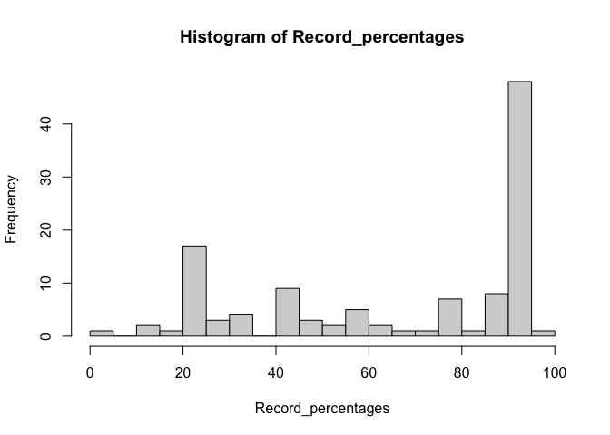

# Part 1: Data Acquisition, Cleaning, and Aggregation

## 10/8/26:

I downloaded necessary data (2025 Purpleair historical data, Purpleair
sensor metadata, and my curated dataset of Chicago pollution sources)
and wrote a function to compute the Haversine distance between any two
latitude/longitude coordinates.

My first step was to connect to the CLEAR lab’s database, from which I
downloaded historical sensor data.

    library(tidyverse)
    library(readxl)
    library(httr)
    library(jsonlite)
    library(lubridate)
    library(PurpleAirAPI)
    library(DBI)
    library(odbc)
    library(PurpleAir)

    con = dbConnect(
      odbc(),
      Driver = "/opt/homebrew/lib/libmsodbcsql.18.dylib",
      Server = "resdbsprdhs02.adms.luc.edu",
      Database = "clearlab_purpleair",
      UID = Sys.getenv("DB_USERNAME"),
      PWD = Sys.getenv("DB_PASSWORD"),
      Encrypt = "yes",
      TrustServerCertificate = "yes"
    )

Once connected to the database, I obtained historical sensor data and
sensor metadata via an RMySQL query (an R based wrapper for SQL code),
the same method I used to query the database during my Summer 2026 USRE
research, and then acquired my curated dataset of Chicago pollution
sources retrieved from Climate Trace’s interactive map.

    Purpleair_historical_data_2025<-dbGetQuery(con, "SELECT * FROM Purpleair_air_history WHERE time_stamp >= '2025-01-01 00:00:00' AND time_stamp < '2026-01-01 00:00:00'")

    ###Make sure that, in your project paper, you provide a solid few paragraphs of contextual explanation about the air quality database you are accessing, how you gained access to it, and an overview of its schema

    #Reading in the air pollution sources data 
    ###Make sure your paper provides a link to the ClimateTrace site where you obtained these sources)

    Chicago_air_pollution_sources<-read_csv("~/Desktop/STAT_338/STAT_338/Final_project/STAT_338_Final_Project/Chicago_air_pollution_sources.csv")

    #Reading in the Purpleair_sensor_information table (sensor metadata) --> we need this table for the latitude and longitude of each sensor index in the historical data

    Purpleair_sensor_information<-dbGetQuery(con, "SELECT sensor_index, latitude, longitude FROM Purpleair_sensor_information")

Once I had acquired all the necessary data, I wrote a function to
compute the Haversine distance (in miles) between two inputted pairs of
latitude and longitude values. The Haversine formula uses trigonometry
to calculate distances under the assumption that the Earth is a perfect
sphere (which it is not). Thus, the accuracy of its calculations is
higher for shorter distances and decreases as distances become very
large.

<https://www.youtube.com/watch?v=lSIVK82o2sI&t=25s>

    #Make sure that, in your paper, you explain the spatial variables you are using in addition to the non spatial ones, and in conjunction with this, explain why you are using the Haversine formula to calculate distances from the perspective of map projections.

    #Include a hyperlink to the web source where you learned about the Haversine formula: 

    Haversine_distance<-function(lat1, lat2, long1, long2){
      latitude_difference=lat2-lat1
      longitude_difference=long2-long1
      latitude_difference_radians=(latitude_difference*pi)/180
      longitude_difference_radians=(longitude_difference*pi)/180
      term1=(sin(latitude_difference_radians/2))^2
      term2=cos(((lat1*pi)/180))
      term3=cos(((lat2*pi/180)))
      term4=(sin(longitude_difference_radians/2))^2
      a=term1+(term2*term3*term4)
      c=2*atan2(sqrt(a), sqrt(1-a))
      distance=c*3958.8
      return(distance)}

Testing out the function: the actual distance between Loyola University
Chicago’s Damen Center (41.9993, -87.6605) and my house (42.075814,
-87.979072) is 17.21 miles, as measured on Google Maps. Let’s see how
close the function approximates this distance.

    test_distance<-Haversine_distance(42.000968, 42.075814, -87.659353, -87.979072)
    percent_error=abs(((test_distance-17.21)/17.21)*100)
    test_distance

    ## [1] 17.20239

    percent_error

    ## [1] 0.04422724

The Haversine function yielded 17.20239 miles (a 0.044% error). This is
excellent and indicates that the spherical Earth approximation made by
the formula is highly accurate for the purposes of the small to medium
distance calculations I need for this project.

# 10/10/26: data preprocessing and aggregation (preparation for modeling)

## My research question will require the aggregation of all the atmospheric variables within the PurpleAir historical data by hour. This dataset contains nearly 20 million observations, so I performed aggregations individually on smaller chunks of data to prevent R from crashing due to memory overload.

    Chunk1<-Purpleair_historical_data_2025[1:1000000, ]
    Chunk1_averaged_by_hour<-Chunk1%>%
      mutate(Day=format(time_stamp, format="%D"), Hour=format(time_stamp, format="%H"))%>%
      mutate(humidity_corrected=1.4498*humidity+7.022, temperature_corrected=1.0227*temperature-9.3755)%>% #Implementing peer reviewed correction formulas, which approximate ambient temperature and humidity as a function of the sensor's internal temperature and humidity (explain these in detail in the paper, and cite the paper where they originate from)
      mutate(Single_pm2p5_measurement=ifelse(is.na(pm2p5_cf_1_b), pm2p5_cf_1_a, (pm2p5_cf_1_a+pm2p5_cf_1_b)/2))%>% #Averages the pm2p5 readings from each channel if both exist. If only the Channel A readings exist, we take that reaidng as the true pm2p5 measurement (it is never NA anywhere in the dataset).
      group_by(sensor_index, Day, Hour)%>%
      summarize(sensor_index=first(sensor_index), average_pm2p5=mean(Single_pm2p5_measurement, na.rm=TRUE), average_humidity=mean(humidity_corrected, na.rm=TRUE), average_temperature=mean(temperature_corrected, na.rm=TRUE), average_pressure=mean(pressure, na.rm=TRUE))  #Averages atmospheric variables for each day/hour combination for each sensor index

I repeated this exact pipeline for each subsequent chunk of 1 million
observations in Purpleair\_historical\_data\_2025, yielding a total of
20 chunks of data. The only difference in the code between chunks was
the row indices used in the first line of code.

    Chunk2<-Purpleair_historical_data_2025[1000001:2000000, ]
    Chunk2_averaged_by_hour<-Chunk2%>%
      mutate(Day=format(time_stamp, format="%D"), Hour=format(time_stamp, format="%H"))%>%
      mutate(humidity_corrected=1.4498*humidity+7.022, temperature_corrected=1.0227*temperature-9.3755)%>%
      mutate(Single_pm2p5_measurement=ifelse(is.na(pm2p5_cf_1_b), pm2p5_cf_1_a, (pm2p5_cf_1_a+pm2p5_cf_1_b)/2))%>% #Averages the pm2p5 readings from each channel if both exist. If only the Channel A readings exist, we take that reaidng as the true pm2p5 measurement (it is never NA anywhere in the dataset).
      group_by(sensor_index, Day, Hour)%>%
      summarize(sensor_index=first(sensor_index), average_pm2p5=mean(Single_pm2p5_measurement, na.rm=TRUE), average_humidity=mean(humidity_corrected, na.rm=TRUE), average_temperature=mean(temperature_corrected, na.rm=TRUE), average_pressure=mean(pressure, na.rm=TRUE)) #Averages atmospheric variables for each day/hour combination for each sensor index

    Chunk3<-Purpleair_historical_data_2025[2000001:3000000, ]
    Chunk3_averaged_by_hour<-Chunk3%>%
      mutate(Day=format(time_stamp, format="%D"), Hour=format(time_stamp, format="%H"))%>%
      mutate(humidity_corrected=1.4498*humidity+7.022, temperature_corrected=1.0227*temperature-9.3755)%>%
      mutate(Single_pm2p5_measurement=ifelse(is.na(pm2p5_cf_1_b), pm2p5_cf_1_a, (pm2p5_cf_1_a+pm2p5_cf_1_b)/2))%>% #Averages the pm2p5 readings from each channel if both exist. If only the Channel A readings exist, we take that reaidng as the true pm2p5 measurement (it is never NA anywhere in the dataset).
      group_by(sensor_index, Day, Hour)%>%
      summarize(sensor_index=first(sensor_index), average_pm2p5=mean(Single_pm2p5_measurement, na.rm=TRUE), average_humidity=mean(humidity_corrected, na.rm=TRUE), average_temperature=mean(temperature_corrected, na.rm=TRUE), average_pressure=mean(pressure, na.rm=TRUE)) #Averages atmospheric variables for each day/hour combination for each sensor index

    Chunk4<-Purpleair_historical_data_2025[3000001:4000000, ]
    Chunk4_averaged_by_hour<-Chunk4%>%
      mutate(Day=format(time_stamp, format="%D"), Hour=format(time_stamp, format="%H"))%>%
      mutate(humidity_corrected=1.4498*humidity+7.022, temperature_corrected=1.0227*temperature-9.3755)%>%
      mutate(Single_pm2p5_measurement=ifelse(is.na(pm2p5_cf_1_b), pm2p5_cf_1_a, (pm2p5_cf_1_a+pm2p5_cf_1_b)/2))%>% #Averages the pm2p5 readings from each channel if both exist. If only the Channel A readings exist, we take that reaidng as the true pm2p5 measurement (it is never NA anywhere in the dataset).
      group_by(sensor_index, Day, Hour)%>%
      summarize(sensor_index=first(sensor_index), average_pm2p5=mean(Single_pm2p5_measurement, na.rm=TRUE), average_humidity=mean(humidity_corrected, na.rm=TRUE), average_temperature=mean(temperature_corrected, na.rm=TRUE), average_pressure=mean(pressure, na.rm=TRUE)) #Averages atmospheric variables for each day/hour combination for each sensor index

    Chunk5<-Purpleair_historical_data_2025[4000001:5000000, ]
    Chunk5_averaged_by_hour<-Chunk5%>%
      mutate(Day=format(time_stamp, format="%D"), Hour=format(time_stamp, format="%H"))%>%
      mutate(humidity_corrected=1.4498*humidity+7.022, temperature_corrected=1.0227*temperature-9.3755)%>%
      mutate(Single_pm2p5_measurement=ifelse(is.na(pm2p5_cf_1_b), pm2p5_cf_1_a, (pm2p5_cf_1_a+pm2p5_cf_1_b)/2))%>% #Averages the pm2p5 readings from each channel if both exist. If only the Channel A readings exist, we take that reaidng as the true pm2p5 measurement (it is never NA anywhere in the dataset).
      group_by(sensor_index, Day, Hour)%>%
      summarize(sensor_index=first(sensor_index), average_pm2p5=mean(Single_pm2p5_measurement, na.rm=TRUE), average_humidity=mean(humidity_corrected, na.rm=TRUE), average_temperature=mean(temperature_corrected, na.rm=TRUE), average_pressure=mean(pressure, na.rm=TRUE)) #Averages atmospheric variables for each day/hour combination for each sensor index

    Chunk6<-Purpleair_historical_data_2025[5000001:6000000, ]
    Chunk6_averaged_by_hour<-Chunk6%>%
      mutate(Day=format(time_stamp, format="%D"), Hour=format(time_stamp, format="%H"))%>%
      mutate(humidity_corrected=1.4498*humidity+7.022, temperature_corrected=1.0227*temperature-9.3755)%>%
      mutate(Single_pm2p5_measurement=ifelse(is.na(pm2p5_cf_1_b), pm2p5_cf_1_a, (pm2p5_cf_1_a+pm2p5_cf_1_b)/2))%>% #Averages the pm2p5 readings from each channel if both exist. If only the Channel A readings exist, we take that reaidng as the true pm2p5 measurement (it is never NA anywhere in the dataset).
      group_by(sensor_index, Day, Hour)%>%
      summarize(sensor_index=first(sensor_index), average_pm2p5=mean(Single_pm2p5_measurement, na.rm=TRUE), average_humidity=mean(humidity_corrected, na.rm=TRUE), average_temperature=mean(temperature_corrected, na.rm=TRUE), average_pressure=mean(pressure, na.rm=TRUE)) #Averages atmospheric variables for each day/hour combination for each sensor index

    Chunk7<-Purpleair_historical_data_2025[6000001:7000000, ]
    Chunk7_averaged_by_hour<-Chunk7%>%
      mutate(Day=format(time_stamp, format="%D"), Hour=format(time_stamp, format="%H"))%>%
      mutate(humidity_corrected=1.4498*humidity+7.022, temperature_corrected=1.0227*temperature-9.3755)%>%
      mutate(Single_pm2p5_measurement=ifelse(is.na(pm2p5_cf_1_b), pm2p5_cf_1_a, (pm2p5_cf_1_a+pm2p5_cf_1_b)/2))%>% #Averages the pm2p5 readings from each channel if both exist. If only the Channel A readings exist, we take that reaidng as the true pm2p5 measurement (it is never NA anywhere in the dataset).
      group_by(sensor_index, Day, Hour)%>%
      summarize(sensor_index=first(sensor_index), average_pm2p5=mean(Single_pm2p5_measurement, na.rm=TRUE), average_humidity=mean(humidity_corrected, na.rm=TRUE), average_temperature=mean(temperature_corrected, na.rm=TRUE), average_pressure=mean(pressure, na.rm=TRUE)) #Averages atmospheric variables for each day/hour combination for each sensor index

    Chunk8<-Purpleair_historical_data_2025[7000001:8000000, ]
    Chunk8_averaged_by_hour<-Chunk8%>%
      mutate(Day=format(time_stamp, format="%D"), Hour=format(time_stamp, format="%H"))%>%
      mutate(humidity_corrected=1.4498*humidity+7.022, temperature_corrected=1.0227*temperature-9.3755)%>%
      mutate(Single_pm2p5_measurement=ifelse(is.na(pm2p5_cf_1_b), pm2p5_cf_1_a, (pm2p5_cf_1_a+pm2p5_cf_1_b)/2))%>% #Averages the pm2p5 readings from each channel if both exist. If only the Channel A readings exist, we take that reaidng as the true pm2p5 measurement (it is never NA anywhere in the dataset).
      group_by(sensor_index, Day, Hour)%>%
      summarize(sensor_index=first(sensor_index), average_pm2p5=mean(Single_pm2p5_measurement, na.rm=TRUE), average_humidity=mean(humidity_corrected, na.rm=TRUE), average_temperature=mean(temperature_corrected, na.rm=TRUE), average_pressure=mean(pressure, na.rm=TRUE)) #Averages atmospheric variables for each day/hour combination for each sensor index

    Chunk9<-Purpleair_historical_data_2025[8000001:9000000, ]
    Chunk9_averaged_by_hour<-Chunk9%>%
      mutate(Day=format(time_stamp, format="%D"), Hour=format(time_stamp, format="%H"))%>%
      mutate(humidity_corrected=1.4498*humidity+7.022, temperature_corrected=1.0227*temperature-9.3755)%>%
      mutate(Single_pm2p5_measurement=ifelse(is.na(pm2p5_cf_1_b), pm2p5_cf_1_a, (pm2p5_cf_1_a+pm2p5_cf_1_b)/2))%>% #Averages the pm2p5 readings from each channel if both exist. If only the Channel A readings exist, we take that reaidng as the true pm2p5 measurement (it is never NA anywhere in the dataset).
      group_by(sensor_index, Day, Hour)%>%
      summarize(sensor_index=first(sensor_index), average_pm2p5=mean(Single_pm2p5_measurement, na.rm=TRUE), average_humidity=mean(humidity_corrected, na.rm=TRUE), average_temperature=mean(temperature_corrected, na.rm=TRUE), average_pressure=mean(pressure, na.rm=TRUE)) #Averages atmospheric variables for each day/hour combination for each sensor index

    Chunk10<-Purpleair_historical_data_2025[9000001:10000000, ]
    Chunk10_averaged_by_hour<-Chunk10%>%
      mutate(Day=format(time_stamp, format="%D"), Hour=format(time_stamp, format="%H"))%>%
      mutate(humidity_corrected=1.4498*humidity+7.022, temperature_corrected=1.0227*temperature-9.3755)%>%
      mutate(Single_pm2p5_measurement=ifelse(is.na(pm2p5_cf_1_b), pm2p5_cf_1_a, (pm2p5_cf_1_a+pm2p5_cf_1_b)/2))%>% #Averages the pm2p5 readings from each channel if both exist. If only the Channel A readings exist, we take that reaidng as the true pm2p5 measurement (it is never NA anywhere in the dataset).
      group_by(sensor_index, Day, Hour)%>%
      summarize(sensor_index=first(sensor_index), average_pm2p5=mean(Single_pm2p5_measurement, na.rm=TRUE), average_humidity=mean(humidity_corrected, na.rm=TRUE), average_temperature=mean(temperature_corrected, na.rm=TRUE), average_pressure=mean(pressure, na.rm=TRUE)) #Averages atmospheric variables for each day/hour combination for each sensor index

    Chunk11<-Purpleair_historical_data_2025[10000001:11000000, ]
    Chunk11_averaged_by_hour<-Chunk11%>%
      mutate(Day=format(time_stamp, format="%D"), Hour=format(time_stamp, format="%H"))%>%
      mutate(humidity_corrected=1.4498*humidity+7.022, temperature_corrected=1.0227*temperature-9.3755)%>%
      mutate(Single_pm2p5_measurement=ifelse(is.na(pm2p5_cf_1_b), pm2p5_cf_1_a, (pm2p5_cf_1_a+pm2p5_cf_1_b)/2))%>% #Averages the pm2p5 readings from each channel if both exist. If only the Channel A readings exist, we take that reaidng as the true pm2p5 measurement (it is never NA anywhere in the dataset).
      group_by(sensor_index, Day, Hour)%>%
      summarize(sensor_index=first(sensor_index), average_pm2p5=mean(Single_pm2p5_measurement, na.rm=TRUE), average_humidity=mean(humidity_corrected, na.rm=TRUE), average_temperature=mean(temperature_corrected, na.rm=TRUE), average_pressure=mean(pressure, na.rm=TRUE)) #Averages atmospheric variables for each day/hour combination for each sensor index

    Chunk12<-Purpleair_historical_data_2025[11000001:12000000, ]
    Chunk12_averaged_by_hour<-Chunk12%>%
      mutate(Day=format(time_stamp, format="%D"), Hour=format(time_stamp, format="%H"))%>%
      mutate(humidity_corrected=1.4498*humidity+7.022, temperature_corrected=1.0227*temperature-9.3755)%>%
      mutate(Single_pm2p5_measurement=ifelse(is.na(pm2p5_cf_1_b), pm2p5_cf_1_a, (pm2p5_cf_1_a+pm2p5_cf_1_b)/2))%>% #Averages the pm2p5 readings from each channel if both exist. If only the Channel A readings exist, we take that reaidng as the true pm2p5 measurement (it is never NA anywhere in the dataset).
      group_by(sensor_index, Day, Hour)%>%
      summarize(sensor_index=first(sensor_index), average_pm2p5=mean(Single_pm2p5_measurement, na.rm=TRUE), average_humidity=mean(humidity_corrected, na.rm=TRUE), average_temperature=mean(temperature_corrected, na.rm=TRUE), average_pressure=mean(pressure, na.rm=TRUE)) #Averages atmospheric variables for each day/hour combination for each sensor index

    Chunk13<-Purpleair_historical_data_2025[12000001:13000000, ]
    Chunk13_averaged_by_hour<-Chunk13%>%
      mutate(Day=format(time_stamp, format="%D"), Hour=format(time_stamp, format="%H"))%>%
      mutate(humidity_corrected=1.4498*humidity+7.022, temperature_corrected=1.0227*temperature-9.3755)%>%
      mutate(Single_pm2p5_measurement=ifelse(is.na(pm2p5_cf_1_b), pm2p5_cf_1_a, (pm2p5_cf_1_a+pm2p5_cf_1_b)/2))%>% #Averages the pm2p5 readings from each channel if both exist. If only the Channel A readings exist, we take that reaidng as the true pm2p5 measurement (it is never NA anywhere in the dataset).
      group_by(sensor_index, Day, Hour)%>%
      summarize(sensor_index=first(sensor_index), average_pm2p5=mean(Single_pm2p5_measurement, na.rm=TRUE), average_humidity=mean(humidity_corrected, na.rm=TRUE), average_temperature=mean(temperature_corrected, na.rm=TRUE), average_pressure=mean(pressure, na.rm=TRUE)) #Averages atmospheric variables for each day/hour combination for each sensor index

    Chunk14<-Purpleair_historical_data_2025[13000001:14000000, ]
    Chunk14_averaged_by_hour<-Chunk14%>%
      mutate(Day=format(time_stamp, format="%D"), Hour=format(time_stamp, format="%H"))%>%
      mutate(humidity_corrected=1.4498*humidity+7.022, temperature_corrected=1.0227*temperature-9.3755)%>%
      mutate(Single_pm2p5_measurement=ifelse(is.na(pm2p5_cf_1_b), pm2p5_cf_1_a, (pm2p5_cf_1_a+pm2p5_cf_1_b)/2))%>% #Averages the pm2p5 readings from each channel if both exist. If only the Channel A readings exist, we take that reaidng as the true pm2p5 measurement (it is never NA anywhere in the dataset).
      group_by(sensor_index, Day, Hour)%>%
      summarize(sensor_index=first(sensor_index), average_pm2p5=mean(Single_pm2p5_measurement, na.rm=TRUE), average_humidity=mean(humidity_corrected, na.rm=TRUE), average_temperature=mean(temperature_corrected, na.rm=TRUE), average_pressure=mean(pressure, na.rm=TRUE)) #Averages atmospheric variables for each day/hour combination for each sensor index

    Chunk15<-Purpleair_historical_data_2025[14000001:15000000, ]
    Chunk15_averaged_by_hour<-Chunk15%>%
      mutate(Day=format(time_stamp, format="%D"), Hour=format(time_stamp, format="%H"))%>%
      mutate(humidity_corrected=1.4498*humidity+7.022, temperature_corrected=1.0227*temperature-9.3755)%>%
      mutate(Single_pm2p5_measurement=ifelse(is.na(pm2p5_cf_1_b), pm2p5_cf_1_a, (pm2p5_cf_1_a+pm2p5_cf_1_b)/2))%>% #Averages the pm2p5 readings from each channel if both exist. If only the Channel A readings exist, we take that reaidng as the true pm2p5 measurement (it is never NA anywhere in the dataset).
      group_by(sensor_index, Day, Hour)%>%
      summarize(sensor_index=first(sensor_index), average_pm2p5=mean(Single_pm2p5_measurement, na.rm=TRUE), average_humidity=mean(humidity_corrected, na.rm=TRUE), average_temperature=mean(temperature_corrected, na.rm=TRUE), average_pressure=mean(pressure, na.rm=TRUE)) #Averages atmospheric variables for each day/hour combination for each sensor index

    Chunk16<-Purpleair_historical_data_2025[15000001:16000000, ]
    Chunk16_averaged_by_hour<-Chunk16%>%
      mutate(Day=format(time_stamp, format="%D"), Hour=format(time_stamp, format="%H"))%>%
      mutate(humidity_corrected=1.4498*humidity+7.022, temperature_corrected=1.0227*temperature-9.3755)%>%
      mutate(Single_pm2p5_measurement=ifelse(is.na(pm2p5_cf_1_b), pm2p5_cf_1_a, (pm2p5_cf_1_a+pm2p5_cf_1_b)/2))%>% #Averages the pm2p5 readings from each channel if both exist. If only the Channel A readings exist, we take that reaidng as the true pm2p5 measurement (it is never NA anywhere in the dataset).
      group_by(sensor_index, Day, Hour)%>%
      summarize(sensor_index=first(sensor_index), average_pm2p5=mean(Single_pm2p5_measurement, na.rm=TRUE), average_humidity=mean(humidity_corrected, na.rm=TRUE), average_temperature=mean(temperature_corrected, na.rm=TRUE), average_pressure=mean(pressure, na.rm=TRUE)) #Averages atmospheric variables for each day/hour combination for each sensor index

    Chunk17<-Purpleair_historical_data_2025[16000001:17000000, ]
    Chunk17_averaged_by_hour<-Chunk17%>%
      mutate(Day=format(time_stamp, format="%D"), Hour=format(time_stamp, format="%H"))%>%
      mutate(humidity_corrected=1.4498*humidity+7.022, temperature_corrected=1.0227*temperature-9.3755)%>%
      mutate(Single_pm2p5_measurement=ifelse(is.na(pm2p5_cf_1_b), pm2p5_cf_1_a, (pm2p5_cf_1_a+pm2p5_cf_1_b)/2))%>% #Averages the pm2p5 readings from each channel if both exist. If only the Channel A readings exist, we take that reaidng as the true pm2p5 measurement (it is never NA anywhere in the dataset).
      group_by(sensor_index, Day, Hour)%>%
      summarize(sensor_index=first(sensor_index), average_pm2p5=mean(Single_pm2p5_measurement, na.rm=TRUE), average_humidity=mean(humidity_corrected, na.rm=TRUE), average_temperature=mean(temperature_corrected, na.rm=TRUE), average_pressure=mean(pressure, na.rm=TRUE)) #Averages atmospheric variables for each day/hour combination for each sensor index

    Chunk18<-Purpleair_historical_data_2025[17000001:18000000, ]
    Chunk18_averaged_by_hour<-Chunk18%>%
      mutate(Day=format(time_stamp, format="%D"), Hour=format(time_stamp, format="%H"))%>%
      mutate(humidity_corrected=1.4498*humidity+7.022, temperature_corrected=1.0227*temperature-9.3755)%>%
      mutate(Single_pm2p5_measurement=ifelse(is.na(pm2p5_cf_1_b), pm2p5_cf_1_a, (pm2p5_cf_1_a+pm2p5_cf_1_b)/2))%>% #Averages the pm2p5 readings from each channel if both exist. If only the Channel A readings exist, we take that reaidng as the true pm2p5 measurement (it is never NA anywhere in the dataset).
      group_by(sensor_index, Day, Hour)%>%
      summarize(sensor_index=first(sensor_index), average_pm2p5=mean(Single_pm2p5_measurement, na.rm=TRUE), average_humidity=mean(humidity_corrected, na.rm=TRUE), average_temperature=mean(temperature_corrected, na.rm=TRUE), average_pressure=mean(pressure, na.rm=TRUE)) #Averages atmospheric variables for each day/hour combination for each sensor index

    Chunk19<-Purpleair_historical_data_2025[18000001:19000000, ]
    Chunk19_averaged_by_hour<-Chunk19%>%
      mutate(Day=format(time_stamp, format="%D"), Hour=format(time_stamp, format="%H"))%>%
      mutate(humidity_corrected=1.4498*humidity+7.022, temperature_corrected=1.0227*temperature-9.3755)%>%
      mutate(Single_pm2p5_measurement=ifelse(is.na(pm2p5_cf_1_b), pm2p5_cf_1_a, (pm2p5_cf_1_a+pm2p5_cf_1_b)/2))%>% #Averages the pm2p5 readings from each channel if both exist. If only the Channel A readings exist, we take that reaidng as the true pm2p5 measurement (it is never NA anywhere in the dataset).
      group_by(sensor_index, Day, Hour)%>%
      summarize(sensor_index=first(sensor_index), average_pm2p5=mean(Single_pm2p5_measurement, na.rm=TRUE), average_humidity=mean(humidity_corrected, na.rm=TRUE), average_temperature=mean(temperature_corrected, na.rm=TRUE), average_pressure=mean(pressure, na.rm=TRUE)) #Averages atmospheric variables for each day/hour combination for each sensor index

    Chunk20<-Purpleair_historical_data_2025[19000001: nrow(Purpleair_historical_data_2025), ]
    Chunk20_averaged_by_hour<-Chunk20%>%
      mutate(Day=format(time_stamp, format="%D"), Hour=format(time_stamp, format="%H"))%>%
      mutate(humidity_corrected=1.4498*humidity+7.022, temperature_corrected=1.0227*temperature-9.3755)%>%
      mutate(Single_pm2p5_measurement=ifelse(is.na(pm2p5_cf_1_b), pm2p5_cf_1_a, (pm2p5_cf_1_a+pm2p5_cf_1_b)/2))%>% #Averages the pm2p5 readings from each channel if both exist. If only the Channel A readings exist, we take that reaidng as the true pm2p5 measurement (it is never NA anywhere in the dataset).
      group_by(sensor_index, Day, Hour)%>%
      summarize(sensor_index=first(sensor_index), average_pm2p5=mean(Single_pm2p5_measurement, na.rm=TRUE), average_humidity=mean(humidity_corrected, na.rm=TRUE), average_temperature=mean(temperature_corrected, na.rm=TRUE), average_pressure=mean(pressure, na.rm=TRUE)) #Averages atmospheric variables for each day/hour combination for each sensor index

I then combined the chunks back into a full dataframe.

    Chunks_1_thru_5_averaged_by_hour<-bind_rows(Chunk1_averaged_by_hour, Chunk2_averaged_by_hour, Chunk3_averaged_by_hour, Chunk4_averaged_by_hour, Chunk5_averaged_by_hour)

    Chunks_6_thru_10_averaged_by_hour<-bind_rows(Chunk6_averaged_by_hour, Chunk7_averaged_by_hour, Chunk8_averaged_by_hour, Chunk9_averaged_by_hour, Chunk10_averaged_by_hour)

    Chunks_11_thru_15_averaged_by_hour<-bind_rows(Chunk11_averaged_by_hour, Chunk12_averaged_by_hour, Chunk13_averaged_by_hour, Chunk14_averaged_by_hour, Chunk15_averaged_by_hour)

    Chunks_16_thru_20_averaged_by_hour<-bind_rows(Chunk16_averaged_by_hour, Chunk17_averaged_by_hour, Chunk18_averaged_by_hour, Chunk19_averaged_by_hour, Chunk20_averaged_by_hour)

    Purpleair_historical_data_2025_averaged_by_hour<-bind_rows(Chunks_1_thru_5_averaged_by_hour, Chunks_6_thru_10_averaged_by_hour, Chunks_11_thru_15_averaged_by_hour, Chunks_16_thru_20_averaged_by_hour) 

To account for instances in which the readings within a given hour for a
given sensor index were split between multiple chunks, I needed to
perform another hourly aggregation on the full dataset. ChatGPT advised
me to do this after I noticed that the lagged predictors contained NA
values at the beginning of each new day, instead of at the position
where the sensor index changes (which is what I need).

    Purpleair_historical_data_2025_averaged_by_hour_averaged_again<-Purpleair_historical_data_2025_averaged_by_hour%>%
    ungroup()%>%
    group_by(sensor_index, Day, Hour)%>%
    summarize(average_pm2p5=mean(average_pm2p5, na.rm=TRUE), average_humidity=mean(average_humidity, na.rm=TRUE), average_temperature=mean(average_temperature, na.rm=TRUE), average_pressure=mean(average_pressure, na.rm=TRUE))

Then, I removed the individual data chunks to save memory in my R
session, now that the full dataset has been obtained.

    rm(Chunk1, Chunk2, Chunk3, Chunk4, Chunk5, Chunk6, Chunk7, Chunk8, Chunk9, Chunk10, Chunk11, Chunk12, Chunk13, Chunk14, Chunk15, Chunk16, Chunk17, Chunk18, Chunk19, Chunk20)
    rm(Chunk1_averaged_by_hour, Chunk2_averaged_by_hour, Chunk3_averaged_by_hour, Chunk4_averaged_by_hour, Chunk5_averaged_by_hour, Chunk6_averaged_by_hour, Chunk7_averaged_by_hour, Chunk8_averaged_by_hour, Chunk9_averaged_by_hour, Chunk10_averaged_by_hour, Chunk11_averaged_by_hour, Chunk12_averaged_by_hour, Chunk13_averaged_by_hour, Chunk14_averaged_by_hour, Chunk15_averaged_by_hour, Chunk16_averaged_by_hour, Chunk17_averaged_by_hour, Chunk18_averaged_by_hour, Chunk19_averaged_by_hour, Chunk20_averaged_by_hour)
    rm(Chunks_1_thru_5, Chunks_1_thru_5_averaged_by_hour, Chunks_6_thru_10_averaged_by_hour, Chunks_11_thru_15_averaged_by_hour, Chunks_16_thru_20_averaged_by_hour)

Then I used the dataset of Chicago pollution sources, the Purpleair
sensor information data, and the Haversine distance function I
previously wrote to find the distances of the closest, second closest,
third closest, fourth closest, and fifth closest pollution source to
each sensor index and the amount of pm2.5 (in tons) released by those
sources in 2025 (these will become 10 additional predictors).

Here is my original code attempt to accomplish this task. It almost
accomplished it successfully, except for one important detail: it does
not ensure that facilities are not duplicated.

    Purpleair_sensor_information_relevant<-Purpleair_sensor_information%>%
    filter(sensor_index %in% Purpleair_historical_data_2025_averaged_by_hour$sensor_index) #116 out of 152 total indices are in the 2025 historical data
    Relevant_sensor_indices<-Purpleair_sensor_information_relevant$sensor_index

    final_output_list<-list()
    for(i in seq(1, length(Relevant_sensor_indices), 1)){
      distances_to_pollution_sources<-c() #Instantiates an empty vector to store the distances between a given sensor index and each pollution sources (calculated using our Haversine function)
      relevant_distances_to_pollution_sources<-c()
      relevant_source_pm2p5_emissions<-c()
      
      for(j in seq(1, nrow(Chicago_air_pollution_sources), 1)){
        distance_to_facility=Haversine_distance(Purpleair_sensor_information_relevant$latitude[i], Chicago_air_pollution_sources$Latitude[j], Purpleair_sensor_information_relevant$longitude[i], Chicago_air_pollution_sources$Longitude[j]) #For a given sensor index, computes the Haversine distance (in miles) between the location of that sensor index and each facility in the air pollution sources dataset, and creates a list of distances, then adds each calculated distance to that list. 
        distances_to_pollution_sources<-c(distances_to_pollution_sources, distance_to_facility)}
        
      closest_distance_to_a_source<-min(distances_to_pollution_sources) #Once the distances_to_pollution_sources vector is fully populated by the inner loop, the outer loop extracts the closest, second closest, third closest, fourth closest, and fifth closest distances and their corresponding pm2p5 releases (in tons)
      relevant_distances_to_pollution_sources<-c(relevant_distances_to_pollution_sources, closest_distance_to_a_source) #Adding the closest distance to a pollution source for a given sensor
      closest_distance_index<-which(distances_to_pollution_sources==closest_distance_to_a_source)
      distances_excluding_closest<-distances_to_pollution_sources[-closest_distance_index]
      relevant_source_pm2p5_emissions<-c(relevant_source_pm2p5_emissions, Chicago_air_pollution_sources$Tons_PM2.5_2025[closest_distance_index]) #Adding the corresponding pm2p5 emissions for the pollution source closest to the sensor

    #Within the for loop, the same logic is repeated for the second, third, fourth, and fifth closest distances
      
      second_closest_distance<-min(distances_excluding_closest)
      relevant_distances_to_pollution_sources<-c(relevant_distances_to_pollution_sources, second_closest_distance)
      second_closest_distance_index<-which(distances_to_pollution_sources==second_closest_distance)
      distances_excluding_second_closest<-distances_excluding_closest[-second_closest_distance_index]
      relevant_source_pm2p5_emissions<-c(relevant_source_pm2p5_emissions, Chicago_air_pollution_sources$Tons_PM2.5_2025[second_closest_distance_index])
      
      third_closest_distance<-min(distances_excluding_second_closest)
      relevant_distances_to_pollution_sources<-c(relevant_distances_to_pollution_sources, third_closest_distance)
      third_closest_distance_index<-which(distances_to_pollution_sources==third_closest_distance)
      distances_excluding_third_closest<-distances_excluding_second_closest[-third_closest_distance_index]
      relevant_source_pm2p5_emissions<-c(relevant_source_pm2p5_emissions, Chicago_air_pollution_sources$Tons_PM2.5_2025[third_closest_distance_index])
      
      fourth_closest_distance<-min(distances_excluding_third_closest)
      relevant_distances_to_pollution_sources<-c(relevant_distances_to_pollution_sources, fourth_closest_distance)
      fourth_closest_distance_index<-which(distances_to_pollution_sources==fourth_closest_distance)
      distances_excluding_fourth_closest<-distances_excluding_third_closest[-fourth_closest_distance_index]
      relevant_source_pm2p5_emissions<-c(relevant_source_pm2p5_emissions, Chicago_air_pollution_sources$Tons_PM2.5_2025[fourth_closest_distance_index])
      
      fifth_closest_distance<-min(distances_excluding_fourth_closest)
      relevant_distances_to_pollution_sources<-c(relevant_distances_to_pollution_sources, fifth_closest_distance)
      fifth_closest_distance_index<-which(distances_to_pollution_sources==fifth_closest_distance)
      distances_excluding_fifth_closest<-distances_excluding_fourth_closest[-fifth_closest_distance_index]
      relevant_source_pm2p5_emissions<-c(relevant_source_pm2p5_emissions, Chicago_air_pollution_sources$Tons_PM2.5_2025[fifth_closest_distance_index])
      
      sensor_index<-Relevant_sensor_indices[i]
      distances_vector<-relevant_distances_to_pollution_sources
      emissions_vector<-relevant_source_pm2p5_emissions
      output_list<-list(sensor_index, distances_vector, emissions_vector)
      final_output_list[[i]] <- output_list
    } #The reuslt is a list of lists of overall length 116 

ChatGPT’s refinement of my code ensured that no facilities were
duplicated. It told me that the reason my code was selecting duplicate
or incorrect locations for the closest facility to each sensor index was
due to this line:

    closest_distance_index<-which(distances_to_pollution_sources==closest_distance_to_a_source)

Here is ChatGPT’s refinement of the code, which uses the vapply()
function (similar to a map function, which I did not think to use at the
time):

    final_output_list <- list()

    for (i in seq_along(vec)) {
      
      # Calculate the distance from this sensor to every pollution source
      distances_to_pollution_sources <- vapply(
        seq_len(nrow(Chicago_air_pollution_sources)),
        function(j) {
          Haversine_distance(
            Purpleair_sensor_information_relevant$latitude[i],
            Chicago_air_pollution_sources$Latitude[j],
            Purpleair_sensor_information_relevant$longitude[i],
            Chicago_air_pollution_sources$Longitude[j]
          )
        },
        numeric(1)
      )
      
      # Find the indices of the five closest sources, in order
      closest_source_indices <- order(distances_to_pollution_sources)[1:5]
      
      # Extract their distances and corresponding PM2.5 emissions
      relevant_distances_to_pollution_sources <-
        distances_to_pollution_sources[closest_source_indices]
      
      relevant_source_pm2p5_emissions <-
        Chicago_air_pollution_sources$Tons_PM2.5_2025[closest_source_indices]
      
      # Store the results for this sensor
      final_output_list[[i]] <- list(
        Relevant_sensor_indices[i],
        relevant_distances_to_pollution_sources,
        relevant_source_pm2p5_emissions
      )
    }
    length(final_output_list)
    final_output_list[1]

This will not render in this document because I have set eval=FALSE to
most of the previous code so that the rendering of this document would
not depend on me being connected to GlobalProtect or the database. So I
did the next best thing: I included a screenshot of the output of the
previous code chunk.

As can be seen above, the output list consists of 116 elements, one for
each sensor index in the original metadata. Each element in the list
consists of 3 sub-elements: the sensor index, an inner list containing
the Haversine distances (in order) from the sensor index to each of the
5 closest pollution sources, and another inner list containing the
respective pm2.5 emissions of each pollution source in 2025.

After inspecting this nested list structure, I was able to extract, as
vectors, the additional predictors representing the distances and 2025
particulate matter emissions of the 5 closest facilities to each sensor
index.

    all_closest_distances<-c()
    all_second_closest_distances<-c()
    all_third_closest_distances<-c()
    all_fourth_closest_distances<-c()
    all_fifth_closest_distances<-c()
    all_closest_source_pm2p5<-c()
    all_2nd_closest_source_pm2p5<-c()
    all_3rd_closest_source_pm2p5<-c()
    all_4th_closest_source_pm2p5<-c()
    all_5th_closest_source_pm2p5<-c()

    #Generating the vectors we will use as spatial predictors

    for (i in seq(1, length(final_output_list), 1)){
      all_closest_distances<-c(all_closest_distances, final_output_list[[i]][[2]][[1]])
      all_second_closest_distances<-c(all_second_closest_distances, final_output_list[[i]][[2]][[2]])
      all_third_closest_distances<-c(all_third_closest_distances, final_output_list[[i]][[2]][[3]])
      all_fourth_closest_distances<-c(all_fourth_closest_distances, final_output_list[[i]][[2]][[4]])
      all_fifth_closest_distances<-c(all_fifth_closest_distances, final_output_list[[i]][[2]][[5]])
      all_closest_source_pm2p5<-c(all_closest_source_pm2p5, final_output_list[[i]][[3]][[1]])
      all_2nd_closest_source_pm2p5<-c(all_2nd_closest_source_pm2p5, final_output_list[[i]][[3]][[2]])
      all_3rd_closest_source_pm2p5<-c(all_3rd_closest_source_pm2p5, final_output_list[[i]][[3]][[3]])
      all_4th_closest_source_pm2p5<-c(all_4th_closest_source_pm2p5, final_output_list[[i]][[3]][[4]])
      all_5th_closest_source_pm2p5<-c(all_5th_closest_source_pm2p5, final_output_list[[i]][[3]][[5]])
    }

Once I had extracted the aforementioned predictors, I added them to the
Purpleair\_sensor\_information\_relevant dataset.

    Purpleair_sensor_information_relevant_expanded<-Purpleair_sensor_information_relevant%>%
    mutate(closest_source_distance=all_closest_distances, 
           second_closest_source_distance=all_second_closest_distances, 
           third_closest_source_distance=all_third_closest_distances, 
           fourth_closest_source_distance=all_fourth_closest_distances, 
           fifth_closest_source_distance=all_fifth_closest_distances, 
           closest_source_2025_pm2p5=all_closest_source_pm2p5,
           second_closest_source_2025_pm2p5=all_2nd_closest_source_pm2p5,
           third_closest_source_2025_pm2p5=all_3rd_closest_source_pm2p5,
           fourth_closest_source_2025_pm2p5=all_4th_closest_source_pm2p5,
           fifth_closest_source_2025_pm2p5=all_5th_closest_source_pm2p5)

I then joined
Purpleair\_historical\_data\_2025\_averaged\_by\_hour\_averaged\_again
to Purpleair\_sensor\_information\_relevant\_expanded.

    Purpleair_data_2025_hourly_averages<-Purpleair_historical_data_2025_averaged_by_hour_averaged_again%>%
    left_join(Purpleair_sensor_information_relevant_expanded, by=c("sensor_index"="sensor_index"))%>%
    select(-latitude, -longitude) #We don't need the latitude or longitude anymore because we have already used them to calculate the 1st-5th closest pollution source distances. 

One more preprocessing step remained, and it lies at the crux of my
research question: calculating the hourly lagged predictors based on the
raw hourly measurements of pm2p5, humidity, temperature, and pressure,
in order to remove time dependency at the hourly scale.

    Purpleair_data_2025_modeling_dataset<-Purpleair_data_2025_hourly_averages%>%
    arrange(sensor_index, Day, Hour)%>%
    group_by(sensor_index)%>%
      
    mutate(sensor_index=sensor_index, Day=Day, Hour=Hour, closest_source_distance=closest_source_distance, second_closest_source_distance=second_closest_source_distance, third_closest_source_distance=third_closest_source_distance, fourth_closest_source_distance=fourth_closest_source_distance, fifth_closest_source_distance=fifth_closest_source_distance, 
              closest_source_2025_pm2p5=closest_source_2025_pm2p5, second_closest_source_2025_pm2p5=second_closest_source_2025_pm2p5, third_closest_source_2025_pm2p5=third_closest_source_2025_pm2p5, fourth_closest_source_2025_pm2p5=fourth_closest_source_2025_pm2p5, fifth_closest_source_2025_pm2p5=fifth_closest_source_2025_pm2p5)%>%
      
    mutate(
        observation_time = as.POSIXct(
          paste(Day, sprintf("%02d:00:00", Hour)),
          format = "%Y-%m-%d %H:%M:%S",
          tz = "UTC"
        ),
        
        time_difference = as.numeric(
          difftime(observation_time, lag(observation_time), units = "hours")
        ),
        
        pm2p5_hourly_difference=ifelse(time_difference==1, average_pm2p5-lag(average_pm2p5), NA),
        humidity_hourly_difference=ifelse(time_difference==1, average_humidity-lag(average_humidity), NA),     temperature_hourly_difference=ifelse(time_difference==1, average_temperature-lag(average_temperature), pressure_hourly_difference=ifelse(time_difference==1, average_pressure-lag(average_pressure))%>%
    select(-average_pm2p5, -average_humidity, -average_temperature, -average_pressure) #I don't need the raw hourly averages for the modeling

This places NA values for the lagged predictors at positions where the
data switches to a new sensor index. This is very important because
calculating the difference between an hourly average from one sensor and
an hourly average from another sensor would completely undermine the
spatial context I have established with the five distance predictors.

# Part 2: Data Exploration

Et voila: we now have our fully prepared, aggregated dataset, ready for
modeling! But before I commence that part of the project, I will take
some time to familiarize myself with the underlying data distributions I
am working with. And even before I do that, I must note that not all
Purpleair sensors in the dataset actively reported readings during the
entirety of 2025. I investigate the date ranges for each sensor here.

# 10/14/2026:

Investigating date ranges of historical data reporting for each sensor
and visualizing the temporal coverage of 2025 historical records for the
sensors

    #Since I generated Purpleair_data_2025_modeling_dataset and Purpleair_sensor_information internally within R, I must write them out to csv files and then read those csv files back in, so that the remainder of my code can actually be evaluated during rendering. 

    Purpleair_data_2025_modeling_dataset<-write.csv(Purpleair_data_2025_modeling_dataset, "Purple_air_data_2025_modeling_dataset.csv", row.names=FALSE)

    Purpleair_sensor_information<-write.csv(Purpleair_sensor_information, "Purple_air_sensor_information.csv", row.names=FALSE)

    library(tidyverse)

    ## Warning: package 'ggplot2' was built under R version 4.4.3

    ## Warning: package 'tibble' was built under R version 4.4.3

    ## Warning: package 'tidyr' was built under R version 4.4.3

    ## Warning: package 'readr' was built under R version 4.4.3

    ## Warning: package 'purrr' was built under R version 4.4.3

    ## Warning: package 'dplyr' was built under R version 4.4.3

    ## ── Attaching core tidyverse packages ──────────────────────── tidyverse 2.0.0 ──
    ## ✔ dplyr     1.2.0     ✔ readr     2.1.6
    ## ✔ forcats   1.0.1     ✔ stringr   1.6.0
    ## ✔ ggplot2   4.0.2     ✔ tibble    3.3.1
    ## ✔ lubridate 1.9.4     ✔ tidyr     1.3.2
    ## ✔ purrr     1.2.1     
    ## ── Conflicts ────────────────────────────────────────── tidyverse_conflicts() ──
    ## ✖ dplyr::filter() masks stats::filter()
    ## ✖ dplyr::lag()    masks stats::lag()
    ## ℹ Use the conflicted package (<http://conflicted.r-lib.org/>) to force all conflicts to become errors

    Purpleair_data_2025_modeling_dataset<-read_csv("~/Desktop/STAT_338/STAT_338/Final_project/STAT_338_Final_Project/Purple_air_data_2025_modeling_dataset.csv")

    ## Rows: 672531 Columns: 17
    ## ── Column specification ────────────────────────────────────────────────────────
    ## Delimiter: ","
    ## chr  (2): Day, Hour
    ## dbl (15): sensor_index, closest_source_distance, second_closest_source_dista...
    ## 
    ## ℹ Use `spec()` to retrieve the full column specification for this data.
    ## ℹ Specify the column types or set `show_col_types = FALSE` to quiet this message.

    Purpleair_sensor_information<-read_csv("~/Desktop/STAT_338/STAT_338/Final_project/STAT_338_Final_Project/Purple_air_sensor_information.csv")

    ## Rows: 193 Columns: 11
    ## ── Column specification ────────────────────────────────────────────────────────
    ## Delimiter: ","
    ## chr  (4): name, model, hardware, sensor_activity_status
    ## dbl  (5): sensor_index, location_type, latitude, longitude, private
    ## dttm (2): date_created, last_seen
    ## 
    ## ℹ Use `spec()` to retrieve the full column specification for this data.
    ## ℹ Specify the column types or set `show_col_types = FALSE` to quiet this message.

    Date_range_per_sensor_index<-Purpleair_data_2025_modeling_dataset%>%
    group_by(sensor_index)%>%
    summarize(earliest_day=min(Day), latest_day=max(Day))

    Sensors_reporting_the_entire_year<-Date_range_per_sensor_index%>%
    filter(earliest_day=="01/01/25" & latest_day=="12/31/25")

    nrow(Sensors_reporting_the_entire_year)

    ## [1] 1

I see that only one sensor index, sensor 195173, actively reported data
during the entire span of 2025. This is because the other sensors in the
dataset were either installed later than January 1, 2025 or stopped
reporting data earlier than December 31, 2025. We can further
investigate this by checking the date\_created and last\_seen variables
in the Purpleair\_sensor\_information database table for each sensor
index.

    Purpleair_sensor_information_applicable<-Purpleair_sensor_information%>%
    filter(sensor_index %in% Purpleair_data_2025_modeling_dataset$sensor_index)

    Sensors_installed_in_2025_reporting_only_part_of_2025<-Purpleair_sensor_information_applicable%>%
    filter(date_created > "2025-01-01 00:00:00" & last_seen < "2026-01-01 00:00:00")

    nrow(Sensors_installed_in_2025_reporting_only_part_of_2025)

    ## [1] 1

    print(Sensors_installed_in_2025_reporting_only_part_of_2025)

    ## # A tibble: 1 × 11
    ##   sensor_index date_created        last_seen           name  location_type model
    ##          <dbl> <dttm>              <dttm>              <chr>         <dbl> <chr>
    ## 1       265767 2025-02-18 15:48:02 2025-10-31 10:48:43 Lyon…             1 PA-I…
    ## # ℹ 5 more variables: hardware <chr>, latitude <dbl>, longitude <dbl>,
    ## #   private <dbl>, sensor_activity_status <chr>

Only one sensor in our dataset was installed during 2025 AND stopped
reporting data in 2025. This sensor was installed on February 18, 2025
and stopped reporting on October 31, 2025.

Let’s see how many sensors were installed BEFORE 2025 AND stopped
reporting data in 2025.

    Sensors_installed_before_2025_reporting_only_part_of_2025<-Purpleair_sensor_information_applicable%>%
    filter(date_created < "2025-01-01 00:00:00" & last_seen < "2026-01-01 00:00:00")

    nrow(Sensors_installed_before_2025_reporting_only_part_of_2025)

    ## [1] 53

53 sensors in our dataset were installed before 2025 and stopped
reporting data in 2025. This means that 116-54=62 sensors were installed
before 2025 and either stopped reporting data after 2025or are still
reporting data. However, even for sensors still reporting data, we
cannot assume that data was reported continuously during 2025. There may
be intervals of time during 2025 where no data exist for certain
sensors.

If a sensor continuously reported data during 2025, we would expect this
sensor to have 24\*365=8,760 hourly averaged records in the modeling
dataset. Therefore, we can determine the percentage of the expected
records for each sensor and plot a distribution of the percentages.

    Record_percentages<-c()
    for (sensor in unique(Purpleair_data_2025_modeling_dataset$sensor_index)){
      filtered_data<-Purpleair_data_2025_modeling_dataset%>%
        filter(sensor_index==sensor)
        Sensor_record_percentage=(nrow(filtered_data)/8760)*100
        Record_percentages<-c(Record_percentages, Sensor_record_percentage)
    }

    hist(Record_percentages, breaks=20)

    sum(Record_percentages >= 90)

    ## [1] 49

    sum(Record_percentages <= 5)

    ## [1] 1

    sum(Record_percentages <= 25)

    ## [1] 21

    sum(Record_percentages <= 50)

    ## [1] 40

    sum(Record_percentages <= 75)

    ## [1] 51

The highest proportion of sensors (49) had greater than 90% historical
coverage in 2025, which is good. However, one sensor had no more than 5%
historical coverage, 21 sensors had no more than 25% historical
coverage, 40 sensors had no more than 50% historical coverage, and 51
sensors had no more than 75% historical coverage.

We can see the exact number of observations available for each sensor
index (remember that the ideal number for 100% historical coverage is
8760 observations)

    table(Purpleair_data_2025_modeling_dataset$sensor_index)

    ## 
    ##   4395   4404   6546  36281  36901  39173  43955  45079  45359  51933  87741 
    ##   8082   8064   8088   4366   6831   7991   6881   8087   4454   3628   8088 
    ##  88413  95075  96035  96079  96933 101643 113959 120369 123003 124513 124649 
    ##   7631   8085   7951   3693   2884   8087   8087   8037   6838   2755   8088 
    ## 124677 124685 124715 124737 124759 133664 137618 137622 140390 144504 147893 
    ##   8034   5081   7845   8083   8083   4915   8086   8086   2616   5475   6886 
    ## 148029 148035 148545 149090 149530 150066 151042 151050 151082 153638 166645 
    ##   3871   8074   8085   8074   8077   3600   4215   8047   7398   8075   6806 
    ## 168725 169187 171015 171075 175417 175419 175455 175457 175483 179769 180725 
    ##   3566      1   5081   8077   8085   8086   8067   8086   8086   1356   5589 
    ## 182245 182281 184435 184939 185237 185239 186099 186621 186941 187547 187615 
    ##   8082   7829   7730   6654   8088   7545   3526   8003   7960   7947   7830 
    ## 188475 188749 189233 189329 189821 191181 192597 192837 193661 193669 193671 
    ##   2909   8056   4399   2866   4848   8088   5871   8076   3897   8087   8068 
    ## 193676 193689 193787 193801 195173 203303 211477 220177 220191 220209 220223 
    ##   5249   8088   8088   8072   8590   8067   8060   1831   2026   2041   1820 
    ## 220261 220521 220531 220537 220553 220577 220579 220583 220591 220613 221165 
    ##   1925   2015   2160   2323   2140   2074   2011   2000   2115   2019   2019 
    ## 226529 233117 241195 244039 244045 244051 244057 244063 244073 244083 251599 
    ##   8070   6959   8069   3984   3536   7616   8059   7898   3749   1997   7870 
    ## 265767 268129 271809 282164 289288 292499 
    ##   1191   6532   2151   1230   1880   2360

We see that sensor index 169187 has only one aggregated hourly record,
which makes this sensor useless for our modeling purposes, so we remove
it.

    Purpleair_data_2025_modeling_dataset<-Purpleair_data_2025_modeling_dataset%>%
    filter(sensor_index != 169187)

The incomplete 2025 historical coverage for each sensor will not affect
the approach to our modeling question, but it is an important
consideration to bear in mind, as it will prevent us from investigating
seasonal differences in model parameter estimates.

# Part 3: Predictive Modeling
